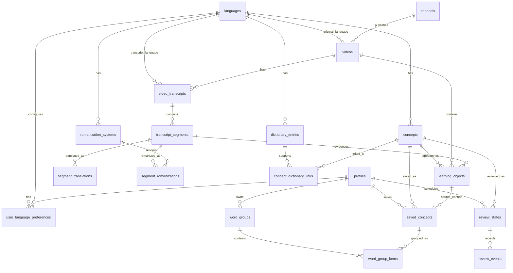

# DeepLingo v3 ERD

## Core Flows

Content:

`channels -> videos -> video_transcripts -> transcript_segments -> learning_objects -> concepts`

Learning:

`review answer -> review_states + review_events + learner_activity_log`

Review:

`review_states -> review_events`

Collections:

`saved_concepts -> word_group_items -> word_groups`
