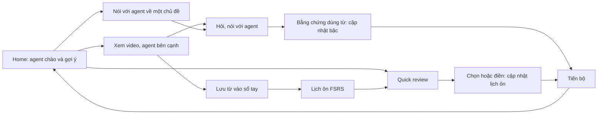

# DeepLingo — Product Requirements Document (PRD)

| | |
|---|---|
| **Trạng thái** | Bản nháp v0.7. Chủ dự án đã duyệt nội dung từng nhóm chức năng và chốt các quyết định mở ngày 2026-10-29; còn việc duyệt mẫu nội dung ngữ pháp và nội dung chưa được kiểm chứng với người học thật. Rà pháp lý là cổng trước khi thương mại hóa hoặc mở công khai (Q8), không chặn việc phát triển. |
| **Chủ sở hữu sản phẩm** | Chủ dự án (owner) |
| **Cập nhật** | 2026-11-07 |
| **Đối chiếu với code** | nhánh `main` tại `ceb5646`, sau L1–L4 |
| **Người đọc** | Chủ dự án, người thiết kế, lập trình viên, các agent |

Tài liệu này trả lời ba câu hỏi: **DeepLingo là gì và để làm gì**, **đã làm được đến đâu**, và **cần làm tiếp như thế nào**.
Nó không thay thế hai tài liệu khác: [STATUS.md](STATUS.md) ghi tình trạng kỹ thuật và bằng chứng kiểm thử;
[AGENTS.md](../../AGENTS.md) ghi quy tắc làm việc của agent (an toàn, phê duyệt, cách báo cáo, lệnh kiểm tra).

**Cách đọc nhãn.** Mỗi nội dung quan trọng mang một nhãn:

| Nhãn | Nghĩa | Agent được làm gì |
|---|---|---|
| **Đã chốt** | Chủ dự án đã quyết định | Làm theo, trong phạm vi việc được giao |
| **Hiện có** | Hành vi đang có trong code, không có nghĩa là thiết kế cuối cùng | Dùng để hiểu hệ thống; không suy ra rằng nó đã được duyệt lại |
| **Đề xuất** | Hướng để chủ dự án xem xét | Không tự triển khai |
| **Cần chốt** | Chưa có quyết định | Hỏi chủ dự án trước khi làm phần phụ thuộc vào nó |

Việc tạo tài liệu này không tự phê duyệt bất kỳ quy tắc học tập, ngưỡng hay thiết kế mới nào. Dòng nào chủ dự án chưa sửa
hoặc xác nhận thì không được coi là đã đồng ý.

---

## 1. Tóm tắt

DeepLingo giúp người học ngoại ngữ **dùng được** những gì họ học, bắt đầu từ nội dung thật mà họ thích (trước hết là video YouTube).
**Agent, một người đồng hành AI duy nhất, là trung tâm của sản phẩm**: chào người học ở Home, ở bên cạnh khi xem video, trò chuyện bằng giọng nói hoặc chữ và đưa họ tới việc nên làm tiếp.
Từ người học lưu vào **sổ tay** và vào lịch ôn FSRS ngay; **Quick review** giúp quen mặt chữ với số từ lớn; nói chuyện với agent giúp hiểu sâu và dùng được từ.
Hệ thống ghi nhận bằng chứng người học thực sự dùng từ (có hỗ trợ hay độc lập), lưu kết quả, xóa nội dung cuộc nói (trừ khi người học đồng ý lưu bản ghi chữ để hiệu chuẩn và xem lại, FR-3.11), và cho người học thấy tiến bộ.

- **Hiện có:** vòng *video → từ → nói → bằng chứng → tiến bộ* đã chạy trên môi trường development, trên web, cho tiếng Anh và tiếng Trung (L1–L4), nhưng agent còn rải ở nhiều màn và người học phải thao tác nhiều.
- **Hướng đã chốt (2026-10-29), giai đoạn 1 code written, tested locally; các phần còn lại chưa làm:** một agent duy nhất (một màn hội thoại riêng và biểu tượng ở các màn khác); bỏ trang Learn from this video; Home do agent dẫn; agent trên màn xem video; sổ tay theo chủ đề với mọi từ vào FSRS ngay và không giới hạn từ mới; Quick review kiểu Quizlet (lật thẻ không đổi lịch); mọi cuộc nói đều tính vào bậc từ; lưu kết quả, xóa nội dung.
- **Chưa kiểm chứng:** chưa có người học thật dùng; giọng nói mới thử bằng giọng tổng hợp; chưa đo hiệu quả học tập; chưa tính chi phí AI (hoãn có chủ đích).
- **Phạm vi hiện tại (Đã chốt 2026-11-07):** sản phẩm dùng cá nhân, chưa mở cho người ngoài, nhưng vẫn là sản phẩm đầy đủ, gồm mọi tính năng quyền riêng tư (đồng ý, xem, xóa, xuất dữ liệu, thông báo quyền riêng tư). Rà pháp lý (giấy phép dữ liệu, xóa dữ liệu, đồng ý) là **cổng trước khi thương mại hóa hoặc mở công khai** (Q8), không chặn tính năng nội dung học. Chủ dự án là người duyệt nội dung.

## 2. Vấn đề và cơ hội

**Vấn đề.** Người học đã có nền tảng cơ bản thường *hiểu* khá hơn *nói*. Các ứng dụng từ vựng rời rạc dạy từ ngoài ngữ cảnh; xem video thì
học thụ động. Khoảng cách từ "biết nghĩa một từ" đến "tự dùng từ đó khi nói" ít được hỗ trợ và hầu như không được đo.

**Cơ hội.** Nội dung thật (video) cung cấp ngữ cảnh miễn phí; mô hình giọng nói thời gian thực cho phép luyện nói tự nhiên;
bằng chứng dùng từ có thể được rút ra và kiểm tra thay vì chỉ đếm số từ đã lưu hay số câu đúng.

**Cách tiếp cận (Đã chốt):** học từ nội dung thật → chọn từ → *dùng khi nói* → ghi nhận bằng chứng → ôn và quay lại.

## 3. Mục tiêu và ngoài phạm vi

### 3.1. Mục tiêu sản phẩm (Đã chốt)
1. Gắn kiến thức với ngữ cảnh thật thay vì các mục rời rạc.
2. Rút ngắn khoảng cách từ hiểu một từ đến tự dùng nó khi nói.
3. Companion gợi mở và hỗ trợ vừa đủ để người học có cơ hội nói.
4. Người học thấy mình đang luyện gì và bằng chứng nào dẫn đến thay đổi tiến bộ.
5. Mọi kết quả đều giải thích được, kiểm tra được và có thể phát triển từng phần.

### 3.2. Ngoài phạm vi hiện tại
- Điểm hoặc nhãn trình độ chính thức (CEFR, IELTS, HSK) cho người học: **hoãn** đến khi có nghiên cứu hiệu chuẩn (Đã chốt).
- Luyện đề IELTS/HSK hoàn chỉnh: hướng dài hạn, chưa có đặc tả nội dung hay chấm điểm.
- Hệ đánh giá ngữ pháp kiểu bậc từ vựng (R0–R5, FSRS): không làm; ngữ pháp học theo FR-8.1 đến FR-8.3 (Đã chốt).
- Các nguồn nội dung ngoài YouTube: chưa có đặc tả.
- Ngôn ngữ ngoài tiếng Anh và tiếng Trung.

## 4. Người dùng mục tiêu

**Đã chốt:** người học đã có kiến thức cơ bản, muốn hiểu và dùng ngoại ngữ tốt hơn; hai ngôn ngữ đầu tiên là tiếng Anh (`en`) và tiếng Trung (`zh`);
ngôn ngữ giải thích là tiếng Việt hoặc ngôn ngữ khác trong hồ sơ.

| Nhóm giả định (Đề xuất, cần xác nhận bằng nghiên cứu người dùng) | Nhu cầu chính |
|---|---|
| Người đi làm/sinh viên Việt Nam học tiếng Anh ở mức trung cấp thấp | Nói tự tin hơn; học từ nội dung họ đã xem |
| Người học tiếng Trung ở mức HSK 2–3 | Dùng từ vựng đã học trong hội thoại; nội dung có transcript đáng tin |

Chủ dự án là người học đầu tiên (từng ghi nhận trình độ tiếng Anh B1, tiếng Trung HSK 2–3; **cần xác nhận còn đúng**).
**Cần chốt:** tiêu chí cụ thể của "đã có kiến thức cơ bản", nhóm người dùng đầu tiên, và điều kiện đưa một tính năng web sang app.

## 5. Chỉ số thành công (Đề xuất, chưa phải KPI đã duyệt)

Chưa đặt mục tiêu phần trăm. Mọi ngưỡng cần dữ liệu thật và sự duyệt của chủ dự án.

| Câu hỏi | Chỉ số có thể dùng | Giới hạn diễn giải |
|---|---|---|
| Người học có dùng từ đã chọn khi nói không? | Số từ có sự kiện dùng đúng (có hỗ trợ / độc lập) trên số từ đã lưu | Không đếm chỉ vì từ xuất hiện trong lời nói |
| Có giảm phụ thuộc hỗ trợ không? | Tỷ lệ dùng độc lập so với có hỗ trợ theo thời gian | Cần tách chủ đề và độ khó |
| Có nhớ lâu không? | Dùng lại đúng cách nhiều ngày | Một lần đúng không chứng minh nhớ bền |
| Vòng học có dễ dùng không? | Tỷ lệ hoàn thành từng bước (lưu từ → ôn → nói với agent → xem kết quả), lỗi, độ trễ | Hoàn thành giao diện không đồng nghĩa học hiệu quả |
| Phân tích có đáng tin không? | Đối chiếu mẫu với người chấm | Chưa có nghiên cứu hiệu chuẩn |
| Chi phí có bền không? | Chi phí AI trung bình mỗi phiên nói | Chưa có ngân sách chính thức |

## 6. Nguyên tắc sản phẩm

1. **Dùng quan trọng hơn nhận biết.** Tiến bộ được tính từ bằng chứng người học *dùng* từ, không chỉ số từ đã lưu hay số phút xem.
2. **Bằng chứng giải thích được.** Mọi thay đổi bậc từ có sự kiện dẫn xuất kèm lý do; chỉ nhắc tên từ, dùng sai nghĩa hay lặp lại câu mẫu của companion không tính.
3. **Ước tính, không phải điểm.** Độ phủ từ vựng của video và bậc từ là ước tính; hệ thống không tuyên bố điểm IELTS/HSK/CEFR hay trình độ tổng thể.
4. **Máy chủ là nguồn sự thật.** Client chỉ gửi lựa chọn của người học; không bao giờ tự ghi điểm, bậc hay đáp án chuẩn.
5. **Riêng tư theo mặc định.** Không lưu audio và nội dung cuộc nói; chỉ lưu kết quả và các tín hiệu cá nhân hóa có cấu trúc, người học xem và xóa được (Đã chốt).
6. **Người học kiểm soát.** Từ vượt trình độ chỉ cảnh báo, không chặn; không có giới hạn số từ mới mỗi ngày (Đã chốt).
7. **Agent là trung tâm, chỉ một agent.** Có một màn hội thoại toàn màn; ở các màn khác (Home, xem video, ôn tập, sổ tay) agent hiện bằng biểu tượng và khung nhỏ có thể thu gọn (theo FR-3.1). Agent *đề xuất*, người học chọn, server quyết định (Đã chốt).
8. **Lật để xem, làm bài để tính.** Chỉ câu trả lời server chấm được (chọn, điền) hoặc việc tự dùng từ khi nói với agent mới đổi lịch ôn và bậc từ; lật thẻ thì không (Đã chốt).

## 7. Hành trình người học

**Ví dụ.** Người học mở app; agent chào và nhắc họ còn xem dở một video du lịch cùng 25 thẻ đến hạn. Họ chọn tiếp tục video. Giữa chừng gặp một cụm từ muốn dùng, họ bấm nói, video dừng, hỏi agent về cụm đó trong câu và lưu nó vào sổ tay "Du lịch"; từ vào lịch ôn ngay. Họ kể trải nghiệm của mình cho agent và dùng đúng cụm từ; hệ thống ghi nhận dùng đúng, giữ kết quả và xóa nội dung cuộc nói. Lúc khác, họ ôn nhanh hàng chục thẻ kiểu Quizlet: lật để làm quen, chọn đáp án để lịch ôn thay đổi.

Người học không bắt buộc đi hết các bước trong một lần; họ có thể bắt đầu ở bất kỳ điểm nào.

## 8. Yêu cầu chức năng

Mỗi chức năng dưới đây có cùng một khung: **Mục đích** (user story) → **Luồng** → **Quy tắc** → **Trường hợp lỗi và biên** → **Ngoài phạm vi** → **Trạng thái** → **Cần chốt**, và một dòng **Bạn duyệt** để bạn đánh dấu.
Các con số nêu ở đây là giá trị mặc định đang có trong code (có thể đổi bằng cấu hình môi trường); khi code đổi thì con số trong code là đúng.
Trạng thái: *Đã chốt, chưa làm* = chủ dự án đã quyết định hướng, code chưa có; *Dev* = đã chạy trên môi trường development với tài khoản dùng một lần, chưa có người học thật (xem mục 10); *Hiện có* = còn trong code, chưa được duyệt lại; *Đề xuất* = chưa làm; *Hoãn* = đã quyết định để sau.

**Tiến độ duyệt:** chủ dự án đã duyệt **tất cả các nhóm chức năng** (8.1 đến 8.7) ngày 2026-10-29. Dòng "Bạn duyệt" có ☑ nghĩa đã giữ nguyên hoặc đã sửa theo quyết định. Mọi quyết định mở ở mục 14 đã chốt (Q1 đến Q16). Còn lại: việc cần người thực hiện, và nội dung này chưa được kiểm chứng với người học thật.

### 8.0. Danh mục

| ID | Chức năng | Trạng thái |
|---|---|---|
| FR-1.1 | Thêm video vào thư viện | Dev (đã duyệt) |
| FR-1.2 | Xem video, vùng học và tiếp tục xem | Dev (đã duyệt) |
| FR-1.3 | Tra nghĩa từ/cụm từ trong transcript | Dev (đã duyệt) |
| FR-1.4 | Độ phủ từ vựng và gợi ý video | Dev; cảnh báo tiếng Trung ở thẻ độ phủ và Library |
| FR-1.5 | Làm mới hồ sơ từ vựng khi transcript đổi | Dev (đã duyệt) |
| FR-2.1 | Lưu từ vào sổ tay và lịch ôn | Mọi từ lưu có chủ ý vào FSRS ngay, bỏ chờ/giới hạn: code written, tested locally |
| FR-2.2 | Trình độ tự khai và cảnh báo vượt trình độ | Bỏ giới hạn ngày, trình độ ở Profile: code written, tested locally |
| FR-2.3 | Sổ tay theo chủ đề và nhập hàng loạt | Sổ tay, ôn theo sổ tay và agent đề xuất gom: code written; xem STATUS |
| FR-2.4 | Bỏ trang Learn from this video; rút gọn trang chi tiết video | code written, tested locally; giữ backend L3 |
| FR-3.1 | Một agent: một màn hội thoại và biểu tượng ở các màn khác | code written, tested locally (agent chọn từ trọng tâm theo chủ đề; từ chưa thuộc sổ tay nào được gom theo video nguồn; bỏ bước người học chọn từ) |
| FR-3.2 | Hội thoại giọng nói và chữ | Dev (2026-10-30, giọng tổng hợp, tiếng Anh và tiếng Trung, Gemini Live thật; Realtime tắt lại sau lượt thử); giọng người thật chưa thử |
| FR-3.3 | Agent khi đang xem video | Chữ: Dev; giọng nói: code written, tested locally |
| FR-3.4 | Đồng ý và quyền riêng tư | Một lần, có thể thu hồi, server bắt buộc: code written, tested locally |
| FR-3.5 | Cập nhật bậc từ từ mọi cuộc nói | Từ chọn trước: Dev; mọi từ đã lưu: Dev (2026-10-30; tiếng Anh ghi nhận dùng tự phát; tiếng Trung chạy được sau sửa trích dẫn theo mệnh đề) |
| FR-3.6 | Tín hiệu cá nhân hóa | code written, tested locally; migration đã áp dụng trên development (2026-10-30); xem và xóa tín hiệu: Dev |
| FR-3.7 | Kết quả và lịch sử nói | Dev |
| FR-3.8 | Phản hồi phát âm (Azure) | Shadowing: hiện có; hội thoại: code written, tested locally (Azure giả) |
| FR-3.9 | Gợi ý câu trả lời khi người học bí | Dev (nút Ideas và Explain chạy với model thật, 2026-10-30) |
| FR-3.10 | Tổng kết cuối phiên | code written, tested locally; dòng tổng kết hôm qua không còn hiển thị trên Home theo cập nhật giao diện 2026-10-31 |
| FR-3.11 | Lưu bản ghi lời nói để hiệu chuẩn và xem lại (đồng ý riêng) | Code written, tested locally; migration chưa áp dụng ở môi trường nào |
| FR-4.1 | Trang Learning progress | Dev |
| FR-4.2 | Home do agent dẫn | code written, tested locally; Home theo mẫu, bỏ intro/nút đọc và dòng tổng kết; API kế hoạch và lịch luyện hiện có giữ nguyên |
| FR-5.1 | Quick review kiểu thẻ (hai chế độ: Làm quen, Ôn tập) | Hai chế độ, đổi chiều, lọc sổ tay, tự nối bộ: code written, tested locally |
| FR-5.2 | Lịch ôn FSRS và nguồn thẻ | Mọi từ lưu có chủ ý, thứ tự thẻ mới và lọc sổ tay: code written, tested locally |
| FR-5.3 | Câu điền | code written, tested locally; migration đã áp dụng trên development (2026-10-30); chưa chạy một phiên Cloze thật |
| FR-6.1 | Tài khoản, đăng nhập và hồ sơ ngôn ngữ | Đăng nhập: Dev; Profile ngôn ngữ/trình độ, đồng ý giọng nói, tín hiệu cá nhân hóa, xóa tài khoản: code written, tested locally; Việt hóa giao diện: code written, tested locally (phủ mọi màn trừ thông báo quyền riêng tư, xem FR-6.1) |
| FR-6.2 | Xuất dữ liệu riêng | Hiện có |
| FR-7.1 | Web | Dev; điều hướng Review/agent: code written, tested locally |
| FR-7.2 | App Flutter | **Đã bỏ 2026-11-15 (xem 8.11).** Trạng thái trước khi bỏ: Chuyển Home/Progress, Quick review, ôn ngữ pháp, sổ tay và Hồ sơ theo web; Agent (d1) hội thoại giọng nói: code written, tested locally, màn đồng ý/chủ đề/từ chối đã verified in a real environment trên development; (d3) agent gom một màn `/agent` và nút agent ở các màn chính: code written, tested locally, verified in a real environment (không gọi AI); (d2) xem video chưa làm |
| FR-8.1 | Agent giảng ngữ pháp khi người học nói sai | Đã chốt hướng; một phần hiện có |
| FR-8.2 | Giải thích ngữ pháp trên transcript | code written, tested locally; cache migration đã áp dụng trên development (2026-10-30); chưa gọi AI thật |
| FR-8.3 | Ôn tập ngữ pháp (trắc nghiệm soạn sẵn) | Dev (người học dùng một lần, tiếng Anh và tiếng Trung, 2026-10-30); lô đầu đã duyệt mẫu |

---

### 8.1. Nội dung video

#### FR-1.1 Thêm video vào thư viện
**Mục đích.** Là người học, tôi muốn thêm một video YouTube tôi thích để học từ chính nội dung đó.

**Đã chốt (2026-11-05): bỏ màn Thư viện riêng và trang chi tiết video.** Mục "Video của bạn" (form dán link và danh sách video) nằm trên Home, dưới các gợi ý; tab Thư viện bị gỡ, `/library` chuyển về Home. Bấm một video mở thẳng màn xem; `/library/videos/:id` chuyển sang `.../watch`. Nhãn độ phủ vẫn hiện trên thẻ video; thẻ độ phủ chi tiết của trang chi tiết đã bỏ (API còn giữ cho Flutter). Quy tắc form bên dưới giữ nguyên.

**Giao diện đã chốt (2026-11-01; làm rõ 2026-11-02).** Hiển thị toàn bộ video trong một danh sách; bỏ ba lựa chọn Tất cả/Sẵn sàng/Đang chuẩn bị. Chỉ có một form dán link và nút Thêm, dùng cả khi thư viện rỗng; bỏ nút Thêm video trên tiêu đề, nút thêm video trong trạng thái rỗng và hộp thoại nhập trùng lặp. Enter gửi cùng form; đang gửi thì không tạo yêu cầu trùng; lỗi giữ đường dẫn để thử lại.

**Luồng.**
1. Người học dán đường dẫn video vào Library.
2. Server kiểm tra, trả về ngay (HTTP 202) một mục thư viện của riêng người học, rồi xử lý ở nền: lấy transcript, sau đó chuẩn bị dữ liệu học (từ/cụm từ gắn với từng câu).
3. Dữ liệu có hai trạng thái riêng: **xử lý video** (`pending` → `processing` → `ready` / `failed`) và **chuẩn bị học** (`not_started`, `processing`, `ready`, `no_content`, `failed`).
4. Khi lỗi và lỗi đó cho phép thử lại, người học bấm thử lại (có hai nút thử lại riêng cho video và cho phần chuẩn bị học).

**Quy tắc.**
- Đường dẫn tối đa 2048 ký tự. Chỉ nguồn được hệ thống hỗ trợ (hiện là YouTube).
- Video là nội dung dùng chung; mục thư viện là liên kết riêng của người học. Thêm video đã có thì dùng lại, không gọi AI lại chỉ vì nhiều người lưu cùng video.
- Hạn mức mặc định: **20 video mới trong 24 giờ cho mỗi người** (nâng từ 5 ngày 2026-11-05 để đo chi phí thật; vùng học được chuẩn bị nâng từ 20 lên 60 mỗi ngày). Chỉ video *chưa ai chuẩn bị xong* mới bị tính; video đã chuẩn bị thì không. Ngoài ra có giới hạn tần suất gửi yêu cầu nhập.
- Môi trường chạy trên cloud lấy transcript bằng Gemini (vì YouTube chặn IP máy chủ), chỉ cho các ngôn ngữ đã qua đánh giá (hiện `en`, `zh`) và video không quá độ dài tối đa (mặc định 20 phút; runbook ghi môi trường development giữ 15 phút).
- Dữ liệu chuẩn bị không đáng tin tuyệt đối: transcript, nghĩa, tách từ và cấp độ đều có thể sai.

**Lỗi và biên.** Mã lỗi: `invalid_video_url`, `video_unavailable`, `transcript_unavailable`, `unsupported_content`, `processing_failed` (kèm cờ có thử lại được hay không). Hết hạn mức → 429 kèm thời gian chờ. Hệ thống bận → 503 "Content is busy". Mục của người khác → 404, không lộ dữ liệu.

**Ngoài phạm vi.** Tải tệp lên, nguồn ngoài YouTube, sửa transcript thủ công.

**Trạng thái.** Dev. **Đã chốt (2026-10-29):** giữ hạn mức 5 video mới/24 giờ. **Cần chốt.** Chính sách nguồn nội dung và giấy phép (Q8).

**Bạn duyệt (2026-10-29):** ☑ Giữ

#### FR-1.2 Xem video, vùng học và tiếp tục xem
**Mục đích.** Là người học, tôi muốn xem video cùng transcript và lần sau tiếp tục đúng chỗ.

**Luồng.**
1. Từ Library hoặc Home ("Continue watching"), người học mở video: player YouTube nhúng và transcript theo từng câu.
2. **Vùng học do AI cắt (đã chốt 2026-11-05).** Lần đầu có người mở video, model chia transcript thành các phần theo nội dung (mỗi phần một chủ đề/tình huống, khoảng 30–120 giây, tối đa 40 câu/5 phút) kèm tên ngắn bằng ngôn ngữ hỗ trợ; server đổi thành khoảng câu chính xác, kiểm tra liền mạch và phủ hết transcript, rồi lưu dùng chung theo phiên bản transcript (mỗi video gọi model một lần). Mở màn xem khi chưa có vùng thì vùng học tự đặt vào phần chứa vị trí đã lưu; học xong thì "phần tiếp theo" là phần AI kế tiếp. Model lỗi hoặc trả lời không dùng được thì server cắt theo số câu (khoảng một phút) và không lưu, để lần sau hỏi lại. **Đã chốt (2026-11-08):** bỏ việc tự cắt vùng; người học chỉ đổi sang phần khác trong danh sách phần do AI chia (vùng tự chọn trước đây vẫn được giữ cho tới khi đổi). API: `GET /learner/me/library/videos/{id}/parts`; bảng `v3.transcript_parts` (migration nháp, chưa áp).
3. Vị trí xem được lưu tự động; lần sau hiện thông báo tiếp tục từ vị trí đã lưu.

**Quy tắc.**
- Server giới hạn vị trí trong độ dài video. Vị trí xem **không phải** bằng chứng học hay dấu hoàn thành.
- Vùng học là khoảng câu của transcript hiện tại của video thuộc thư viện người học.
- Người học có thể bật pinyin có dấu thanh cho phụ đề tiếng Trung. Với video cũ chưa có phiên âm, server tạo pinyin từ câu phụ đề khi đọc.
- Giới hạn tần suất lưu: vị trí 720 lần/giờ, vùng học 120 lần/giờ cho mỗi người.
- Home có thẻ "Continue learning" dựa trên không gian làm việc được lưu gần nhất của video đã sẵn sàng.

**Lỗi và biên.** Quá tần suất lưu → 429. Video của người khác → 404.

**Ngoài phạm vi.** Đánh dấu "đã xem xong", chấm điểm việc xem.

**Trạng thái.** Dev (đã kiểm tra phát video thật và lưu vị trí khi thử L1). **Cần chốt.** Không.

**Bạn duyệt (2026-10-29):** ☑ Giữ

**Cập nhật giai đoạn 3 (2026-11-14, theo 8.10).** Phụ đề song ngữ và luyện theo vùng học: xem mục 8.10. Màn xem có khung "Luyện vùng" (Dictation, Shadowing, Câu hỏi trên các câu của vùng đang chọn), nút "Kết quả đoạn"/"Hoàn tất" hiện thẻ kết quả vùng. Nút Finish không còn gọi `session-summary` trên web.

**Sửa sau phản hồi bản dev (2026-11-14).** Dictation, Shadowing và nút nghe câu của Câu hỏi phát đúng câu: đoạn phát rộng thêm 0,15 giây trước và 0,2 giây sau câu (hằng số trong `clipTiming.ts`), bỏ qua vị trí cũ player còn báo ngay sau khi tua, và dừng theo đồng hồ tính từ vị trí mới nhất và tốc độ phát (không chờ lần báo vị trí sau). Enter để chốt chữ của bộ gõ (pinyin, Telex) không còn nộp bài Dictation. Trên màn xem, thanh Tata cố định đổi thành "Nói về đoạn N" và mở agent ở vùng học; không còn nút "Nói về đoạn này với Tata" riêng. Thẻ kết quả vùng mở trong khung bên phải thay cho transcript hoặc bài tập, không bị thanh Tata che; khung bên phải không cuộn ngang.

#### FR-1.3 Tra nghĩa từ/cụm từ trong transcript
**Mục đích.** Là người học, tôi muốn chạm vào một từ hoặc cụm từ trong câu và hiểu nghĩa của nó *trong câu đó*.

**Luồng.**
1. Người học chạm/bấm một từ để tra nghĩa, hoặc bôi đen một đoạn trong cùng câu để tra từ/cụm từ trong ngữ cảnh (**làm rõ theo chủ dự án 2026-11-01**). Không cần giữ Shift. Shift-click chỉ là phím tắt bổ sung trên thiết bị có bàn phím, không phải một chức năng tra nghĩa riêng. Việc bôi đen không tự khẳng định đoạn đó là một cụm từ cố định; server xác định đơn vị từ/cụm từ phù hợp.
2. Server nhận vị trí chọn theo **số ký tự Unicode (code point)** trong câu, mở rộng vùng chọn ra đơn vị từ điển dài nhất chứa nó (từ hoặc cụm).
3. Giao diện hiện: từ gốc, cách đọc, từ loại, nghĩa trong ngôn ngữ hỗ trợ, ghi chú ngắn, cấp độ, nguồn từ điển kèm giấy phép, và nút lưu từ (FR-2.1).
4. Với từ đã được chuẩn bị sẵn trong nội dung, người học mở "Concept sheet" của đúng lần xuất hiện đó.
5. Từ hoặc cụm từ vừa tra lưu được vào sổ tay (cả từ lẻ lẫn cụm bôi đen); lượt tra và lượt lưu gắn với vùng học đang luyện để vào thẻ kết quả vùng (giai đoạn 3).

**Quy tắc.**
- **Nghĩa lấy từ từ điển.** Mô hình chỉ chọn một nghĩa (`sense_id`) trong số nghĩa được đưa ra rồi diễn đạt sang ngôn ngữ hỗ trợ. Nhãn nguồn nghĩa: `translated_from_sense` (từ điển + dịch), `ai_unverified` (không có mục từ điển, AI tự giải thích, chưa kiểm chứng), `dictionary_only` (mô hình không khả dụng, chỉ có chú giải từ điển), `unavailable`.
- Client không tự đặt nghĩa chuẩn; server tự lấy câu từ transcript tin cậy và vị trí chọn.
- Tra nghĩa **không ghi** trạng thái học. Một từ tra ra đúng một nghĩa còn được ghi nhận ở nền thành *ứng viên cho Quick review* (có hạn).
- Giới hạn: 120 lượt tra/giờ cho mỗi người. Có thêm tra từ điển thủ công theo từ khóa (tối đa 80 ký tự) và xem/tạo câu ví dụ cho từ đã lưu (20 lượt/giờ).

**Lỗi và biên.** Một mặt chữ nhiều nghĩa phải gắn đúng nghĩa; nguồn không hợp lệ hoặc đã đổi → báo lỗi chứ không gắn nhầm. Quá tần suất → 429. Dịch vụ lỗi → 503 "Lookup is temporarily unavailable".

**Ngoài phạm vi.** Dịch cả câu, giải thích ngữ pháp.

**Trạng thái.** Dev. **Đã chốt (2026-10-29):** nghĩa do AI tự giải thích (không có trong từ điển) được hiện kèm nhãn "chưa kiểm chứng". Giao diện hiện đã làm vậy ("AI explanation, not checked against a dictionary"), không cần việc mới.

**Bạn duyệt (2026-10-29):** ☑ Giữ

#### FR-1.4 Độ phủ từ vựng và gợi ý video
**Mục đích.** Là người học, tôi muốn biết một video *dễ hay khó* với tôi để chọn video vừa sức.

**Luồng.** Người học khai báo trình độ (FR-2.2) → trong Library/Video detail, mỗi video đã chuẩn bị có nhãn độ phủ; có thể sắp danh sách gợi ý theo độ phù hợp. Trang chi tiết độ phủ cho biết: "bạn có thể biết X trên Y từ trong video"; cần học thêm bao nhiêu từ thường gặp nhất để chạm ngưỡng 95%; tốc độ nói (từ/phút); phân bố từ theo cấp độ; danh sách các từ thường gặp nhất mà bạn có thể chưa biết.

**Quy tắc.**
- Độ phủ là **ước tính** tỷ lệ chữ trong lời nói mà người học có thể đã quen, tính từ hồ sơ từ vựng của video, trình độ tự khai và các từ đã biết/đã nhận ra. Đây không phải phần trăm hiểu nội dung và không phải điểm năng lực.
- Nhãn: **phù hợp** (`suitable`) từ 95% trở lên; **thử thách** (`challenging`) từ 90% đến dưới 95%; **khó** (`hard`) dưới 90%.
- Gợi ý xếp video phù hợp trước (gần ngưỡng 95% đứng trước), rồi thử thách, rồi khó; video chưa có ước tính đứng cuối.
- Video chưa có hồ sơ từ vựng thì server trả 404 và giao diện nói chưa có ước tính, không trả 0%. Tốc độ nói chỉ hiện khi có từ 30 giây lời nói trở lên.
- Từ có cấp độ chỉ **suy** từ các chữ cấu thành (tiếng Trung) được đánh dấu "≈" để phân biệt với nhãn lấy trực tiếp từ nguồn; giao diện nêu tỷ lệ từ bị suy.
- Có từ không có trong từ điển thì không nói được cần học bao nhiêu từ để đạt ngưỡng.
- Với video tiếng Trung (`zh` theo phản hồi độ phủ của server), giữ nhãn và phần trăm nhưng hiện cảnh báo "ước tính tiếng Trung chưa được hiệu chuẩn" ngay cạnh nhãn ở thẻ độ phủ và Library. Không đổi thuật toán, ngưỡng hay cách xếp gợi ý; không hiện cảnh báo khi chưa có ước tính.

**Lỗi và biên.** Trình độ do người học đặt trong Hồ sơ; không nhắc đặt trình độ lần nữa ở Từ của tôi hoặc thẻ độ phủ. Thiếu trình độ không chặn xem video hoặc lưu từ.

**Ngoài phạm vi.** Dự đoán điểm hiểu, xếp hạng người học.

**Trạng thái.** Dev cho tiếng Anh. **Tiếng Trung chưa đáng tin:** một video HSK 1–2 được 88% cho người học HSK 2; việc tách từ và suy cấp độ tiếng Trung chưa được hiệu chuẩn.
**Đã chốt (2026-10-29):** giữ hiển thị nhãn độ phủ tiếng Trung nhưng gắn cảnh báo "ước tính tiếng Trung chưa được hiệu chuẩn" ở thẻ độ phủ và Library.

**Bạn duyệt (2026-10-29):** ☑ Giữ

**Ước tính từ vựng (2026-11-02; thẻ đã bỏ trên web 2026-11-05; endpoint `GET /learner/me/vocabulary-estimate` đã bỏ 2026-11-14 vì không client nào gọi).** Phép tính vẫn còn trong server và chỉ dùng cho hồ sơ người học mà agent đọc: số từ khác nhau (có trong từ điển) trong các video đã có hồ sơ từ vựng mà người học có thể đã biết, theo đúng quy tắc "biết" của độ phủ theo video (trình độ khai báo cùng thang + từ người học đã chứng minh).

#### FR-1.5 Làm mới hồ sơ từ vựng khi transcript đổi
**Mục đích.** Là người học, tôi muốn độ phủ và danh sách từ luôn khớp với transcript hiện tại.

**Quy tắc.** Hồ sơ từ vựng mỗi video lưu một mã băm của văn bản và thời gian của toàn bộ transcript. Thay, thêm, bớt câu, đổi thời gian hoặc sửa ngôn ngữ của track thì hồ sơ cũ bị coi là lỗi thời và được dựng lại khi cần (trong hạn mức dựng lại hiện có). Transcript không đổi thì dùng lại kết quả từ điển. Không lưu transcript thô trong hồ sơ.

**Lỗi và biên.** Lỗi thời không bao giờ được phục vụ như dữ liệu mới. Chưa xử lý: tách từ chính xác về mặt ngữ nghĩa, hiệu chuẩn cấp độ tiếng Trung.

**Trạng thái.** Dev. **Cần chốt.** Không.

**Bạn duyệt (2026-10-29):** ☑ Giữ

---

### 8.2. Sổ tay (từ vựng)

Hướng đã chốt ngày 2026-10-29: từ người học lưu nằm trong **sổ tay** (màn Words), có thể chia theo chủ đề, và **vào lịch ôn FSRS ngay** (như Anki, Mochi). Không còn giới hạn từ mới mỗi ngày.

#### FR-2.1 Lưu từ vào sổ tay và lịch ôn
**Mục đích.** Là người học, tôi muốn lưu một từ khi gặp và để hệ thống tự lên lịch ôn cho tôi.

**Luồng.**
1. Lưu từ từ ba nguồn (như hiện nay): lần tra nghĩa trong transcript, một lần xuất hiện đã chuẩn bị sẵn của video, hoặc tìm trong từ điển.
2. Từ vào sổ tay kèm nghĩa, cấp độ, bậc R0–R5 và lịch ôn kế tiếp.
3. Từ có thẻ ôn FSRS ngay.

**Quy tắc.**
- **Đã chốt, chưa làm:** mọi từ đã lưu vào lịch ôn ngay; không có bước "chờ" và **không có giới hạn từ mới mỗi ngày**.
- **Hiện có (sẽ bỏ):** từ mới vào `backlog`; chỉ `active` mới có thẻ ôn; hệ thống kích hoạt mỗi ngày tối đa 10 từ (đổi được trong khoảng 1–50) theo mức ưu tiên (lưu chủ động 100, từ tra 50, nhập danh sách 40, gợi ý từ nội dung 10). Người học cũng có thể tự chuyển một từ sang đang học, tạm dừng hoặc xóa.
- Không còn khái niệm "đã biết": known check, bảng và mã đã xóa 2026-11-16 (xem 8.8).
- Lưu lặp không tạo trùng, không xóa hay làm lùi bằng chứng đã có. Từ lưu trong ngữ cảnh một video được liên kết riêng với video đó (một từ có thể gắn nhiều video); xóa từ hoặc video thì xóa liên kết, không xóa nội dung dùng chung.

**Lỗi và biên.** Nguồn lưu không hợp lệ hoặc đã đổi → báo lỗi, không gắn nhầm. Từ đã biết thì không đổi trạng thái được (409).

**Ngoài phạm vi.** Tự gán "đã biết"; gộp các nghĩa khác nhau của cùng mặt chữ.

**Trạng thái.** Hành vi hiện có: Dev. Thay đổi (bỏ chờ/kích hoạt, mọi từ vào FSRS ngay): **code written, tested locally** ở backend (chỉ từ lưu có chủ ý; đọc `backlog` cũ như `active`, không migration); giao diện bỏ giới hạn/chờ: **code written, tested locally**.
**Đã chốt (2026-10-29):** giữ trạng thái **tạm dừng**; **bỏ mức ưu tiên** (thẻ mới đã sắp theo lưu gần nhất, FR-5.2). **Cần chốt.** Không.
**Rủi ro đã biết.** Anki và Mochi đặt giới hạn thẻ mới mỗi ngày vì lưu nhiều từ cùng lúc làm thẻ đến hạn dồn thành núi ở các ngày sau. Quyết định là bỏ giới hạn và đo sau (xem mục 13).

**Bạn duyệt (2026-10-29):** ☑ Giữ

#### FR-2.2 Trình độ tự khai và cảnh báo vượt trình độ
**Mục đích.** Là người học, tôi muốn được cảnh báo (không bị chặn) khi chọn từ quá khó so với trình độ của mình.

**Quy tắc.**
- Trình độ tự khai (**Đã chốt 2026-10-29:** đặt ở **Profile**; My words chỉ nhắc khi chưa khai): tiếng Anh A1, A2, A2+, B1, B1+, B2, B2+; tiếng Trung HSK1–HSK6. Không quy đổi giữa hai thang. Trình độ tự khai hỗ trợ chọn nội dung và tính độ phủ, không phải kết quả thi hay xếp loại.
- **Cảnh báo vượt trình độ** chỉ khi cả hai nhãn đã biết và từ cao hơn trình độ tự khai hơn một bậc nguyên (khai A2: từ B1 chưa cảnh báo, từ B2 thì cảnh báo). Từ chưa phân loại hoặc người học chưa khai báo thì không cảnh báo. Người học xác nhận để tiếp tục. Việc nhập danh sách chỉ **đếm** số từ vượt trình độ, không chặn.
- **Đã chốt, chưa làm:** bỏ "từ mới mỗi ngày" (giới hạn 1–50, mặc định 10) và bảng "Today" đếm theo ngày trong My words.

**Trạng thái.** Dev; bỏ giới hạn ngày trên web và chuyển trình độ tự khai sang Profile: **code written, tested locally**. **Cần chốt.** Không.

**Bạn duyệt (2026-10-29):** ☑ Giữ

#### FR-2.3 Sổ tay theo chủ đề và nhập hàng loạt
**Mục đích.** Là người học, tôi muốn gom từ theo chủ đề (ví dụ du lịch, IELTS) và nhập nhanh một danh sách từ.

**Hiện có (danh sách có tên).**
1. Tạo danh sách (tên ≤60 ký tự, mô tả ≤300) cho ngôn ngữ đang học.
2. Dán văn bản, mỗi dòng một từ hoặc cụm, có thể kèm ghi chú nghĩa của chính mình.
3. Server phân giải từng dòng bằng từ điển và trả **báo cáo**: đã lưu, trùng, quá dài, vượt giới hạn, **mơ hồ** (nhiều nghĩa), **chưa phân giải được**, và số từ vượt trình độ.
4. Dòng mơ hồ: người học chọn một trong các nghĩa server lưu sẵn (tối đa 15 ứng viên) hoặc bỏ dòng. Dòng chưa phân giải được giữ ở trạng thái chờ xử lý.

**Quy tắc hiện có.** 50 dòng đọc mỗi lần nhập (client có thể chia lô, mỗi yêu cầu ≤8000 ký tự); 500 mục (từ cộng dòng chờ) mỗi danh sách; 50 danh sách mỗi người; từ ≤120 ký tự, ghi chú nghĩa ≤300; tên danh sách không trùng. Ghi chú của người học **không** thành nghĩa chuẩn; dòng không có mục từ điển không tự thành từ. Xóa danh sách **không** xóa từ đã lưu.

**Đã chốt.**
- Danh sách trở thành **sổ tay theo chủ đề**. Người học tự tạo sổ tay. **Đã chốt (2026-11-05):** bỏ việc agent gom từ theo chủ đề (web và backend); app Flutter đang tạm dừng vẫn còn nút này và sẽ lỗi nếu bật lại.
- Đề xuất cách làm cho phần agent gom: agent *đề xuất* nhóm chủ đề, người học xác nhận bằng một chạm (không tự đổi sổ tay của người học). Chủ đề này cũng là cách agent chọn từ trọng tâm khi thực hành (FR-3.1).
- Từ nhập từ danh sách vào lịch ôn ngay như mọi từ lưu (FR-2.1).

**Luồng được duyệt thêm (2026-10-30, vị trí cập nhật 2026-11-01; đã bỏ 2026-11-05).** Trong Tata, người học mở thao tác gom từ (cũng có sau khi lưu từ), chọn tối đa 50 từ đã lưu cho ngôn ngữ hiện tại, rồi bấm đề xuất. Server lấy chữ và nghĩa đã lưu, không nhận văn bản/nghĩa/trạng thái từ client. Agent trả tối đa năm nhóm; mỗi mã từ phải thuộc lựa chọn hợp lệ, mỗi từ được xếp ít nhất một nhóm và có thể thuộc nhiều nhóm. Chỉ xem, bỏ hoặc đóng đề xuất không thay đổi sổ tay. Từng nhóm có nút xác nhận một chạm; khi xác nhận, server tạo hoặc dùng lại sổ tay cùng tên trong ngôn ngữ đó và thêm thành viên. Không chuyển/xóa thành viên cũ, không tạo từ mới, không đổi trạng thái từ, FSRS hay bậc R. Gửi lại cùng tên và thành viên không tạo bản sao.

Đã gỡ 2026-11-05: hai endpoint `POST /learner/me/lists/topic-proposals` (chỉ trả gợi ý) và `POST /learner/me/lists/apply-topic-proposal` (chỉ dùng sau xác nhận). Bước ghi dùng RPC `v3.apply_notebook_topic_proposal`, backend service_role, kiểm tra lại quyền sở hữu/ngôn ngữ và giới hạn sổ tay hiện có trong một transaction. Hàm `v3.apply_notebook_topic_proposal` vẫn còn trong database; gỡ nó cần một migration riêng được duyệt.

**Ngoài phạm vi.** Danh sách dùng chung giữa người học; nhập CSV; danh sách "dự đoán đề IELTS" của bên thứ ba (không chính thức; đề xuất tự soạn bộ chủ đề và cho người học tự nhập riêng tư).

**Trạng thái.** Mã và kiểm tra của sổ tay, nhiều thành viên, ôn theo sổ tay và agent đề xuất gom nằm tại STATUS. **Đã chốt (Q5, 2026-10-29):** chủ đề giống đề IELTS/HSK do ta tự viết, người học tự nhập danh sách riêng. **Cần chốt.** Giấy phép nếu sau này dùng dữ liệu ngoài (Q8).

**Bạn duyệt (2026-10-29):** ☑ Giữ

#### FR-2.4 Bỏ trang "Learn from this video" và rút gọn trang chi tiết video
**Đã chốt (2026-10-29): bỏ** trang `/library/videos/:id/learn`, và bỏ khỏi trang chi tiết video ba thẻ **Learn from this video**, **Speak with words** và **Talk**, vì agent chỉ là một và biểu hiện khác nhau ở từng màn (FR-3.1).

**Hiện có (sẽ bỏ).**
- Trang bốn bước: xem; chọn từ (danh sách từ gợi ý lấy từ transcript để duyệt không cần phát video, mỗi lần thêm 12 mục); nói; xem tiến bộ các từ đã lưu từ video này.
- Trang chi tiết video có 6 thẻ: Learn, Watch, Dictation, Shadowing, Speak with words, Talk, cùng thẻ độ phủ và trạng thái chuẩn bị.

**Sau khi bỏ.** Trang chi tiết video còn: Watch (chính), Dictation, Shadowing, thẻ độ phủ (FR-1.4) và trạng thái chuẩn bị. Việc nói với agent về video diễn ra ngay trên màn xem (FR-3.3).

**Tối giản (đã chốt 2026-10-29).** Không làm chỗ thay thế cho hai thứ chỉ có ở trang này: danh sách từ gợi ý để duyệt không cần phát video, và tiến bộ riêng theo từng video. Lý do: người học đã chạm vào chữ để lưu từ ngay trên màn xem, và đã có đánh giá tổng thể ở Learning progress. Các liên kết tới trang Learn bị bỏ cùng trang; nơi nào cần dẫn tới video thì trỏ về màn xem video.

**Dữ liệu liên quan.** Bảng liên kết từ-video của người học (`learner_video_words`) và việc lọc từ theo video, theo những gì tôi thấy, chỉ được dùng ở trang Learn và màn chọn từ để nói theo video (cả hai bị bỏ hoặc gộp). Sau khi bỏ chúng có thể thừa; chưa xóa gì.

**Trạng thái.** **code written, tested locally**: đã bỏ trang và liên kết Learn trên web; backend L3 giữ nguyên. **Cần chốt.** Có giữ bảng liên kết từ-video không (có thể còn dùng cho ngữ cảnh ôn từ video, FR-5.2).

**Bạn duyệt (2026-10-29):** ☑ Bỏ

---

### 8.3. Agent (một màn hội thoại và biểu tượng ở các màn khác)

**Đã chốt (2026-10-29): chỉ có một agent.** Có **một màn hội thoại toàn màn riêng**; ở các màn khác agent hiện bằng **biểu tượng**, bấm vào mở khung trò chuyện nhỏ không che nội dung. Không có các trang agent riêng cho từng cách bắt đầu. Cùng một agent ở mọi nơi: cùng hồ sơ cá nhân hóa, cùng cài đặt đồng ý, cùng quy tắc ghi bằng chứng.

**Hiện có.** Một màn Agent dùng chung; các đường dẫn agent cũ chuyển về đây. Không còn chế độ `mode=conversation` riêng (2026-11-14, giai đoạn 4 của 8.10): màn Agent mở giọng nói; khi micro hoặc giọng nói trực tiếp không dùng được, cùng cuộc nói tiếp tục ngay trong màn đó bằng chữ gõ hoặc ghi âm từng lượt (code written, tested locally). Shadowing, Dictation và Questions là công cụ của màn xem video, dùng chung cột với Phụ đề và ẩn phụ đề khi công cụ được mở.

**Sửa theo phản hồi của chủ dự án trên bản dev (2026-11-14, nhánh `fix/agent`; code written, tested locally).** (1) Màn giọng nói không còn chồng chữ: khung giữa màn cuộn khi nội dung dài hơn chỗ còn lại thay vì đè lên các nút; danh sách chi tiết mở ra cuộn tại chỗ. (2) Dấu hiệu của nhà cung cấp như `<no speech>{pause}` không bao giờ hiện thành lời; server lọc (kể cả khi đến từng mảnh) và web lọc thêm một lần; im lặng không tạo dòng của Tata. (3) Chỉ có **một** thẻ Gợi ý, lớn dần theo bậc (câu hỏi và từ, rồi khung câu, rồi câu mẫu), thay thẻ trước thay vì thêm thẻ mới; khi người học nói thì thẻ mất. (4) Mỗi lượt nói có điểm phát âm gọn (một số tổng và tối đa ba từ cần nói lại) hiện ngay trên màn và cạnh dòng của người học trong chi tiết, từ chính kết quả chấm hội thoại (FR-3.8) khi còn đồng ý giọng nói; điểm vẫn được lưu như trước và vẫn không đổi bậc từ. (5) Mở tab Tata không kèm video, chủ đề hay tình huống: Tata chào ngắn và **hỏi người học muốn làm gì**, kèm vài lựa chọn bấm được dựng từ ngữ cảnh (nói về một đoạn video vừa học, luyện các từ đến hạn hôm nay, một tình huống, trò chuyện về chủ đề mình chọn); Tata không tự chọn chủ đề, và trong lúc chưa chọn thì không tự gợi ý. Từ đến hạn chỉ là một lựa chọn, không ép. Kênh theo lượt (chữ, ghi âm) cũng chào như vậy và trả cùng các lựa chọn. Vào từ một video, một sổ tay hoặc một tình huống thì giữ nguyên cách bắt đầu cũ.

#### FR-3.1 Một agent: một màn hội thoại và biểu tượng ở các màn khác
**Mục đích.** Là người học, tôi muốn gặp cùng một agent dù ở màn nào, có một nơi để nói chuyện thoải mái, và có thể thu gọn khung trò chuyện để quay lại nội dung đang xem.

**Hình thức (Đã chốt 2026-10-29).**
- **Một màn hội thoại toàn màn riêng:** nơi nói chuyện tự do không gắn video (ví dụ nói về một chủ đề) và nơi thực hành từ vựng với agent. Theo `Agent.dc.html` chủ dự án giao: mặc định mở giao diện giọng nói, ẩn thanh điều hướng chung; có nút đóng và các lối vào Nói tự do và Chủ đề (lối vào JAM 1 phút đã bỏ ngày 2026-11-11). Dùng linh vật gốc và nút Bắt đầu nói; không tự mở micro khi vào trang. Khi nói, hiển thị trạng thái, câu hiện tại, gợi ý và cụm nút trợ giúp/tạm dừng micro/kết thúc. Tạm dừng ngừng gửi âm thanh, bật lại mới tiếp tục gửi. Linh vật co theo chiều cao còn lại khi nội dung dài để giữ nút thao tác trong màn hình. Nhóm từ trên giao diện đọc tối đa năm từ đã lưu, ghi rõ là từ trong sổ tay; không giả làm danh sách từ trọng tâm do server chọn và không gửi danh sách này để thay đổi cách chấm. Quyền đồng ý, trợ giúp nâng cao, bằng chứng và kết quả phiên giữ nguyên; nhánh hội thoại chữ vẫn có khi cần chuyển sang. Dòng riêng tư chỉ nói không lưu bản ghi âm, không khẳng định toàn bộ nội dung hội thoại không được lưu.
- **Ở các màn khác** (Home, xem video, ôn tập, sổ tay), theo mẫu `agent1.html` do chủ dự án giao triển khai ngày 2026-10-31: thanh Tata cao 56px; trên tablet/laptop rộng 448px, căn giữa theo chiều ngang và cách đáy 24px; trên điện thoại nằm trên thanh điều hướng. Bấm phần mặt/tên vào màn Agent riêng; nút mũi tên mở khung nhỏ. Khung nhỏ là panel phủ bên phải rộng 384px, từ y=84px tới cách đáy 24px trên tablet/laptop; điện thoại là sheet ở đáy, cao tối thiểu 40% viewport. Có nút toàn màn và thu gọn; Escape đóng, trả focus về nút mở. Quyết định này thay bố cục không chồng lên nội dung trước đây.
- Cùng một agent ở mọi nơi: chung hồ sơ cá nhân hóa (FR-3.6), chung cài đặt đồng ý (FR-3.4), chung quy tắc ghi bằng chứng (FR-3.5).
- **Dọn giao diện theo yêu cầu 2026-11-01:** trên các màn có thanh điều hướng chung, bỏ cụm nút chuyển trang trùng lặp (Agent, Sổ tay, Tiến bộ, về Home/Thư viện, rời ôn tập). Dùng thanh Tata hiện có để vào Agent, không thêm lối vào thay thế. Giữ thao tác theo dữ liệu/ngữ cảnh như ôn một sổ tay, xem đúng video, thêm từ. Bỏ lời nhắc đặt trình độ ở Từ của tôi (đặt trong Hồ sơ), các đoạn hướng dẫn dài trên Từ của tôi/Sổ tay/Thư viện/Ôn tập và cả mục Cách đọc kết quả ở Tiến bộ. Trạng thái tải, lỗi và nguồn câu ví dụ vẫn gắn với dữ liệu thật.

**Luồng.** Agent có mặt ở Home (gợi ý: FR-4.2), màn xem video (hỏi đáp và nói về đoạn đang xem: FR-3.3), ôn tập (FR-5.1) và sổ tay. Người học chọn một đề xuất hoặc tự hỏi, bằng giọng nói hoặc chữ. Khi cần trò chuyện dài thì mở màn hội thoại toàn màn.

**Quy tắc.**
- Không có trang agent riêng cho từng cách bắt đầu: bỏ thẻ/trang "Speak with words" (chọn từ để nói) và "Talk". **JAM đã bỏ ngày 2026-11-11 (xem "Quyết định bỏ JAM" bên dưới).**
- **Thực hành từ vựng với agent (Đã chốt hướng):** agent chọn **từ trọng tâm theo chủ đề**, lấy trong các **từ đã đến lịch ôn**, vì học theo chủ đề dễ hơn. Chủ đề lấy từ sổ tay theo chủ đề (FR-2.3); từ chưa thuộc sổ tay nào thì agent gom tạm theo chủ đề khi chọn (Đề xuất). Người học có thể đổi chủ đề. Việc thực hành này ảnh hưởng lịch ôn và bậc từ (FR-3.5, FR-5.1).
- **Giới hạn mặc định (Đã chốt 2026-10-29):** giữ trần **12** từ trọng tâm mỗi phiên, 600 giây mỗi phiên và 1800 giây mỗi ngày mỗi người; chỉnh bằng cấu hình khi cần. Quick review không giới hạn (FR-5.1). Mọi từ đã lưu mà người học tự dùng đúng vẫn được tính (FR-3.5), không chỉ từ trọng tâm.
- **Đã chốt (2026-11-07):** khi người học chọn rõ một sổ tay, chỉ lấy từ đến hạn trong sổ đó. Sổ không có từ đến hạn vẫn giữ chủ đề với danh sách trọng tâm rỗng, không lấy từ của sổ khác hoặc video khác để thay thế. Giữ kiểm tra quyền sở hữu và trần 12 từ.
- Mở rộng khung Tata sang toàn màn giữ lựa chọn sổ tay và câu video đang xem; Live và ghi âm từng lượt gửi cùng selector cho server kiểm tra. Việc tự mở phần học AI đầu tiên trong Watch không khởi tạo lại cuộc trò chuyện đã mở; đổi vùng học bằng tay vẫn kết thúc ngữ cảnh cũ.
- Hồ sơ cá nhân hóa và kiểm soát dữ liệu của agent nằm ở phần cài đặt của agent (FR-3.4, FR-3.6).

**Ngoài phạm vi (Đã chốt 2026-10-29, Q17; làm rõ theo cập nhật 2026-11-01).** Người dùng tự tạo agent hoặc nhiều agent/nhân vật có hồ sơ riêng. **Chỉ có một agent.** Việc Tata tạm đóng một vai trong tình huống thực hành không tạo agent mới.

**Đã chốt bổ sung (2026-11-01).** Hai cách thực hành trong cùng Agent: Nói tự do và Đóng vai (JAM đã bỏ ngày 2026-11-11). Đóng vai khác Nói tự do ở tình huống, hai vai và mục tiêu riêng của mỗi vai; người học chọn tình huống, chọn/đổi vai trước khi bắt đầu. Tata phản ứng theo cuộc nói, không đưa kịch bản bắt người học đọc, không nói thay lời người học hoặc tự nhận mục tiêu đã hoàn thành. Danh mục tình huống do server quản lý; client chỉ gửi mã và cờ đổi vai. Có thể mở từ một sổ tay, giữ giới hạn từ trọng tâm và kiểm tra sở hữu hiện có. Live mặc định, thu âm từng lượt dự phòng; hội thoại chữ tiếp tục hoãn. Không hiện thanh Tata thường trực trên Thư viện và Tiến độ; giữ Tata ở Home, video, ôn tập và sổ tay.

**Quyết định bỏ JAM (chủ dự án, 2026-11-11).** Bỏ JAM ("Speak for one minute") vì chưa chắc người học cần. Đã gỡ khỏi web, app Flutter và code backend: trang `/speaking/jam`, bốn route `/learner/me/speaking/jam/{topics,sessions,live,report}`, dịch vụ, chủ đề, vé ký và lời nhắc của JAM, cùng kiểu mời "jam" của agent. Shadowing, hội thoại giọng nói và chấm phát âm giữ nguyên. **Dữ liệu cũ không bị đụng**: bảng `speaking_activity` và `pronunciation_scores` vẫn có thể chứa dòng có `source = "jam"`; chưa có migration nào. Khôi phục nếu sau này cần: lấy lại từ lịch sử git (PR "refactor: remove JAM").

**Hiện có (code written, tested locally).** Một màn `/agent`, biểu tượng và khung nhỏ. Trong hội thoại tự do (không gắn video) **agent chọn từ trọng tâm**: lấy các từ đã đến lịch ôn của ngôn ngữ đang học, chọn sổ tay có nhiều từ đến hạn nhất, dùng tối đa 12 từ đến hạn của sổ tay đó, từ quá hạn lâu nhất trước; từ tạm dừng hoặc đã đánh dấu biết bị loại. Trong Đóng vai hoặc khung Tata thu gọn, người học có thể đổi sổ tay bằng bộ chọn chủ đề (chỉ sổ tay của chính họ; server kiểm tra); tab Nói tự do toàn màn không có bộ chọn này. Có thể mở Đóng vai trực tiếp từ một sổ tay. Không có từ nào đến hạn thì hội thoại vẫn bắt đầu từ các video như trước. Màn "Choose words" và việc chọn từ từng cái đã bỏ; liên kết cũ `/companion/speak` chuyển sang hội thoại giọng nói. **Hiện có:** từ đến hạn chưa thuộc sổ tay được gom tạm theo tiêu đề video nguồn; khi không tìm được video hoặc đọc nguồn lỗi thì dùng nhóm chung "Words you are reviewing today". Đây là nhóm trọng tâm của phiên nói, không tự tạo sổ tay mới. **Cần chốt.** Cách bố trí khung trò chuyện trên từng màn.

**Bạn duyệt (2026-10-29):** ☑ Giữ

#### FR-3.2 Hội thoại giọng nói và chữ
**Mục đích.** Là người học, tôi muốn nói chuyện thật với agent, dùng những từ tôi đang học, trong chủ đề tôi quan tâm.

**Đã chốt (2026-11-01, sau rà soát Agent).** Live là cách hội thoại giọng nói mặc định của Tata, cả trong màn Agent riêng và khi mở từ hoạt động học. Giữ thu âm từng lượt làm phương án dự phòng khi Live không dùng được; đây là cùng một Tata, không phải một chế độ trợ lý riêng. Hai cách truyền âm thanh phải dùng chung quyền giọng nói, ngữ cảnh và quy tắc ghi nhận học tập/phát âm; không coi phương án dự phòng đã hoàn thành khi còn thiếu các cơ chế này. Hội thoại nhập chữ là một luồng cần triển khai thêm, hiện chưa có trên web; tạm hoãn khỏi phạm vi triển khai trước mắt theo chủ dự án. **Cập nhật 2026-11-14 (giai đoạn 4):** kênh theo lượt nhận thêm câu gõ (`text` thay cho tệp âm thanh) để làm dự phòng khi không có micro; đây vẫn là cùng một Tata và cùng lõi agent (code written, tested locally). Quyết định này thay các mô tả cũ cho rằng hội thoại chữ đã có sẵn, nhưng không tự bật Live cho tài khoản hay môi trường thật.

**Đã chốt (2026-11-23).** Người học có thể chọn chat bằng chữ từ màn Agent và khi học. Trước khi bắt đầu, giao diện báo nội dung gõ được AI xử lý để trả lời và DeepLingo giữ tạm trong phiên. Phiên chỉ dùng chữ không yêu cầu đồng ý giọng nói và chỉ nhận văn bản.

Giao diện ghi âm từng lượt dùng toàn bộ chiều rộng vùng hội thoại; lịch sử cuộn trong vùng riêng phía trên linh vật và nút thao tác, tự cuộn tới lượt mới. Người học vẫn bấm được nút nói/gửi/kết thúc khi lịch sử dài, cả trên điện thoại và desktop.

**Đã chốt (2026-11-08).** Live là luồng giọng nói chính (đã đo so với luồng từng lượt). Để giảm chi phí, phiên Live chỉ giữ khoảng hai phút hội thoại gần nhất trong ngữ cảnh (nén khi tới 6.000 token, còn 3.000); chỉ dẫn hệ thống luôn được giữ. Để đáp nhanh hơn, thời gian chờ im lặng cuối lượt mặc định là 1 giây, chỉnh bằng `COMPANION_REALTIME_SILENCE_MS`; cần thử với giọng thật xem có cắt lời khi người học ngập ngừng không.

**Hiện có (giọng nói).**
1. Trình duyệt mở kết nối WebSocket; **tin nhắn đầu tiên** gửi mã xác thực (không đặt mã trong URL vì URL vào log), sau đó là tin nhắn bắt đầu kèm ngữ cảnh và cờ đồng ý phân tích.
2. Server mở phiên Gemini Live; trình duyệt gửi âm thanh micro và phát âm thanh trả lời; người học thấy phụ đề và các gợi ý/sửa lỗi đã kiểm tra.
3. Kết thúc bằng nút End, hết thời gian, hoặc khi hệ thống dừng vì vi phạm chính sách.

**Quy tắc.**
- Mặc định trong code: kênh giọng nói **tắt** (cấu hình kênh `AGENT_CHANNELS`, mặc định chỉ `text`; thêm `voice` để bật, chỉ ở development/test), chỉ cho danh sách người dùng được phép; tối đa **600 giây** mỗi phiên, **1800 giây** mỗi ngày mỗi người, **3 phiên đồng thời**; ngôn ngữ `en`, `zh`. Mô hình gọi hàm đã nối sẵn với một công cụ tra từ điển.
- Agent mời dùng một từ mỗi lần, hỏi một câu nối tiếp, đưa gợi ý hoặc khung câu khi cần; ngôn ngữ hỗ trợ lấy từ hồ sơ. Gợi ý, sửa lỗi và câu mẫu phải được phân biệt với lời người học thực sự nói. Agent **không** tuyên bố điểm IELTS/HSK/CEFR hay mức thành thạo.
- **Hỗ trợ theo bậc (Đã chốt 2026-10-29):** agent **không viết sẵn cả câu** cho người học nói nhại. Người học chủ động bấm Help: lần đầu chỉ có câu hỏi gợi mở và các từ có thể dùng; lần sau mới tới khung câu có chỗ trống; **cả câu mẫu chỉ hiện khi người học thực sự không biết nói gì** (bấm thêm hoặc nói rõ là không biết). Dùng khung câu hay câu mẫu thì ghi nhận là có hỗ trợ (FR-3.5). **Hiện có (code written, tested locally):** server giữ thang Help trong hội thoại giọng nói: tap đầu chỉ câu hỏi và từ có thể dùng, tap thứ hai thêm khung câu, tap thứ ba mới có câu mẫu; bậc quay về đầu khi người học nói. Gợi ý do model tự đưa khi chưa ai bấm không vượt bậc đầu. **Tự gợi mở (8.10, code written, tested locally 2026-11-14):** sau câu hỏi của agent, im lặng 5 giây, câu chỉ có từ đệm ("um", "uh", "嗯", "那个") hoặc nói rõ là không biết nói ("I don't know", "no idea", "不知道", "我不会说"; danh sách ngắn cố định cho en và zh) thì server tự nâng gợi ý một bậc (1, rồi 2, rồi 3) mà không cần bấm; mỗi câu hỏi tối đa ba bậc; người học trả lời được thì về 0; nút Gợi ý leo cùng thang. Thay quy tắc cũ "nói không biết thì nhảy thẳng tới câu mẫu". Kênh theo lượt (chữ hoặc ghi âm) không đo được im lặng trên server, nên chỉ tự mở gợi ý khi câu chỉ có từ đệm hoặc "không biết nói".
- Không lưu audio. Hủy khi đang xin quyền micro, đổi video hoặc rời màn hình: dừng micro và đóng kết nối; kết quả quyền micro đến muộn không được khởi động lại phiên.
- Mỗi phiên kết thúc kèm lý do: `learner_ended`, `learner_left`, `time_limit`, `provider_unavailable`, `provider_closed`, `invalid_audio`, hoặc `policy`.
- **Đã chốt:** chưa tính ngân sách lúc này; làm đủ tính năng rồi mới đo và tối ưu chi phí (rủi ro ghi ở mục 13). Thử gọi dịch vụ AI thật vẫn cần bạn duyệt từng lần theo `AGENTS.md`.
- **Đã chốt (2026-11-05):** dùng AI ở chỗ làm tính năng tốt hơn, trong khoảng 40 USD tín dụng khi xây dựng, đo chi phí thật rồi tối ưu sau. Sổ chi phí AI: mỗi lần gọi model có cấu trúc ghi nhà cung cấp, model, tính năng (loại scope) và số token vào `v3.ai_usage_events` (không có dữ liệu người học; migration nháp, chưa áp); `scripts/ai_cost_report.py` tổng hợp theo tính năng và model với bảng giá do người chạy cung cấp. Chưa gồm Gemini Live (âm thanh) và Azure Speech. Câu ví dụ được viết ở nền ngay khi lưu từ (cùng API và hạn mức với nút "Tìm ví dụ"); công cụ tra từ của agent bật mặc định.
- **Đã chốt (2026-11-18, chủ dự án giao tự quyết từ các nguồn):** trần chi tiêu AI ước tính **2 USD mỗi ngày (UTC) cho cả hệ thống** (`AI_DAILY_BUDGET_USD`, 0 = tắt). Cơ sở: giá niêm yết (Gemini 3.5 Flash-Lite 0,30/2,50 USD mỗi triệu token vào/ra; Gemini 3.8 Live âm thanh 0,005 USD/phút vào, 0,018 USD/phút ra; Azure nhận dạng kèm chấm phát âm khoảng 1,30 USD/giờ; Azure đọc thành tiếng 15 USD mỗi triệu ký tự), ngày dùng nhiều nhất trên development tốn khoảng 0,44 USD tiền chữ, một phiên Live 30 phút kèm chấm khoảng 1 USD, và tín dụng khoảng 40 USD đủ ít nhất 20 ngày ở mức trần. Khi chạm trần: lời gọi chữ trả lỗi "không khả dụng" như khi nhà cung cấp lỗi, không mở phiên Live mới, tạm bỏ chấm phát âm và đọc thành tiếng; giới hạn theo người học (30 phút Live mỗi ngày, số video và vùng học) giữ nguyên. Xem lại con số khi có người dùng thật.

**Ngoài phạm vi.** Thi thử; lưu bản ghi để nghe lại. Phản hồi phát âm luyện tập được mô tả tại FR-3.8, không phải điểm trình độ.

**Trạng thái.** Live mặc định trong panel Tata ở video và các màn học, cùng một component dùng chung; người học có thể chọn gửi từng lượt trong công cụ bổ sung hoặc khi Live lỗi. Luồng dự phòng kiểm tra quyền trước khi mở phiên và nhận audio, kiểm tra lại sau xử lý và khi kết thúc; giữ ngữ cảnh câu đang xem/chủ đề khi có selector hợp lệ. Kết thúc phiên gửi bằng chứng từ đã lưu sang cùng bộ phân tích và trả trạng thái để web đọc kết quả; chấm phát âm trả từ nên luyện ở cuối phiên. **code written**, **tested locally** với dịch vụ giả; chưa **verified in a real environment** cho thay đổi này, không tự bật Live/Azure hay thay cờ môi trường thật. Hội thoại nhập chữ chưa có trên web và đang tạm hoãn theo quyết định 2026-11-01. Chưa thử giọng người thật hay micro điện thoại.

**Bạn duyệt (2026-10-29):** ☑ Giữ

#### FR-3.3 Agent khi đang xem video
**Mục đích.** Là người học, tôi muốn hỏi agent về chủ đề, từ vựng và ngữ pháp của **đoạn tôi đang xem**, và video dừng lại để tôi nói.

**Luồng.**
1. Trên màn xem, người học bấm nói hoặc gõ câu hỏi.
2. Video **tự dừng** khi bắt đầu nói; agent trả lời dựa trên đoạn đang xem.
3. Sau khi agent trả lời, video **chờ người học**: người học bấm **"Phát tiếp"** hoặc tiếp tục trò chuyện (**Đã chốt 2026-10-29**).

**Giao diện đã chốt (2026-11-01, cập nhật theo phản hồi chủ dự án).** Tablet/laptop có video bên trái và vùng nội dung bên phải với bốn lựa chọn Phụ đề/Nghe chép/Nhại theo/Câu hỏi; mỗi lần chỉ hiện một nội dung ở bên phải. Điện thoại xếp vùng nội dung sau video. Biểu tượng quay lại đặt trước tiêu đề; chọn vùng học dùng biểu tượng cắt đoạn. Chạm từ để tra nghĩa; biểu tượng phân tích trên từng câu dùng phần chữ đang bôi chọn, hoặc cả câu nếu không chọn chữ. Bỏ bộ chọn “Khi chọn chữ” và nút phân tích rời. Bỏ tab/khung Companion riêng trong nội dung trang; hội thoại chỉ nằm trong panel/sheet Tata dùng chung. Đổi công cụ vẫn giữ một player và vị trí đang xem.
**Hiện có (code written, tested locally).** Hội thoại thường và giọng nói trực tiếp dùng chung khung Tata, chỉ hiện một bộ điều khiển mỗi lần; tùy chọn giọng trực tiếp nằm trong công cụ hội thoại bổ sung. Hội thoại thường giữ ngữ cảnh vùng học và gợi ý mở đúng câu trong công cụ. Giọng trực tiếp giữ nút "Talk about this part": tin nhắn bắt đầu mang `segment_id` của câu đang phát; server kiểm tra lại chuỗi Library → video → transcript gốc → đoạn trước khi đưa câu đó và hai câu lân cận cho model, và ưu tiên từ của các câu đó. Chỉ mở micro sau thao tác nói, video tự dừng và chờ người học bấm "Resume video" ("Phát tiếp" khi Việt hóa). Video dừng lại khi bắt đầu lượt nói mới, kể cả khi người học đã bấm phát. Đóng Tata hoặc rời màn thu hồi micro; đổi vùng học kết thúc hội thoại về vùng cũ. Đợt đổi giao diện này chỉ kiểm tra với API/âm thanh giả.

**Quy tắc đề xuất.** Dừng video khi bắt đầu nói (tránh dội tiếng; khuyến nghị tai nghe; chưa thử hiện tượng này); mở micro khi bấm nói, không mở liên tục. Hỏi agent về ngữ pháp của câu đang xem là được.

**Ngữ pháp (Đã chốt 2026-10-29):** học theo cách riêng, không theo cách của từ vựng. Giải thích ngữ pháp khi bấm chọn trên transcript là FR-8.2; agent giảng lại khi người học nói sai và trả lời câu hỏi ngữ pháp là FR-8.1; ôn tập ngữ pháp là FR-8.3.
Nói với agent khi đang xem **tính vào bậc từ** như mọi cuộc nói khác (FR-3.5).

**Trạng thái.** Chữ: Dev. Giọng nói và biết đoạn đang xem: **code written, tested locally** (chưa thử giọng thật, chưa thử hiện tượng dội tiếng). **Đã chốt (2026-10-29):** video chờ người học, có nút Phát tiếp.

**Bạn duyệt (2026-10-29):** ☑ Giữ

#### FR-3.4 Đồng ý và quyền riêng tư
**Đã chốt (hướng).** Kết quả của việc nói được lưu; **nội dung bị xóa**, trừ bản ghi chữ khi người học bật đồng ý lưu riêng (FR-3.11); không lưu audio.

**Hiện có.**
- Người học đánh dấu đồng ý xử lý micro và văn bản tạm **cho từng phiên**; chọn lại từ, đổi video hoặc rời màn hình thì mất đồng ý cũ.
- Văn bản cần cho phân tích được giữ tạm **tối đa 15 phút** trong kho Redis riêng, không lưu bền, rồi xóa; hàng đợi chỉ nhận ID phiên.

**Đã chốt (2026-10-29).** Đồng ý **một lần, có thể thu hồi**: người học đồng ý khi bắt đầu dùng agent hoặc trong cài đặt của agent; mọi cuộc nói sau đó dùng quyền này cho đến khi họ tắt. Giao diện vẫn hiện biểu tượng micro khi đang nói và trình duyệt vẫn hỏi quyền micro riêng. Lý do: nội dung vốn không giữ lâu, nên hỏi lại mỗi lần (nhất là khi agent là biểu tượng ở mọi màn) làm hỏng trải nghiệm mà không tăng bảo vệ bao nhiêu.

**Việc cần làm.** Thay ô đồng ý theo từng phiên bằng một cài đặt đồng ý của người học; thêm cách xem và thu hồi; khi thu hồi thì agent không xử lý giọng nói và không phân tích. Phần pháp lý của kiểu đồng ý này (theo yêu cầu quyền riêng tư nơi phát hành) **chưa được rà**.

**Quy tắc.** Đồng ý giọng nói bao gồm việc gửi âm thanh cho Azure khi chấm phát âm ở Shadowing và hội thoại (FR-3.8). Đồng ý xử lý tạm không đồng nghĩa cho lưu bản ghi để nghe lại, làm tập hiệu chuẩn hay xuất transcript ra log; lưu bản ghi chữ để hiệu chuẩn cần đồng ý riêng (FR-3.11). Điều khoản lưu giữ của nhà cung cấp AI cần được rà riêng.

Hội thoại giọng nói kiểm tra lại quyền trước khi xử lý audio và trước khi trả kết quả hoặc ghi hoạt động. Nếu quyền đã bị thu hồi hoặc không đọc được, không tiếp tục bước xử lý kế tiếp và không trả kết quả vừa xử lý; quyền trên ticket cũ không thay thế quyền hiện tại.

**Hiện có (code written, tested locally).** Một bản ghi đồng ý của người học (`ask`, `granted`, `revoked`). **Server kiểm tra bản ghi này trước mỗi phiên giọng nói** và từ chối (`voice_consent_required`) khi chưa cho; cờ đồng ý do client gửi đã bỏ. Màn hội thoại hỏi một lần ngay trên màn (nút "Allow voice processing"), Profile có công tắc bật/tắt. Thu hồi giữa phiên thì khi kết thúc phiên không phân tích từ, không chấm phát âm, không ghi tín hiệu, không ghi chuỗi ngày. Thu hồi không xóa tín hiệu đã lưu; người học xóa ở Profile.

Phiên chỉ dùng chữ giữ ngữ cảnh tạm bằng ticket, xóa trạng thái khi kết thúc hoặc hết hạn và không đọc hay ghi ghi chú bộ nhớ. Phiên này không gửi dữ liệu tới dịch vụ giọng nói, không tạo bản ghi lời nói hay bằng chứng phát âm hoặc sử dụng từ khi nói. Trong phiên có micro, chỉ những lượt thu âm mới được dùng làm bằng chứng nói. Đồng ý lưu bản ghi chữ của lời nói vẫn là quyền riêng theo FR-3.11.

**Hiện có (2026-11-08, code written, tested locally).** Trong khi đang nói, server đọc lại đồng ý mỗi 5 giây; đã thu hồi hoặc không đọc được thì dừng cuộc nói, ngừng gửi âm thanh và ngừng chấm phát âm. Worker phân tích cũng đọc lại đồng ý trước và sau khi gọi mô hình, đã thu hồi thì không ghi bằng chứng.

**Trạng thái.** Code written, tested locally. **Cần chốt.** Không. Rà pháp lý về đồng ý thuộc cổng trước khi thương mại hóa hoặc mở công khai (Q8).

**Bạn duyệt (2026-10-29):** ☑ Giữ

#### FR-3.5 Cập nhật bậc từ từ mọi cuộc nói
**Mục đích.** Là người học, tôi muốn việc tôi tự dùng đúng một từ khi nói với agent được ghi nhận, dù từ đó có được chọn trước hay không.

**Đã chốt (2026-10-29):** **mọi cuộc nói chuyện với agent đều tính vào bậc từ nếu người học tự nói.** Áp cho cả khi nói lúc xem video và khi nói về chủ đề.

**Hiện có (chỉ cho từ chọn trước, tối đa 12).**
1. Server ghi nhận từ nào đã được hỗ trợ (gợi ý, câu mẫu) trước từng lượt người học.
2. Khi kết thúc, văn bản được giữ tạm tối đa 15 phút; một tác vụ nền gọi mô hình kiểm tra cách dùng từ so với nghĩa đã chọn.
3. Server kiểm tra lại đầu ra và chỉ ghi **sự kiện dẫn xuất** khi đủ bằng chứng; cập nhật bậc từ rồi xóa văn bản tạm.

**Quy tắc giữ nguyên.**
- Hai loại sự kiện dùng đúng: **có hỗ trợ** (`framed_use`) và **độc lập** (`spontaneous_use`), phân biệt theo hỗ trợ server đã ghi nhận.
- **Đã chốt (2026-11-07):** chỉ dùng đúng **độc lập** tính là một lượt ôn thành công; có hỗ trợ chỉ cập nhật bậc từ. Lượt thành công dùng mức `Good` (3) của FSRS trên thẻ nhận biết hiện có (`concept_to_meaning`), lấy thời điểm người học nói, tối đa một lượt cho mỗi từ trong mỗi phiên. Không tạo câu trả lời bài tập giả. Từ tạm dừng vẫn được ghi bằng chứng/bậc nhưng giữ tạm dừng và không đổi lịch; từ đã đánh dấu biết bị loại. Sự kiện đến muộn không ghi đè một lần ôn mới hơn; gửi lại hoặc xử lý đồng thời không cộng trùng. Không có bằng chứng không tính là trả lời sai.
- **Không** ghi sự kiện khi: chỉ nhắc tên từ, dùng sai nghĩa, chép câu mẫu của agent, lời bị cắt hoặc không rõ, hoặc không đối chiếu được với lượt nói. Không có sự kiện cũng **không** tự coi là "sai" để hạ bậc.
- Ghi nhận lặp lại an toàn: tác vụ trùng không gọi mô hình hay ghi sự kiện trùng; lỗi bước cập nhật bậc thử lại tối đa hai lần từ sự kiện đã lưu.
- Hết hạn 15 phút → trạng thái `expired`, văn bản bị bỏ. Phân tích từ vựng này không dùng để chấm phát âm (phát âm có luồng riêng qua Azure, FR-3.8) và không cấp chứng nhận trình độ.

**Ngoài phạm vi (Đã chốt 2026-10-29):** từ người học dùng nhưng chưa lưu thì không làm gì; agent không đề xuất lưu.

**Trạng thái.** Dev (cho từ chọn trước): một ca đúng tiếng Anh (R0 lên R3), một ca chép lại lời agent tiếng Trung không ra sự kiện, ba ca tiếng Anh trong vòng học thật. Chưa thử: ca đúng tiếng Trung; R4 trong phiên thật. Mở rộng cho mọi từ đã lưu: **code written, tested locally** (kể cả từ tạm dừng; từ đã đánh dấu biết thì không). **Đã chốt (2026-10-29):** giữ ngưỡng bậc hiện có (R5, hạ bậc) cho đến khi có dữ liệu người học thật (Q2).

**Bạn duyệt (2026-10-29):** ☑ Giữ

#### FR-3.6 Tín hiệu cá nhân hóa (thay cho bộ nhớ companion)
**Hướng đã chốt.** Lưu **kết quả** nói và một số thông tin cụ thể để agent phù hợp với từng người, **không lưu nội dung cá nhân**.

**Hiện có.** Bộ nhớ companion lưu các ghi chú dạng văn bản (theo hằng số trong code, có cả trích dẫn tối đa 200 ký tự), cần đồng ý riêng. Cách này **trái** với hướng đã chốt.

**Đã chốt (2026-10-29).**
- *Được phép lưu*, dạng có cấu trúc: chủ đề quan tâm (theo nhóm, ví dụ du lịch, công nghệ); mục tiêu học đã nói; loại lỗi lặp lại (ví dụ chia thì quá khứ), không kèm câu gốc; tín hiệu mức độ trôi chảy (tốc độ nói, độ dài lượt nói); ngôn ngữ hỗ trợ ưa thích. (Câu gốc của lỗi chỉ được lưu trong bản ghi chữ có đồng ý riêng, FR-3.11; tín hiệu ở đây giữ nguyên dạng mã đóng.)
- *Cấm lưu*: tên người, địa điểm, nơi làm việc, quan hệ, sức khỏe, trích dẫn, văn bản gốc.
- Người học **xem và xóa** được các tín hiệu này (phần cài đặt của agent).
- Bộ nhớ companion hiện có (ghi chú dạng văn bản) sẽ bị thay bằng các tín hiệu này.

**Hiện có (code written, tested locally).** Năm loại tín hiệu, mỗi loại là **mã đóng** (không có chỗ cho chữ tự do): chủ đề quan tâm (17 nhóm, không có sức khỏe), mục tiêu học (8), loại lỗi lặp lại (12), tốc độ nói (chậm, vừa, nhanh) và độ dài lượt nói (ngắn, vừa, dài). Chủ đề và mục tiêu do model ghi nhận kín đáo qua hàm `note_interest` và `note_goal` (server chỉ nhận mã trong danh sách); loại lỗi đến từ lần sửa lỗi; tốc độ và độ dài tính bằng đếm từ và thời lượng có tiếng, ngưỡng thô theo ngôn ngữ (cần hiệu chuẩn). Chỉ ghi khi đồng ý đang là đã cho. Ngôn ngữ hỗ trợ ưa thích không tạo tín hiệu riêng vì hồ sơ ngôn ngữ đã lưu nó. Người học xem và xóa ở Profile; tệp xuất có tín hiệu và bản ghi đồng ý. **Bộ nhớ companion cũ đã ngừng dùng:** server không đọc, không ghi, các route `/learner/me/companion/memory*` và màn hình đã bỏ. File migration `20261030150000_drop_companion_memory.sql` xóa hai bảng cũ và sửa hàm dọn dữ liệu, **đã áp dụng trên development (2026-10-30) sau khi mã mới chạy; chưa áp dụng ở môi trường nào khác**. Giá trị chỉ dẫn agent dùng: loại lỗi đã gặp từ hai phiên trở lên. **Cần chốt.** Không (nếu sau này muốn thêm loại tín hiệu thì phải duyệt lại danh sách).

**Bạn duyệt (2026-10-29):** ☑ Giữ

#### FR-3.7 Kết quả và lịch sử nói
**Mục đích.** Là người học, tôi muốn thấy buổi nói vừa rồi cho kết quả gì và xem lại lịch sử.

**Quy tắc (hiện có).**
- Sau khi End, giao diện thăm dò kết quả cho tới khi xong. Trạng thái xử lý: `queued`, `processing`, `projecting`, `completed`, `failed`, `expired`; `unavailable` chỉ ở luồng kết quả của một phiên.
- **Kết quả rỗng khi `completed` nghĩa là "chưa xác nhận được lần dùng từ đáng tin cậy", không phải "toàn bộ cuộc nói sai".**
- Lịch sử chỉ đọc, phân trang theo con trỏ (mặc định 20, tối đa 50), giảm dần theo thời điểm rồi theo ID, lọc theo ngôn ngữ và video. Chỉ trả siêu dữ liệu, các từ liên quan và sự kiện dẫn xuất; **không** trả audio, transcript, trích dẫn, chẩn đoán mô hình hay lỗi thô. Phản hồi `Cache-Control: no-store`. Người khác truy cập → 404.
- Xem trạng thái hết hạn không tự ghi lại kết quả học. Video không còn khả dụng không được tạo liên kết sang video người khác.

**Trạng thái.** Dev. **Cần chốt.** Hiển thị lịch sử khi mọi cuộc nói đều được phân tích (không chỉ từ chọn trước).

**Bạn duyệt (2026-10-29):** ☑ Giữ

#### FR-3.8 Phản hồi phát âm (Azure)
**Mục đích.** Là người học, tôi muốn biết mình phát âm từng từ, từng âm có chuẩn không khi luyện đọc theo và nói theo chủ đề.

**Đã chốt (2026-10-29):** có chấm phát âm qua **Azure Speech**, ở **tất cả mọi chỗ người học nói**, gồm cả hội thoại với agent.

**Hiện có (trong code).**
- **Shadowing** (đọc theo một câu của transcript, văn bản mẫu do server chọn): người học ghi âm, server gửi âm thanh **một lần** cho Azure và trả về phản hồi.
- Điểm thang 100: phát âm, độ chính xác, trôi chảy, độ đầy đủ; **ngữ điệu chỉ có cho tiếng Anh (en-US)**. Có chi tiết theo từng từ và từng âm, loại lỗi (đọc sai, bỏ sót, thêm, ngắt sai chỗ, thiếu ngắt, giọng đều) và danh sách từ yếu. Mã ngôn ngữ chấm được gồm en và zh cùng một số ngôn ngữ khác.
- **Hội thoại (code written, tested locally, 2026-11-14):** mỗi lượt nói được chấm một lần và hiện một số tổng cùng tối đa ba từ cần nói lại trên màn; kết quả vẫn được lưu như trước.
- Khóa Azure chỉ nằm ở server. DeepLingo không lưu âm thanh. Dữ liệu nhà cung cấp được kiểm tra trước khi dùng và không ghi log. Nếu chưa cấu hình khóa Azure thì tính năng tắt.

**Quy tắc.**
- Điểm phát âm là **phản hồi luyện tập**: **không** đổi bậc từ, **không** vào lịch ôn và **không** là điểm trình độ (nguyên tắc 3, mục 6).
- Việc gửi âm thanh cho Azure nằm trong đồng ý giọng nói (FR-3.4); điều khoản xử lý của Azure thuộc phần rà pháp lý (Q8).

**Hiện có trong hội thoại giọng nói (code written, tested locally với Azure giả; chưa gọi Azure thật).** Khi người học đã đồng ý và ngôn ngữ chấm được, server giữ âm thanh từng lượt trong bộ nhớ (tối đa 30 giây, không ghi đĩa, bỏ ngay sau khi chấm), gọi Azure một lần cho mỗi lượt với **chính lời người học đã nói (do phiên Gemini Live chép) làm văn bản mẫu** (cách hai bước cho lời nói tự do), tối đa 20 lượt mỗi phiên, và chỉ giữ danh sách **từ yếu** (đọc sai hoặc chính xác dưới 60; bỏ qua lỗi bỏ sót/thêm vì thường do hai bộ nhận dạng lệch nhau). Từ yếu hiện ở thẻ tổng kết cuối phiên, không ngắt lời, không điểm. Lượt quá 30 giây, quá 300 ký tự hoặc không có tiếng nói thì bỏ qua.

**Điều đã xác minh về Azure (tài liệu Microsoft, 2026-10-29).** Trang how-to nói `ReferenceText` là tùy chọn (chấm không kịch bản), nhưng trang REST short audio đang dùng ghi `ReferenceText` là bắt buộc và khuyên chấm phát âm ≤30 giây; chưa xác nhận được chấm không kịch bản cho `zh-CN`. Vì vậy chọn cách hai bước. **Chưa kiểm:** chất lượng thật (nhất là tiếng Trung và khi lời chép của Gemini "sửa" chỗ phát âm sai), chi phí Azure theo thời lượng, và JAM đang cho phép tới 60 giây (vượt khuyến nghị 30 giây).

**Việc còn lại của mục này.** Chấm phát âm trong **hội thoại với agent**, bản thiết kế ban đầu: Việc cần làm: giữ tạm phần giọng của người học trong bộ nhớ (không lưu) để gửi Azure; cách gọi Azure hiện cần một văn bản mẫu (reference text), nên cần xác minh cách chấm cho lời nói tự do; chi phí Azure tăng theo thời lượng giọng (ngân sách hoãn, xem mục 13). Cách hiển thị trong hội thoại: đề xuất tóm tắt cuối phiên kèm các từ yếu, **không ngắt lời giữa chừng**.

**Hiện có bổ sung (2026-11-01).** Hội thoại dự phòng dùng cùng bộ lọc từ phát âm cần luyện như Live, tối đa sáu từ, chỉ hiện khi kết thúc; lỗi dịch vụ phát âm không ngăn cuộc nói hoặc tự tạo bằng chứng dùng từ. Bằng chứng học từ chỉ xét từ đã lưu thuộc người học, giữ thời điểm của từng lượt và hỗ trợ đã gửi trước lượt đó; không dùng điểm phát âm để nâng bậc. Vì luồng dự phòng cũ gửi sẵn các gợi ý trong DTO, server coi phần hỗ trợ đã gửi là đã tiếp cận, không tin client khai đã ẩn gợi ý để cấp bằng chứng độc lập. Ticket giữ ngữ cảnh ký bởi server, có hạn tuyệt đối 15 phút; quá giới hạn dữ liệu thì không cấp bằng chứng từ ngữ cảnh bị thiếu. Web đọc trạng thái phân tích server và không coi dịch vụ tắt/lỗi là đã ghi nhận. Bỏ câu phản hồi tự nhận là "Native-like".

**Trạng thái.** Shadowing: hiện có trong code; chưa kiểm tra môi trường development đã cấu hình Azure và thử thật hay chưa. Hội thoại Live và dự phòng: **code written**, **tested locally** với Azure giả, phản hồi từ nên luyện nằm ở cuối phiên. Chưa **verified in a real environment** chất lượng chấm giọng thật. Việc kiểm chứng chất lượng theo ngôn ngữ vẫn cần làm trước khi khẳng định độ tin cậy; không tự bật dịch vụ thật.

**Bạn duyệt (2026-10-29):** ☑ Giữ

#### FR-3.9 Gợi ý câu trả lời khi người học bí
**Mục đích.** Là người học, khi tôi không biết nói gì, tôi muốn agent gợi ý vài câu tôi có thể nói kèm giải thích ngắn.

**Luồng.** Người học bấm "Gợi ý" (hoặc nói rõ là không biết nói gì). Agent đưa vài câu có thể nói (đề xuất khoảng 3), mỗi câu kèm giải thích ngắn bằng ngôn ngữ hỗ trợ. Người học chọn một câu để nói hoặc tự nói theo ý mình.

**Quy tắc (Đã chốt 2026-10-29).**
- Do **người học chủ động**: agent không tự đưa gợi ý trọn câu (xem "Hỗ trợ theo bậc" ở FR-3.2).
- Dùng một gợi ý được ghi là **có hỗ trợ (R3)**, **không** phải dùng độc lập (R4). Chép nguyên gợi ý không tính (FR-3.5).
- Gợi ý bám theo chủ đề cuộc trò chuyện và các từ đang học.

**Hiện có.** Nút Help theo thang từng bước (xem FR-3.2); nút Ideas trong hội thoại giọng nói hiện tối đa 3 câu kèm giải thích ngắn, chỉ khi người học bấm; câu gợi ý được ghi là hỗ trợ nên dùng lại chỉ tính có hỗ trợ (R3) và chép nguyên không tính.

**Trạng thái.** Hội thoại giọng nói: **code written, tested locally** (chưa thử với model thật). **Cần chốt.** Không.

**Bạn duyệt (2026-10-29):** ☑ Giữ

#### FR-3.10 Tổng kết cuối phiên
**Mục đích.** Là người học, tôi muốn agent tóm tắt ngắn buổi nói vừa rồi: điều làm tốt và nên luyện gì tiếp.

**Luồng.** Khi phiên kết thúc, agent đưa tóm tắt ngắn: những điều làm tốt, từ phát âm yếu, loại lỗi ngữ pháp lặp lại và từ nên dùng lại.

**Quy tắc (Đã chốt 2026-10-29).**
- Dựa trên kết quả đã có (FR-3.5, FR-3.8, FR-8.1) và tín hiệu cá nhân hóa (FR-3.6); **không lưu nội dung cuộc nói** và không tuyên bố điểm hay trình độ.
- "Cuối ngày": đề xuất thể hiện bằng lời chào ở Home hôm sau (FR-4.2); chi tiết do thiết kế quyết định.

**Hiện có (code written, tested locally).** Cuối phiên giọng nói, màn hình hiện thẻ tóm tắt lập bằng mẫu từ số liệu của server: số lượt nói, số lần sửa, số lần Help và Ideas, các từ đã phải hiện để hỗ trợ. Không gọi mô hình thêm, không lưu, không điểm. Từ phát âm yếu (FR-3.8) và loại lỗi ngữ pháp kèm một ghi chú ngắn cho mỗi loại (FR-8.1) có khi người học đã đồng ý. Lời chào "cuối ngày" ở Home hôm sau là một dòng từ số liệu hôm qua (số buổi, số phút và tên các từ của chính người học, không có nội dung cuộc nói).

**Trạng thái.** Code written, tested locally, trừ "cuối ngày". **Cần chốt.** Hình thức "cuối ngày".

**Bạn duyệt (2026-10-29):** ☑ Giữ

#### FR-3.11 Lưu bản ghi lời nói để hiệu chuẩn và xem lại (đồng ý riêng)
**Mục đích.** Là người học, tôi muốn (nếu tôi cho phép) lời mình nói được lưu lại, để sau này hệ thống hiệu chuẩn được trình độ nói và tôi xem lại được những câu mình đã nói sai.

**Vì sao.** Khi lời nói bị xóa sau tối đa 15 phút (FR-3.4, FR-3.5) thì không còn dữ liệu nào cho hiệu chuẩn trình độ (mục 9) và người học không xem lại được lỗi của mình.

**Đã chốt (2026-11-07).**
- **Một đồng ý riêng, thứ hai** ("Cho phép lưu bản ghi để hiệu chuẩn và xem lại"), tách khỏi đồng ý giọng nói (FR-3.4). Mặc định **tắt**, hỏi một lần, thu hồi được bất cứ lúc nào. Chỉ có tác dụng khi đồng ý giọng nói cũng đang bật; server kiểm tra cả hai.
- **Lưu khi đã đồng ý, cho mỗi lượt người học:** chữ lời người học (bản chép của Gemini Live và, khi có chấm phát âm, kết quả nhận dạng của Azure); lượt của agent ngay trước; điểm Azure theo từ; ngôn ngữ, chủ đề hoặc video, mức hỗ trợ đã dùng; lỗi ngữ pháp **kèm câu gốc**.
- **Không lưu audio** ở giai đoạn này. Audio là giai đoạn sau và cần thêm một đồng ý riêng (lưu ở Storage, không ở cơ sở dữ liệu).
- **Quyền riêng tư đi kèm:** người học xem và xóa bản ghi ở Profile; bản ghi có trong tệp xuất (FR-6.2); xóa tài khoản thì xóa theo; không ghi vào log; chỉ backend truy cập như các bảng riêng khác; thời hạn lưu **12 tháng** kể từ lượt nói rồi tự xóa. [PRIVACY_NOTICE.md](PRIVACY_NOTICE.md) được cập nhật trong cùng PR với code.
- Bản ghi không đổi bậc từ, không vào lịch ôn và không làm hiện nhãn trình độ (Q1 giữ nguyên).
- **Thu hồi (Đã chốt 2026-11-07):** chỉ ngừng lưu từ lượt sau; bản ghi cũ giữ tới khi người học xóa ở Profile hoặc hết 12 tháng.
- **Agent dùng bản ghi để nhớ (Đã chốt 2026-11-07, khác đề xuất trước đó):** agent được đọc bản ghi các buổi trước của **chính người học đó** khi trò chuyện, chỉ khi cả đồng ý giọng nói và đồng ý lưu bản ghi đang bật; lượng đưa vào ngữ cảnh có giới hạn để kiểm soát chi phí. Danh sách cấm của FR-3.6 không áp cho bản ghi (đây là lời người học đã đồng ý lưu), nhưng bản ghi không vào log.

**Việc cần làm.** Migration bảng bản ghi và bản ghi đồng ý thứ hai; luồng giọng nói ghi bản ghi sau khi kiểm hai đồng ý; Profile (bật/tắt, xem, xóa); tệp xuất; xóa tự động sau 12 tháng; cập nhật thông báo quyền riêng tư. Áp migration vào môi trường nào cũng cần chủ dự án duyệt riêng.

**Hiện có (code written, tested locally; 2026-11-07).** Migration `20261107120000_speech_transcripts.sql` thêm cột `transcript_consent` (null = chưa hỏi, mặc định tắt) vào bản ghi đồng ý của agent, bảng `learner_speech_transcripts` (xóa theo tài khoản, chỉ service role, không grant cho người dùng) và mở rộng hàm dọn dữ liệu hằng giờ để xóa lượt nói quá 12 tháng; **chưa áp dụng ở môi trường nào**. Hội thoại giọng nói Live chỉ gom lượt nói khi cả hai đồng ý đang bật lúc bắt đầu, giữ trong bộ nhớ tới cuối phiên, rồi server kiểm lại cả hai đồng ý lúc lưu (thu hồi giữa phiên thì không lưu gì). Mỗi lượt có: lời người học (bản chép Gemini Live), bản nhận dạng và điểm theo từ của Azure khi lượt được chấm, lượt agent ngay trước, ngôn ngữ, video hoặc chủ đề, bậc Help đã dùng (0–3), các lần sửa ngữ pháp (trích, gợi ý, ghi chú, loại lỗi) kèm câu gốc; tối đa 40 lượt mỗi phiên, không audio, không ghi log. Màn hội thoại hỏi một lần sau khi đã cho phép giọng nói ("Cho phép lưu bản ghi" / "Để sau"; cả hai đều là quyết định, không chặn bắt đầu). Profile (web) có bật/tắt, danh sách theo trang (mới nhất trước, `Cache-Control: no-store`), xóa từng lượt và xóa hết; tệp xuất có bản ghi đồng ý thứ hai và các lượt còn trong 12 tháng. Khi bắt đầu một hội thoại Live mà cả hai đồng ý đang bật, server đọc tối đa **8 lượt mới nhất** của chính người học trong ngôn ngữ đang học (trong 12 tháng), mỗi lượt cắt còn 160 ký tự kèm lần sửa ngữ pháp đầu tiên (trích và gợi ý, mỗi phần 80 ký tự), cả khối tối đa 1.500 ký tự (khoảng 400 token), giữ lượt mới nhất khi chạm trần; khối này nằm trong chỉ dẫn của model dưới dạng dữ liệu, không phải lệnh (prompt `companion-realtime-v7`). Hội thoại dự phòng ghi âm từng lượt chưa lưu và chưa đọc bản ghi. Flutter chưa làm.

**Trạng thái.** Code written, tested locally (với dữ liệu giả; chưa áp migration, chưa thử giọng thật). **Cần chốt.** Người chấm mẫu hiệu chuẩn (Q7).

---

### 8.4. Tiến bộ và Home

**Cập nhật giai đoạn 5 (2026-11-14, theo 8.10, code written, tested locally).** Tab Tiến bộ trên web được làm lại trên một endpoint `GET /learner/me/progress?language=` (không có `language` là mọi ngôn ngữ), chỉ tính từ nhật ký học tập và trạng thái thẻ ôn của chính người học: chuỗi ngày (ngày có ít nhất một dòng nhật ký, theo múi giờ của người học), heatmap 365 ngày, số thẻ theo trạng thái FSRS mỗi bộ ngôn ngữ, độ chính xác theo loại bài, điểm phát âm theo ngày, số điểm ngữ pháp đã học và đã làm đúng, số vùng học đã luyện, số phút nói. Trang có bộ lọc ngôn ngữ; thẻ tóm tắt ở Home và ô số liệu ở Tài khoản dùng cùng endpoint. Danh sách từ theo bậc R0–R5 và lịch từ đến hạn 7 ngày không còn trên Tiến bộ và Home (thay bằng số thẻ theo trạng thái FSRS). Danh sách "từ yếu" vẫn không hiện.

**Sửa sau phản hồi của chủ dự án (2026-11-14, code written, tested locally).** Tiến bộ phải dùng biểu đồ, không chỉ số: số liệu chỉ còn là bốn ô tóm tắt trên cùng. Trang có heatmap hoạt động (1 tháng, 3 tháng, 1 năm), biểu đồ cột hoạt động theo ngày (30 ngày) hoặc theo tuần (26 tuần), thẻ theo trạng thái FSRS một thanh chồng cho mỗi ngôn ngữ, độ chính xác theo loại bài dạng thanh ngang, phút nói theo tuần (12 tuần) và phần Phát âm như bản cũ: tổng điểm, độ chính xác, độ trôi chảy, độ đầy đủ, ngữ điệu (mỗi điểm một biểu đồ đường theo ngày), số buổi nói theo ngày và danh sách từ yếu nhất. `GET /learner/me/progress` nay đọc điểm phát âm từ bảng `learner_pronunciation_scores` (không còn từ cột `score` của nhật ký): `pronunciation` là danh sách theo ngày `{date, pronunciation, accuracy, fluency, completeness, prosody, sessions}` (điểm không có là `null`), thêm `weak_words` và `speaking.weeks` (`week_start` là thứ Hai, `minutes`). Bộ lọc ngôn ngữ áp cho cả phần này. Flutter không đọc endpoint này; các lớp chuyển tiếp của Flutter giữ nguyên. Không có migration.

**Chủ dự án chốt (2026-11-18): "Thời gian nói" là số phút người học thật sự nói.** Cả kênh giọng (Live) và kênh chữ/ghi âm từng lượt cùng đo phần có tiếng nói trong lượt của người học (phát hiện giọng nói theo năng lượng), không tính thời gian chờ hay lúc nghe Tata. Phiên chỉ gõ chữ không cộng phút nói.

#### FR-4.1 Trang Learning progress
**Mục đích.** Là người học, tôi muốn thấy rõ mình đang ở đâu với từng từ và nên luyện gì tiếp.

**Đã chốt (2026-11-05): bỏ màn này trên web** để sản phẩm gọn hơn. Tab Tiến bộ bị gỡ khỏi thanh điều hướng, `/learning-progress` chuyển về Home. Home giữ thẻ "Tuần này" và "Từ đang luyện"; bậc từ xem trong sổ tay; kết quả dùng từ của mỗi cuộc nói hiện ở cuối phiên. Phần dưới mô tả màn cũ, còn trong app Flutter đang tạm dừng.

**Luồng (cập nhật 2026-11-01, đã bỏ trên web 2026-11-05).** Trang `/learning-progress` có tổng quan luyện tập và hai khối dữ liệu:
1. **Your word stages:** số từ ở mỗi bậc R0–R5 của ngôn ngữ đang xem.
2. **Speaking history:** lịch sử nói (FR-3.7) có bộ lọc ngôn ngữ/video và nút tải trang cũ. **Đã chốt (2026-10-29):** vì mọi cuộc nói đều tính vào bậc từ (FR-3.5), mỗi mục hiện **các từ được ghi nhận dùng đúng** (có hỗ trợ hay độc lập), không còn hiện "từ đã chọn trước".

**Giao diện (2026-11-01).** Bỏ khối đề xuất “Nên luyện gì tiếp theo” và mục “Cách đọc kết quả”; đề xuất luyện thuộc Tata. Giữ số liệu, trạng thái thiếu dữ liệu/lỗi và bộ lọc lịch sử.

**Quy tắc.**
- Bộ lọc video **chỉ lọc lịch sử**; khối bậc từ phía trên luôn là toàn ngôn ngữ.
- Bộ lọc nằm trên địa chỉ nên giữ khi tải lại; đổi ngôn ngữ bỏ bộ lọc video cũ.
- Khi còn kết quả đang xử lý, trang đọc lại bậc từ do server trả; lịch sử **không bao giờ tự tính hay tự ghi bậc**.
- Lỗi tải hiện thành lỗi có thể thử lại, **không** biến thành "0 từ đã học". Dữ liệu đã tải nhưng làm mới lỗi thì báo "có thể cũ".
- Kết quả hoàn tất rỗng không khẳng định cuộc nói sai.
- Đường cũ `/progress` chuyển về Home.
- Flutter dùng cùng ba khối trên tại `/learning-progress`; lỗi từng nguồn dữ liệu có nút thử lại riêng. Khi đổi ngôn ngữ hoặc tài khoản, không hiển thị phản hồi đến muộn của lựa chọn/người trước; khi đổi bộ lọc video, bậc từ vẫn là toàn ngôn ngữ.

**Ngoài phạm vi.** Điểm tổng thể hay nhãn trình độ (mục 9).

**Trạng thái.** Dev. **Cần chốt.** Có thêm khối kết quả ôn ngữ pháp (FR-8.3) vào trang này không. Ngữ pháp không có bậc nên chưa có khối tiến bộ ngữ pháp kiểu bậc từ.

**Bạn duyệt (2026-10-29):** ☑ Giữ

**Trang Tiến bộ và thẻ hoạt động trên Home theo mẫu đã duyệt (Đã chốt 2026-11-10).** Home có một thẻ: heatmap theo năm kiểu Anki (số tuần vừa bề ngang, tối đa 53), dòng chuỗi hiện tại, chuỗi dài nhất, % số ngày có học, trung bình lượt/ngày; bấm heatmap mở trang Tiến bộ. Bên phải là biểu đồ số từ cần ôn 7 ngày tới, tính từ ngày đến hạn của các từ đã lưu đang học (từ quá hạn gộp vào hôm nay), kèm nút Ôn ngay; các từ hiện khi rê chuột. Trang `/progress` trở lại thanh điều hướng với chọn khoảng 1 tháng / 3 tháng / 1 năm, bốn ô số liệu, heatmap lớn, lượt luyện 30 ngày qua kèm đường trung bình, giai đoạn từ vựng, từ cần ôn 7 ngày tới, và phần phát âm hiện mọi điểm cả câu của Azure, mỗi điểm một biểu đồ theo ngày có số mới nhất và mức thay đổi so với tuần trước: điểm phát âm, độ chính xác, độ trôi chảy, độ đầy đủ, ngữ điệu (chỉ tiếng Anh), cùng số buổi nói mỗi ngày. Độ đầy đủ và ngữ điệu được lưu từ 2026-11-10 (Đã chốt 2026-11-10); trang Tiến bộ không hiện danh sách từ cần luyện phát âm. Mọi số liệu lấy từ lịch hoạt động (tối đa 371 ngày) và danh sách từ sẵn có; chuỗi hiện tại là số server trả.

#### FR-4.2 Home do agent dẫn
**Mục đích.** Là người học, tôi muốn mở ứng dụng là được chào và biết ngay nên làm gì tiếp, rồi chuyển thẳng tới việc đó.

**Luồng (Đã chốt).**
1. Người học mở app hoặc web. Home hiện các khối theo mẫu, không còn đoạn chào dài, nút đọc lời chào hoặc phần chữ tổng kết dưới các card.
2. Agent đưa ra vài lựa chọn: tiếp tục video đang xem dở, đến giờ ôn từ (kèm số thẻ đến hạn), bắt đầu nói về một chủ đề, thêm video mới.
3. Người học chọn; agent đưa họ tới màn hình tương ứng. Agent **không** tự chuyển màn khi người học chưa chọn.

**Hiện có.**
- API `/learner/me/plan` soạn tối đa 3 đề xuất mỗi ngày (ôn tập, trò chuyện, luyện video, từ của tôi, thêm video) theo ngân sách 15 phút; thứ tự do server quyết định, mô hình chỉ viết lại lời giải thích; người học chấp nhận hoặc bỏ qua từng đề xuất.
- Home hiển thị các đề xuất của kế hoạch, lịch tuần và từ đang luyện; không hiển thị đoạn intro, nút đọc lời chào và chuỗi ngày dạng dòng chữ. Lỗi đọc chuỗi ngày không chặn đề xuất; khi chưa đọc được đề xuất thì hiện lỗi có thể thử lại, không suy ra người học đã hoàn thành mọi việc.

**Đã chốt (2026-10-29).**
- **Home (thiết kế cập nhật được chủ dự án giao triển khai 2026-10-31):** áp dụng token và bố cục Home từ Claude Design, có sáng/tối và bố cục điện thoại/tablet/laptop. Theo cập nhật của chủ dự án 2026-10-31: bỏ lời chào dài, nút đọc lời chào, dòng chuỗi ngày và tổng kết hôm qua; giữ tối đa 3 đề xuất từ server cùng thao tác bắt đầu/bỏ qua. Đề xuất video đang mở được trình bày thành card nổi bật; bổ sung lịch tuần và tối đa 3 từ đã lưu đang hoạt động, dẫn tới sổ tay. Lịch hiện số lượt luyện do API trả về, không diễn giải thành số phút; trạng thái từ lấy từ bậc thật, không dùng dữ liệu mẫu trong thiết kế. Lỗi tải lịch hoặc từ không chặn các đề xuất. Các thẻ Continue learning và Quick review riêng vẫn bỏ.
- **Chuỗi ngày luyện (Q11):** giữ khái niệm chuỗi. Một ngày được tính khi người học có **buổi nói được ghi nhận** hoặc làm **Quick review ở chế độ Ôn tập**. **Không tính** chế độ Làm quen (nhất quán với "lật thẻ không tính").

**Bố cục Home theo bản thiết kế (2026-10-31).** Đầu trang chỉ có ngày, lời chào ngắn và lối vào Hồ sơ. Card video nổi bật dùng mascot 96px và nút "Xem tiếp"; thao tác "Not today" nằm ở nút đóng có nhãn truy cập. Hai card lịch tuần và từ đang luyện đặt tiếp theo, rồi tới gợi ý dạng card ngang. Không có phần chữ/nút phụ dưới các card. Thanh điều hướng giữ năm mục Home/Thư viện/Sổ tay/Ôn tập/Tiến bộ dù mẫu lược bỏ Sổ tay; Sổ tay dẫn tới trang chủ đề hiện có tại `/words/lists`, trang từ vựng `/words` vẫn mở được từ đó. Tiêu đề chào ngắn ở đầu trang vẫn theo mẫu. Giữ nút đăng xuất dạng biểu tượng. Thời gian trên card vẫn là ước lượng từ kế hoạch, không đổi thành thời gian video còn lại khi chưa có dữ liệu đó; các gợi ý vẫn đúng loại do server trả về, không thay bằng video minh họa.

**Quy tắc đề xuất.** Home không hiển thị hoặc đọc intro; trường intro trong API kế hoạch cũ chưa thay đổi ở đợt giao diện này. Giọng nói trong Agent chỉ bật khi người học chủ động bắt đầu. Chuyển màn bằng nút bấm không cần mô hình. Cần thêm loại đề xuất "nói về một chủ đề" (hiện chưa có trong kế hoạch).

**Ngoài phạm vi.** Huy hiệu, điểm kinh nghiệm hay xếp hạng.

**Hành vi nền trước cập nhật giao diện 2026-10-31 (code written, tested locally).** Home chỉ còn lời chào (câu `intro` của kế hoạch ngày), tối đa 3 đề xuất do server chọn và chuỗi ngày nhỏ. Thứ tự đề xuất: thêm video (khi chưa có video), đến giờ ôn kèm số thẻ, tiếp tục xem video dở (loại `video_practice`, mở màn Watch), nói về một chủ đề (loại `conversation` với `companion_entry=home`; không cần migration), rồi các đề xuất cũ nếu còn chỗ. Bấm Start mới mở màn hình, "Not today" ẩn đề xuất. Chuỗi ngày tính **mọi buổi nói**: hội thoại có lời người học, và Shadowing đã chấm, mỗi buổi ghi một hàng `learner_speaking_activity` (thời điểm, ngôn ngữ, loại, số giây; không có nội dung), cùng các câu trả lời Quick review chế độ Ôn tập; chế độ Làm quen không ghi gì nên không tính. Migration `20261029140000_speaking_activity.sql` đã áp dụng trên development (2026-10-30); ở môi trường chưa áp dụng thì buổi nói chưa được đếm (ứng dụng chịu được bảng thiếu). Lời chào đọc thành tiếng: xem bên dưới.

**Trạng thái.** Home theo mẫu và bỏ lời chào/đọc lời chào theo yêu cầu chủ dự án 2026-10-31: **code written**, **tested locally**. Chưa thay đổi API kế hoạch hoặc gọi giọng agent cho lời chào.

**Bạn duyệt (2026-10-29):** ☑ Giữ

---

### 8.5. Ôn tập

**Hướng đã chốt (2026-10-29):** Quick review giúp quen mặt chữ với **số từ lớn**; nói chuyện với agent giúp hiểu sâu với số từ ít hơn. Hai thứ bổ sung nhau: Quick review dẫn tới bậc R1, agent dẫn tới R3 và R4.

#### FR-5.1 Quick review kiểu thẻ
**Mục đích.** Là người học, tôi muốn ôn nhanh nhiều từ với giao diện quen thuộc như Quizlet, và tách rõ việc *làm quen mặt chữ* với việc *được tính vào trí nhớ*.

**Đã chốt (2026-11-05): Ôn tập là cách học của một bộ từ, không còn là tab riêng.** Như Quizlet, đầu mỗi sổ tay và bộ "Tất cả từ" (trang `/words`) có các nút học: **Thẻ ghi nhớ** (Làm quen, không đổi lịch ôn), **Học** (Ôn tập do server chấm, có đổi lịch) và, với sổ tay, **Luyện cùng Tata**. Trang Sổ tay mở đầu bằng ô "Tất cả từ" rồi tới các sổ tay. Thanh điều hướng còn Trang chủ và Sổ tay; `/review/quick` vẫn là màn học, nút quay lại về đúng bộ từ. Ôn ngữ pháp giữ lối vào ở màn học (mọi trình độ đã được duyệt; A1/HSK1 còn mỏng, bản nháp mở rộng chờ duyệt).

**Đã chốt (2026-10-29).**
- Giao diện giống Quizlet (ít nhất về giao diện): thẻ, lật thẻ, thanh tiến độ.
- Các thao tác không có trong artboard (chọn sổ tay, đổi chiều, thẻ trước, ôn ngữ pháp) vẫn dùng kiểu chữ, màu, kích thước, bo góc và trạng thái của bộ component đã gửi; không kế thừa hiệu ứng nút cũ. Các bộ chọn nằm dưới thanh chế độ; nút chuyển thẻ không chừa khoảng trống cho nút Agent cũ.
- **Chuyển động và phản hồi (2026-11-01):** thẻ Làm quen có hai mặt, lật 3D và chuyển thẻ theo `--dur-nav`/`--spring-nav` của bộ component (420 ms); tắt chuyển động lật khi người học bật giảm chuyển động. Mặt ẩn không đọc bằng công cụ trợ năng. Không để thanh Tata che nút chuyển thẻ trên điện thoại. Ở Ôn tập, giữ câu hỏi sau khi chấm, tô lựa chọn đã gửi theo kết quả server và hiện thao tác tiếp tục tại câu hỏi; không dùng khung phản hồi phủ đáy cũ. Không suy đáp án đúng của những lựa chọn khác nếu API chỉ trả kết quả đúng/sai. Lật và chuyển thẻ vẫn chỉ đọc, không đổi lịch hay bậc từ.
- **Hai chế độ:**
  - **Làm quen:** lật thẻ để xem. **Không ảnh hưởng lịch ôn và không đổi bậc** (nhìn thì nhớ nhưng chưa chắc). Dùng để quen mặt chữ, nhất là với từ mới.
  - **Ôn tập:** người học trả lời câu **chọn đáp án** hoặc **điền từ** do server chấm; **đổi lịch ôn**, ghi `recognition` (R1) cho câu chọn hoặc `recall` (R2) cho câu điền (FR-5.3).
  - **Thực hành với agent:** đổi lịch ôn và bậc qua FR-3.5; agent chọn từ trọng tâm theo chủ đề trong các từ đến hạn ôn (FR-3.1).
- **Mặt thẻ:** mặt trước là **từ**, mặt sau là **nghĩa kèm câu ví dụ**; người học được **đổi chiều** (nghĩa trước, từ sau). (Cách tôi hiểu câu trả lời của bạn là "cho đổi chiều"; nếu không đúng, báo để sửa.)
- **Không giới hạn số thẻ** mỗi lần ôn; người học dừng lúc nào cũng được. (Giới hạn theo kích thước phiên chỉ có ở agent, FR-3.1.)
- **Thứ tự:** thẻ **đến hạn trước**, rồi **thẻ mới theo thứ tự lưu gần nhất trước**. Người học cũng có thể ôn **theo chủ đề** (chọn một sổ tay, FR-2.3).

**Quy tắc.** Lật thẻ không làm thẻ hết hạn: một thẻ đến hạn chỉ hết hạn khi người học trả lời ở chế độ Ôn tập (chọn, sau này là điền) hoặc thực hành với agent.

**Cơ chế từng bộ phía server.** Bộ câu hỏi dựng sẵn (mặc định 10, tối đa 20 mỗi bộ; đây không phải trần số thẻ cả phiên, web tự nối bộ tiếp theo theo phản hồi server) trước khi hiện câu đầu, không gọi mô hình trên đường tương tác; chỉ có câu chọn nghĩa và chọn nghĩa trong câu; thẻ đến hạn trước, rồi từ **đang học** và từ vừa tra nghĩa. Câu ngữ cảnh lấy từ lần xuất hiện thật hoặc từ câu ví dụ có nhãn nguồn; đáp án nhiễu lấy từ nghĩa của từ khác cùng ngôn ngữ, ưu tiên cùng từ loại, loại các nghĩa khác của chính từ đó; không đủ phương án tốt thì bỏ câu, không bịa. Mở lại bộ đang dở thì tiếp tục đúng bộ đó. Trả lời một bước, gửi lại không chấm hai lần. Có thể bỏ một mục khỏi Quick review (có danh sách bỏ để khôi phục), không đánh dấu đã biết.

**Cập nhật 2026-11-15 (xem 8.9, 8.10).** Flashcard không còn đánh giá *Dùng được*; Luyện viết chỉ cho chữ Hán.

**Ngoài phạm vi (để sau).** Các kiểu khác của Quizlet như ghép cặp, học tuần tự, kiểm tra: mỗi kiểu là một mục riêng.

**Trạng thái.** Kiểu thẻ, Làm quen chỉ đọc, đổi chiều, lọc sổ tay và Ôn tập tự nối các bộ: **code written, tested locally**; chưa **verified in a real environment**. **Cần chốt.** Từ mới có nên được gợi ý đi từ Làm quen sang Ôn tập không (không bắt buộc).

**Thay bởi 8.10, giai đoạn 2 (2026-11-14).** Trên web, Quick review theo bộ câu lưu trên server, Làm quen chỉ đọc và hai lịch riêng cho chọn/điền được thay bằng một phiên ôn chung (`/review/:language`): server trả danh sách thẻ của lượt (đến hạn trước, rồi từ mới lưu gần nhất), client chạy lượt, mỗi câu trả lời được chấm và đổi lịch ngay (tối đa một lần mỗi thẻ mỗi lượt). Thẻ ghi nhớ trong phiên có đổi lịch. Từ đã "Bỏ khỏi Quick review" (Flutter) không vào bộ thẻ trừ khi người học chọn chính từ đó. App Flutter vẫn chạy Quick review cũ qua các endpoint cũ cho tới khi chuyển. *Sửa theo phản hồi của chủ dự án (2026-11-14), xem 8.10:* màn phiên ôn chung bị thay lại bằng giao diện Sổ tay đã duyệt; Ôn tập theo Hanzii, chỉ Ôn tập và Flashcard đổi lịch; mục "Tất cả từ" (`/words`) đã bỏ.

Engine ôn hiện tại ghi `recognition` cho câu chọn đúng và `recall` cho câu điền đúng trong cùng giao dịch với kết quả bài làm. Bậc của từ lên tối thiểu R1 hoặc R2 tương ứng. Gửi lại cùng câu trả lời giữ nguyên bằng chứng và lịch ôn.

**Bạn duyệt (2026-10-29):** ☑ Giữ

#### FR-5.2 Lịch ôn FSRS và nguồn thẻ
**Mục đích.** Là người học, tôi muốn hệ thống tự quyết định khi nào ôn từ nào, như Anki.

**Quy tắc.**
- Mọi từ đã lưu có thẻ ôn FSRS (FR-2.1). Thứ tự mỗi lần ôn: thẻ đến hạn trước, rồi thẻ mới theo thứ tự **lưu gần nhất trước** (**Đã chốt 2026-10-29**); có thể lọc theo chủ đề.
- Lịch chỉ đổi bởi câu trả lời server chấm được (chọn, điền) hoặc việc dùng từ khi nói với agent. **Lật thẻ không đổi lịch.**
- Câu ngữ cảnh ưu tiên lấy từ lần xuất hiện thật trong video thư viện của người học. Việc "nối ôn từ video với Quick review" (từng gọi là L5) coi như nằm trong chức năng này; trước khi làm phải **kiểm kê** phần Quick review theo ngữ cảnh video đã có, không dựng engine ôn thứ hai.
- Trả lời lặp lại an toàn (mã nộp), không chấm hai lần vì mất mạng.

**Trạng thái.** Lịch FSRS và nguồn ngữ cảnh video: hiện có. Mọi từ lưu có chủ ý vào lịch, thứ tự thẻ mới và lọc theo sổ tay: **code written, tested locally**. **Cần chốt.** Không.

**Bạn duyệt (2026-10-29):** ☑ Giữ

#### FR-5.3 Câu điền
**Đã chốt (2026-10-29):** triển khai sau khi giai đoạn 1 và 2 đã merge.

**Cách triển khai.** Người học chọn **Chọn đáp án** hoặc **Điền từ** trong Ôn tập, cùng bộ lọc sổ tay.

Server chấm bằng so khớp với đáp án đã lưu sau khi chuẩn hóa: NFKC, bỏ khác biệt hoa thường, khoảng trắng đầu/cuối và khoảng trắng lặp; bỏ khoảng trắng cạnh chữ Hán theo bộ chấm hiện có. Giữ phân biệt từ, dấu câu và dấu thanh. Trả lời đúng ghi sự kiện `recall` (R2); đúng/sai đổi lịch FSRS theo chiều nhớ lại `meaning_to_concept` hiện có, cùng cơ chế chấm và lưu nguyên tử như câu chọn. Gửi lại cùng lượt trả lời không tạo thêm sự kiện hay đổi lịch lần nữa.

**Tiếng Trung (chủ dự án chốt trong chat): chỉ nhập chữ Hán; không nhận pinyin.** Câu điền lấy một lần xuất hiện rõ ràng từ transcript trong thư viện riêng hoặc câu ví dụ đã lưu; giữ nguyên dạng chữ ở nguồn làm đáp án. Có gợi ý nghĩa bằng ngôn ngữ hỗ trợ. Từ chưa có nguồn câu hoặc vị trí điền không rõ thì chưa tạo câu hỏi; không gọi AI khi tạo phiên hay làm bài.

**Trạng thái.** **code written**, **tested locally** bằng kiểm thử với dữ liệu giả. Migration `quick_review_cloze` đã áp dụng trên development (2026-10-30); RPC mới chưa được thử bằng một phiên Cloze thật. Chưa **verified in a real environment**.

**Bạn duyệt (2026-10-29):** ☑ Giữ

---

### 8.6. Tài khoản, dữ liệu và ứng dụng

#### FR-6.1 Tài khoản, đăng nhập và hồ sơ ngôn ngữ
**Mục đích.** Là người học, tôi muốn đăng nhập an toàn và đặt ngôn ngữ học của mình.

**Luồng.** Đăng nhập (có quên và đặt lại mật khẩu) → nếu hồ sơ chưa hoàn tất thì sang **Choose your languages**: chọn ngôn ngữ học (en hoặc zh) và ngôn ngữ hỗ trợ → vào Home. Có màn **Profile** (Account). Trình độ tự khai đặt ở Profile (FR-2.2); số từ mới mỗi ngày sẽ bị bỏ.

**Quy tắc.**
- Mọi dữ liệu riêng gắn với người dùng đã xác thực; danh tính luôn lấy từ mã xác thực.
- Đăng xuất rồi đăng nhập người khác **trong cùng trang** không được thấy dữ liệu, bộ nhớ đệm hay phản hồi đến muộn của người trước.
- Hồ sơ chưa hoàn tất thì luôn đi qua luồng onboarding.
- Ngôn ngữ giải thích khác ngôn ngữ đang học.

**Hiện có (code written, tested locally).** Màn Profile đổi ngôn ngữ học và ngôn ngữ hỗ trợ, đặt trình độ tự khai, bật hoặc thu hồi đồng ý giọng nói, xem và xóa tín hiệu cá nhân hóa, tải dữ liệu và xóa tài khoản.

**Đã chốt (2026-10-29).**
- **Onboarding** thêm một bước hỏi **trình độ tự khai** (có thể bỏ qua); độ phủ video và cảnh báo vượt trình độ dựa vào nó.
- **Profile** gồm: đổi ngôn ngữ học và ngôn ngữ hỗ trợ; trình độ tự khai; bật hoặc tắt **đồng ý giọng nói** (FR-3.4); xem và xóa **những gì agent biết về bạn** (thay liên kết "Companion memory", FR-3.6); bật hoặc tắt, xem và xóa **bản ghi lời nói** (FR-3.11); tải dữ liệu; quyền riêng tư.
- **Xóa dữ liệu và tài khoản tự phục vụ:** xóa tín hiệu cá nhân hóa ngay; xóa toàn bộ tài khoản qua một yêu cầu có xác nhận. Phần pháp lý của việc xóa **chưa được rà**.
- **Ngôn ngữ giao diện (Q12):** giao diện theo ngôn ngữ hỗ trợ: `vi` dùng tiếng Việt, ngôn ngữ khác dùng tiếng Anh. Chữ gốc tiếng Anh là khóa; bản dịch tiếng Việt dùng chung câu chữ giữa web và app. Chữ do server trả giữ nguyên. Flutter đặt locale một lần ở cấp app bằng delegate sẵn có; phạm vi đã chuyển và bằng chứng kiểm tra ở [STATUS.md](STATUS.md). Các màn còn lại được Việt hóa khi chuyển từng tính năng đã ổn định.

**Ngoài phạm vi.** Đăng nhập xã hội.

**Trạng thái.** Đăng nhập và onboarding hiện có: Dev. Profile đổi ngôn ngữ/trình độ và câu hỏi trình độ tùy chọn trong onboarding: **code written, tested locally**. Bật/tắt đồng ý giọng nói, xem và xóa tín hiệu cá nhân hóa, xóa tài khoản: **code written, tested locally**. **Xóa tài khoản:** thẻ "Delete my account" ở Profile, gõ đúng `DELETE` rồi bấm; server (`POST /learner/me/account/delete`) chỉ xóa tài khoản của người đang đăng nhập (danh tính lấy từ mã xác thực), mọi dữ liệu riêng bị xóa theo (các hàng của họ liên kết xóa dây chuyền với người dùng đăng nhập); video, transcript và từ điển dùng chung không bị đụng. Việt hóa: **code written, tested locally** — giao diện theo ngôn ngữ hỗ trợ (`vi` thì tiếng Việt), danh mục tiếng Việt (khoảng 800 chuỗi) là một gói tải riêng chỉ khi cần. Chữ gốc luôn là tiếng Anh; câu có biến được dịch thành cả câu, nhãn, thông báo lỗi dựng trong code, `aria-label` và chú thích đều đi qua danh mục. Một kiểm thử tự động chặn chuỗi `<T>`/`t()`/`tr()` thiếu bản dịch và chữ Việt gõ cứng trong màn hình. **Ngoại lệ có chủ đích:** thông báo quyền riêng tư (văn bản pháp lý tiếng Việt chờ rà, Q8), cảnh báo "ước tính tiếng Trung chưa được hiệu chuẩn" (câu chữ do chủ dự án chốt), nội dung ngân hàng ngữ pháp (tiếng Việt, FR-8.3; người học có ngôn ngữ hỗ trợ khác thấy báo nội dung đang được chuẩn bị), và chữ do server trả về. **Chưa có** người đọc tiếng Việt rà bản dịch. Giá trị `deeplingo.ui_language` trong localStorage (`en` hoặc `vi`) ghim ngôn ngữ giao diện; chỉ dùng cho kiểm thử trình duyệt tất định. **Cần chốt.** Chủ dự án đã xác nhận phần pháp lý của việc xóa ổn để làm (2026-10-29); văn bản chính sách chính thức vẫn thuộc Q8.

**Bạn duyệt (2026-10-29):** ☑ Giữ

#### FR-6.2 Xuất dữ liệu riêng
**Mục đích.** Là người học, tôi muốn lấy ra dữ liệu của chính mình.

**Quy tắc.** Một yêu cầu xuất trả dữ liệu riêng của người đăng nhập: gồm liên kết từ-video, sự kiện dẫn xuất và phiên nói (không có văn bản thô, audio hay trích dẫn). Dữ liệu dùng chung (video, transcript, từ điển) không phải dữ liệu riêng nên không nằm trong đó. **Đã chốt (2026-10-29):** tệp xuất thêm **tín hiệu cá nhân hóa** (FR-3.6) và **bản ghi đồng ý**; vẫn không có văn bản thô hay audio, trừ bản ghi chữ người học đã đồng ý lưu (FR-3.11, Đã chốt 2026-11-07; tệp xuất có bản ghi và bản ghi đồng ý thứ hai: code written, tested locally).

**Trạng thái.** Hiện có; thêm tín hiệu cá nhân hóa, bản ghi đồng ý và các buổi nói (chỉ thời điểm): **code written, tested locally**. **Cần chốt.** Chính sách lưu giữ dữ liệu xuất.

**Bạn duyệt (2026-10-29):** ☑ Giữ

#### FR-7.1 Web
**Mô tả.** Client chính: React + TypeScript.

**Thiết kế web được giao triển khai (2026-10-31).** Chủ dự án cung cấp HTML/CSS, các bản xuất PNG theo màn và ba ảnh Tata (idle/listen/happy), yêu cầu áp dụng cho Home và các màn còn lại: Landing, đăng nhập/đăng ký, Thư viện, Sổ tay, Ôn tập, Agent, Hồ sơ, Tiến bộ và Xem video. Dùng chung token màu sáng/tối, kiểu chữ, khoảng cách, bo góc và thanh điều hướng kính; bố cục thích ứng điện thoại/tablet/laptop. Giữ các API, quyền truy cập, đồng ý giọng nói, cách chấm và lịch ôn hiện có.

**Trang Hồ sơ theo mẫu đã duyệt (Đã chốt 2026-11-10, tham khảo Hanzii).** Bên trái: thẻ danh tính (mascot, phần trước "@" của email làm tên vì tài khoản chưa có tên hiển thị, email, ngôn ngữ đang học và trình độ), thẻ số liệu (chuỗi ngày, ngày có học, từ đã lưu, từ dùng được, liên kết Tiến bộ) và nút Đăng xuất. Bên phải: Học tập (ngôn ngữ đang học, ngôn ngữ giải thích, trình độ là nút chọn, lưu bằng nút Lưu hồ sơ), Giao diện, Giọng nói và quyền riêng tư (hai công tắc đồng ý riêng: xử lý giọng nói và lưu bản ghi; mỗi công tắc có mô tả một dòng, trạng thái bằng chữ và đoạn giải thích đầy đủ trong "Chi tiết"; dòng Bản ghi đã lưu và Những gì Tata biết về bạn mở tại chỗ để xem và xóa), Dữ liệu và tài khoản (tải dữ liệu, thông báo quyền riêng tư, xóa tài khoản với xác nhận gõ DELETE). Không có huy hiệu, đổi mật khẩu hay quản lý thiết bị.

**Tra cụm từ, lưu vào sổ tay và chọn đoạn khi xem video (Đã chốt 2026-11-10).** Prompt tra từ `word_lookup_sense_v2` nhận thêm câu phụ đề trước và sau, và trả về cấu trúc ngữ pháp (2–5 phần, ví dụ get + tân ngữ + V3), một câu giải thích cấu trúc và tối đa 2 ví dụ mới có bản dịch; thẻ tra hiện ngữ cảnh, Nghĩa ở đây, Cấu trúc, Cách dùng, Ví dụ. Khi lưu, người học chọn thêm sổ tay cùng ngôn ngữ (Tất cả từ luôn có) hoặc tạo sổ tay mới ngay tại chỗ. Phần chọn đoạn là dải các đoạn theo độ dài, nút đoạn trước/sau, tên, thời gian, số câu, trạng thái chuẩn bị từ, Phát đoạn và Hoàn thành.

**Điều hướng (chủ dự án yêu cầu 2026-11-01).** Thanh điều hướng laptop gọn, căn giữa, tối đa 960 px; mọi mục luôn hiện cả biểu tượng lẫn tên; thu gọn bề ngang và khoảng cách, không ẩn tên của mục chưa chọn. Tooltip/nhãn trợ năng vẫn đầy đủ. Giữ năm đích, gồm Sổ tay. Biểu tượng tài khoản góc phải mở menu Hồ sơ/Cài đặt/Đăng xuất; bỏ nút đăng xuất rời. Cài đặt dẫn đến phần tùy chọn trong Hồ sơ. Thanh Tata căn giữa; panel hội thoại vẫn dùng kích thước mẫu. Màn ôn ngữ pháp dùng cùng card, bộ chọn và kiểu đáp án với hệ thiết kế; bỏ tiêu đề/chú thích lặp.

- Landing công khai tại `/` và `/landing`, không cần cấu hình hay phiên đăng nhập để xem; nút đăng ký mở `/signin?mode=signup`. Các màn xác thực công khai mặc định tiếng Việt, vẫn tôn trọng lựa chọn ngôn ngữ giao diện đã lưu.
- Thư viện có ô dán URL ngay trên trang, dùng cùng thao tác nhập hiện có; hộp thoại nhập vẫn được giữ. Sổ tay hiện các nhóm thành lưới chủ đề, vẫn giữ tạo nhóm, nhập từ và quản lý từ.
- Tiến bộ dùng lịch lượt luyện theo tuần và số từ có bằng chứng dùng độc lập. Không đổi lượt luyện thành phút, không lấy số từ đã lưu làm ước tính độ phủ và không dùng con số minh họa trong thiết kế. Các bậc từ, lịch ôn và lịch sử nói hiện có được giữ.
- Thiết kế không tự bổ sung API hội thoại chữ, nút tạm dừng micro hay kiểu đánh giá mới chưa có hợp đồng; các chế độ hội thoại và quyền micro giữ hành vi hiện có.

**Điều hướng đã chốt (2026-10-29).** Thanh điều hướng: **Home**, **Library**, **Sổ tay** (Words), **Ôn tập** (Quick review và ôn ngữ pháp), **Progress**, cộng chip **Profile**. Agent là **biểu tượng nổi** ở mọi màn (mở khung nhỏ hoặc màn hội thoại toàn màn, FR-3.1). Mục "Speaking" trong thanh hiện nay bị bỏ vì chỉ còn một agent; mục "Ôn tập" là lối vào mới của Quick review vì Home tối giản không còn thẻ Quick review (FR-4.2).

**Phím tắt (Đã chốt 2026-10-29).** Mở agent bằng **Ctrl hoặc Cmd + L** (cùng với biểu tượng nổi); màn xem video có các phím tắt cơ bản (ví dụ phát hoặc dừng, chọn cụm). Danh sách cụ thể do thiết kế quyết định.

**Các màn hiện có.** `/onboarding`, `/home` (gồm video của bạn), `.../watch`, `.../learn` (sẽ bỏ, FR-2.4), `/words`, `/words/lists`, `/companion/speak` (sẽ gộp vào agent), `/review/quick` (mở từ sổ tay), `/account` (`/library`, trang chi tiết video và `/learning-progress` đã bỏ 2026-11-05), cùng các màn còn trong code ở mục 8.8.

**Trạng thái.** Dev; điều hướng Review và agent: **code written, tested locally**. Mọi thay đổi bề mặt API phải đối chiếu danh sách cho phép trong `backend/tests/architecture`.

**Bạn duyệt (2026-10-29):** ☑ Giữ

#### FR-7.2 App Flutter

**Đã bỏ (chủ dự án quyết định 2026-11-15, xem 8.11).** `deeplingo_app/` đã xóa khỏi kho; bản cuối nằm ở tag git `archive/flutter-app-20261115`. Phần dưới đây là mô tả trước khi bỏ, giữ làm lịch sử.

**Điều hướng Flutter đã chốt ngày 2026-11-09.** Thanh chính gồm Trang chủ, Sổ tay, Tata và Tiến bộ. Trang chủ nhập và mở video vào Watch. Sổ tay dẫn tới bộ từ và các cách ôn. Tata mở hội thoại toàn màn. Tiến bộ đọc lịch hoạt động từ server và hỗ trợ liên kết cũ `/learning-progress`. Watch có phần học AI và khung Tata theo câu đang xem. Đóng vai chọn tình huống, vai và sổ tay trước phiên.
**Mô tả.** App được chuyển theo từng tính năng web đã hoàn thiện. Home và Tiến bộ dùng dữ liệu học tập từ server theo bản đồng bộ 2026-11-11 bên dưới. Quick review theo FR-5.x: Làm quen chỉ đọc từ và ví dụ đã lưu; Ôn tập chọn đáp án hoặc điền từ do server chấm một bước, lọc sổ tay và gửi lại cùng mã nộp. Tiếng Trung nhập chữ Hán. Ôn ngữ pháp là mục riêng trong Ôn tập (FR-8.3): chọn cấp độ, nhóm và điểm ngữ pháp; danh mục ban đầu không có câu hỏi; chỉ tải câu khi truyền cấp độ. App gửi bốn selector để server chấm, giữ nguyên lượt khi gửi lại; 409 không tự thay lượt/lựa chọn/hash, người học chọn bộ khác để bắt đầu lại. Kết quả đúng/sai riêng theo điểm lấy từ server, không FSRS/bậc R. Ngôn ngữ hỗ trợ khác tiếng Việt hiện thông báo nội dung đang được chuẩn bị. Các màn ôn theo ngôn ngữ hỗ trợ, dùng cùng chuỗi tiếng Việt với web. Kiểm tra từ và ví dụ của từ (known check, example practice) trả lời một bước như Quick review; Practice theo video đã xóa khỏi app (web và server đã bỏ).
**Quyết định (Đã chốt):** để sau; khi web hoàn thiện một tính năng thì cập nhật app theo từng tính năng, không sửa lẻ tẻ.
**Phạm vi được giao (2026-10-30):** Home/Progress (PR #38), nhóm (a) Quick review (PR #50, đã merge `ddcc113`), tiếp theo riêng nhóm (b) ôn ngữ pháp theo yêu cầu chủ dự án. Mỗi nhóm một nhánh từ `origin/main` và một PR vào `main`. Nhóm (c) sổ tay/hồ sơ đã được giao và làm xong (code written, tested locally). Agent (d) được giao 2026-10-31 và chia nhỏ: **(d1)** màn hội thoại giọng nói `/companion/realtime` theo giao thức hiện tại của web (Hint theo bậc, Ideas, Explain, Sound natural, đồng ý do server giữ, chọn chủ đề, tổng kết cuối phiên, cập nhật luyện nói sau phiên, tiếng Việt), giữ nguyên micro `record` và phát `just_audio` đã có, không thêm gói mới; **(d2)** nút "Talk about this part" trên màn xem video (FR-3.3) chưa làm. **(d3)** đã làm theo web (2026-10-31, theo yêu cầu chủ dự án "làm hết"; cách bố trí lấy từ web): một màn `/agent` có hai chế độ (hội thoại và giọng nói trực tiếp), nút agent ở các màn chính mở khung nhỏ nằm trên phần dưới màn, bắt đầu khi người học bấm, và liên kết "Open full conversation"; các liên kết cũ `/companion`, `/companion/realtime`, `/companion/speak` chuyển sang `/agent`. Màn bộ nhớ companion và mọi mã bộ nhớ của app đã xóa (server đã bỏ bộ nhớ ngày 2026-10-30).

**Đồng bộ Flutter theo web ngày 2026-11-11.** Home hiện thẻ xem tiếp video đang học, 13 tuần gần nhất của lịch hoạt động và số từ đang học đến hạn theo ngày trong 7 ngày tới. Dòng thống kê Home dùng dữ liệu của 365 ngày. Video sẵn sàng mở Watch từ toàn bộ thẻ. Thẻ hiển thị ngôn ngữ, thời lượng, độ phủ do server ước tính và số mục học. Thanh điều hướng Flutter ở khổ điện thoại có bốn biểu tượng Trang chủ, Sổ tay, Tata và Tiến bộ kèm nhãn truy cập. Thanh nói với Tata ở trên thanh tab. Cả hai thu gọn thành một hàng khi cuộn xuống và mở lại khi cuộn lên. Watch dành phần trên cho video 16:9 và nút Tata. Thanh đoạn có các vạch chọn đoạn, số đoạn, khoảng thời gian và nút Xong để kết thúc và tổng kết. Chọn đoạn sẽ tua đến câu đầu và phát. Bên dưới là Bản ghi, Nghe chép, Nhại theo và Câu hỏi. Chạm từ để tra, nhấn giữ hoặc mở menu của dòng phụ đề để giải thích ngữ pháp và phân tích cả câu. Khi server chưa có đoạn gợi ý, người học có thể chọn câu đầu và câu cuối thủ công. Bảng tra từ hiển thị cách đọc, phát âm từ theo yêu cầu, nghĩa, mẫu ngữ pháp, ví dụ và ngữ cảnh khi có dữ liệu. Người học chọn sổ tay từ nút lưu từ. Việc lưu mẫu ngữ pháp cần API riêng. Sổ tay mở riêng Flashcard, Học và Luyện viết, có bộ từ dựng sẵn và tab Ngữ pháp. Kệ Sổ tay có hai tab Sổ tay và Ngữ pháp, tìm sổ tay theo tên, năm mức ghi nhớ từ dữ liệu server dưới dạng biểu đồ cột hoặc tròn, và mở Cài đặt ôn với những từ đã đến hạn được chọn sẵn. Sổ cá nhân và bộ từ có sẵn hiển thị theo hàng ngang. Tạo sổ tay mở bảng nhập tên. Kệ có lối mở Tata để luyện nói. Khi bấm Ôn trong sổ tay, Tất cả từ hoặc một mức ghi nhớ, app mở Cài đặt ôn để chọn từ, cách hiển thị và dạng câu hỏi. Luyện thêm có tối đa 20 câu, chạy trước và có lối tiếp tục tới ôn theo lịch. Trắc nghiệm và điền chỗ trống dùng phiên riêng trên cùng lựa chọn từ. Ôn theo lịch giới hạn 50 từ được chọn. Nếu chọn toàn bộ một sổ tay hoặc toàn bộ Tất cả từ, app có thể dùng phạm vi server thay cho danh sách chọn. Chế độ Học có ghép từ với nghĩa và xếp lại câu ví dụ đã lưu. Luyện viết tiếng Trung có hướng dẫn thứ tự nét. Tab Ngữ pháp hiển thị quy tắc, ví dụ, lỗi thường gặp và cho phép luyện từng điểm. Flashcard gửi đánh giá ghi nhớ và tự đánh giá mức dùng được theo hai thao tác riêng. Tiến bộ dùng điểm Azure trung bình theo ngày từ API hiện tại, tách theo từng chỉ số. Heatmap Home và Tiến bộ vẽ cả ô không có hoạt động. Khoảng thời gian trên Tiến bộ và các màn đăng nhập, đăng ký, quên mật khẩu dùng catalog tiếng Việt của app. Khi chưa đăng nhập, app theo ngôn ngữ thiết bị trong các ngôn ngữ hỗ trợ. Hồ sơ lưu lựa chọn giao diện theo thiết bị và quản lý đồng ý giữ bản ghi lời nói riêng với đồng ý xử lý giọng nói.

**Lưu ý.** Agent giọng nói là trung tâm nên chất lượng micro trên điện thoại (web di động và app) là rủi ro chưa kiểm chứng.
**Đã chốt (Q6, 2026-10-29):** giữ hai codebase (React web và Flutter app); cập nhật app theo từng tính năng web đã hoàn thiện.
**Trạng thái.** Tiến độ Home/Progress, Quick review, ôn ngữ pháp, locale cấp app theo FR-6.1, sổ tay và Hồ sơ và bằng chứng kiểm tra ở [STATUS.md](STATUS.md); các nhóm còn lại chờ giao riêng. **Cần chốt.** Không cho nhóm ôn ngữ pháp.

**Bạn duyệt (2026-10-29):** ☑ Giữ

---

### 8.7. Ngữ pháp

**Đã chốt (2026-10-29):** ngữ pháp **không** học kiểu từ vựng: không sổ tay ngữ pháp, không lịch FSRS, không bậc R0–R5. Ngữ pháp có ba phần: (1) agent giảng giải khi người học nói sai; (2) giải thích ngữ pháp khi bấm chọn trên transcript; (3) một mục ôn tập ngữ pháp bằng bài trắc nghiệm soạn sẵn, đầy đủ ngữ pháp.

**Khác từ vựng ở đâu.** Đơn vị là một **cấu trúc** (không có mục từ điển, nghĩa nằm ở chức năng); nhận ra người học dùng đúng cấu trúc khó hơn nhiều so với khớp dạng từ (nhất là tiếng Trung không có dấu cách); có thứ tự theo trình độ; học hiệu quả nhờ hiểu quy tắc và được sửa lỗi của chính mình, không nhờ gặp lại một câu nhiều lần.

#### FR-8.1 Agent giảng ngữ pháp khi người học nói sai
**Mục đích.** Là người học, tôi muốn được chỉ ra và giảng giải khi tôi nói sai ngữ pháp, và có thể hỏi agent về ngữ pháp của một câu.

**Luồng.**
1. Trong cuộc trò chuyện, nếu người học nói sai ngữ pháp, agent chỉ ra lỗi, giảng giải ngắn (quy tắc và ví dụ) bằng ngôn ngữ hỗ trợ, rồi để người học thử nói lại.
2. Người học cũng có thể hỏi "câu này dùng ngữ pháp gì?", kể cả khi đang xem video (agent biết đoạn đang xem, FR-3.3).
3. Người học có thể nhờ agent **nói tự nhiên hơn** cho câu vừa nói: vài cách diễn đạt tự nhiên hơn kèm giải thích (**Đã chốt 2026-10-29**); việc này không đổi bậc từ.

**Quy tắc.**
- **Hiện có (code written, tested locally, chưa thử model thật):** agent sửa nhẹ một dòng khi lỗi rõ ràng, kèm tên loại lỗi nếu thuộc danh sách đóng (thì quá khứ, hòa hợp chủ-vị, mạo từ, giới từ, trật tự từ, số nhiều, đại từ, liên từ, chọn từ, lượng từ, trợ từ thể, bổ ngữ). Người học bấm **Explain** để nghe quy tắc và một ví dụ, bấm **Sound natural** để xem tối đa 3 cách nói tự nhiên hơn; cả hai chỉ hiện khi người học đã bấm, giải thích gắn nhãn "AI explanation, not yet checked". Cuối phiên, loại lỗi (mã, không kèm câu) được lưu thành tín hiệu cá nhân hóa **chỉ khi đồng ý giọng nói đang ở trạng thái đã cho** (server kiểm tra bản ghi đồng ý), mỗi loại một lần mỗi phiên; loại lỗi đã gặp từ hai phiên trở lên được đưa vào chỉ dẫn của agent để chú ý hơn. Thẻ tổng kết cuối phiên liệt kê tên các loại lỗi **kèm một ghi chú ngắn cố định** cho mỗi loại (tối đa ba; tiếng Việt hoặc tiếng Anh theo ngôn ngữ hỗ trợ, có ví dụ theo ngôn ngữ đang học), gắn nhãn "chưa được biên tập viên duyệt"; đây là văn bản viết sẵn, không gọi model. **Hiện có trong Live:** nhận các lời yêu cầu giải thích ngữ pháp rõ ràng từ lời người học theo ngôn ngữ đang học, gửi cùng chỉ dẫn như nút Explain một lần mỗi lượt; câu nói thông thường có từ "explain" không tự kích hoạt. Đã có test provider giả; chưa xác minh chất lượng với giọng người thật.
- Loại lỗi lặp lại được lưu như tín hiệu cá nhân hóa (FR-3.6), **không kèm câu gốc**, để agent chú ý hơn tới đúng lỗi của người đó.
- **Sửa lỗi thành yêu cầu học (8.10, code written, tested locally 2026-11-14):** khi lời sửa gắn với một điểm ngữ pháp trong ngân hàng đã duyệt (agent chỉ được chọn khóa trong danh sách server đưa, tới trình độ tự khai), server tạo một yêu cầu `grammar_redo` (không tạo trùng khi đã có yêu cầu mở cùng điểm trong 7 ngày, tối đa ba yêu cầu mỗi cuộc nói); màn hình hiện "Tata sẽ nhắc bạn luyện lại" và agent nói ngắn một câu bằng ngôn ngữ đang học. Làm đúng bài của điểm đó trong Sổ tay thì yêu cầu tự đóng (giai đoạn 2).
- Lỗi ngữ pháp **không** hạ bậc từ vựng; hai thứ độc lập. Agent không tuyên bố điểm hay trình độ ngữ pháp tổng thể.
- Giải thích do AI mà không dựa trên mục ngữ pháp soạn sẵn thì gắn nhãn "AI giải thích, chưa kiểm chứng" như nghĩa từ ở FR-1.3.

**Đã chốt (2026-10-29):** agent sửa nhẹ ngay một câu ngắn, giảng kỹ khi người học muốn hoặc ở cuối phiên.

**Trạng thái.** Hướng **đã chốt**; sửa lỗi nhẹ, giảng giải theo yêu cầu, nói tự nhiên hơn và lưu loại lỗi: **code written, tested locally**; giảng cuối phiên bằng ghi chú viết sẵn: **code written, tested locally**. **Cần chốt.** Biên tập viên duyệt nội dung các ghi chú ngữ pháp.

**Bạn duyệt (2026-10-29):** ☑ Giữ

#### FR-8.2 Giải thích ngữ pháp trên transcript
**Mục đích.** Là người học, tôi muốn bấm chọn một cấu trúc trong transcript và hiểu cách dùng nó.

**Luồng.** Người học bấm chọn một khoảng chữ hoặc cả câu trong transcript. Giải thích gồm **ba phần ngắn** bằng ngôn ngữ hỗ trợ (**Đã chốt 2026-10-29**): **Cấu trúc câu → Ngữ pháp → Từ và cụm quan trọng**, kèm nhãn "chưa kiểm chứng" khi do AI giải thích và bộ nhớ đệm dùng chung.

**Hiện có.**
- Khi chuẩn bị video, backend có một bước chọn **điểm ngữ pháp theo giáo trình** cho từng câu (`grammar_selection.py`, dữ liệu ở `backend/content/curriculum/`), nhưng giáo trình đã nạp hiện chỉ có **tiếng Anh A1 và tiếng Trung HSK1**. Bản nháp các cấp còn lại (A2–C2, HSK2–HSK6) đã soạn ngày 2026-11-07, chưa duyệt mẫu, chưa nạp.
- Đã xác nhận bằng kiểm thử hồi quy: bộ lọc "nghĩa đã chuẩn bị" loại annotation ngữ pháp khỏi transcript. Bản triển khai giữ annotation ngữ pháp hợp lệ theo tham chiếu giáo trình, không yêu cầu nghĩa từ vựng; client nhận được tham chiếu để mở giải thích đúng loại.
- Màn xem dùng biểu tượng **Phân tích câu** trên từng câu phụ đề; có chữ được bôi chọn thì phân tích khoảng đó, không có thì phân tích cả câu. Chạm từ vẫn tra từ, không cần bộ chọn chế độ chữ. Luồng ngữ pháp không gọi tra từ hay ghi sự kiện tra từ. Server nối các segment liền nhau khi câu bị tách trong phụ đề.

**Quy tắc đã chốt trong giao việc.**
- Có điểm ngữ pháp soạn sẵn cho đoạn đó bằng ngôn ngữ hỗ trợ thì dùng. Các file giáo trình hiện bằng tiếng Việt và vẫn ghi `DRAFT`, chưa ghi nhận duyệt trong dữ liệu: giữ nhãn **"Nội dung soạn sẵn, chưa duyệt"**. Chưa có phần phù hợp thì giải thích bằng AI khi người học yêu cầu, **lưu cache dùng chung** theo văn bản nguồn, phạm vi chọn, phiên bản và ngôn ngữ hỗ trợ, gắn nhãn **"AI giải thích, chưa kiểm chứng"**.
- Server tự lấy câu từ transcript tin cậy theo vị trí chọn (như tra nghĩa); client chỉ gửi vị trí. Không ghi trạng thái học.
- Tiếng Trung dễ sai vì không có dấu cách; cần đánh giá độ chính xác trước khi dùng rộng.

**Đã chốt (2026-10-29):** chọn theo khoảng chữ như tra từ, kèm nút "Phân tích cả câu".

**Đã chốt (2026-11-07, Q16).** Mở rộng giáo trình chọn điểm ngữ pháp cho transcript lên **mọi cấp** (tiếng Anh A1–C2, tiếng Trung HSK1–6), dùng danh mục điểm ngữ pháp của CEFR-J Grammar Profile (chỉ các cột của CEFR-J, không dùng cột EGP) và GF 0025-2021 làm **khung bao phủ**. Lời giải, ví dụ và bài học do DeepLingo tự viết; mỗi mục ghi mã nguồn (`source_ref`) để gỡ hoặc thay được. Nội dung mới đi qua bản nháp và chủ dự án duyệt như ngân hàng ngữ pháp.

**Trạng thái.** **code written**, **tested locally** bằng dữ liệu và AI giả. Endpoint và cập nhật allowlist đã được chủ dự án duyệt trong chat; migration cache đã áp dụng trên development (2026-10-30). Chưa **verified in a real environment**; chất lượng giải thích AI thật và nội dung giáo trình chưa được duyệt. Mở rộng giáo trình lên mọi cấp: bản nháp **code written** (2026-11-07; 10 file mới, 345 điểm ngữ pháp, A1 bổ sung 5 điểm; báo cáo bao phủ ở `backend/content/curriculum/COVERAGE.md`), chờ chủ dự án duyệt mẫu; chưa nạp vào môi trường nào. CEFR-J không xếp cấp trên B2, nên C1/C2 dùng các mục CEFR-J không cấp và điểm `deeplingo` theo đánh giá của DeepLingo.

**Bạn duyệt (2026-10-29):** ☑ Giữ

#### FR-8.3 Ôn tập ngữ pháp (trắc nghiệm soạn sẵn)
**Cập nhật (2026-11-06).** A1 và HSK1 mở rộng từ 4 lên 8 điểm (48 câu mỗi trình độ), mỗi điểm có bài học; chủ dự án duyệt, mẫu duyệt là câu đầu của mỗi điểm.
**Mục đích.** Là người học, tôi muốn có một mục riêng để luyện ngữ pháp bằng bài trắc nghiệm đã được thiết kế sẵn, bao phủ đầy đủ ngữ pháp.

**Luồng.** Người học vào mục "Ôn tập ngữ pháp" (riêng, không phải Quick review); chọn trình độ hoặc một điểm ngữ pháp (hoặc theo loại lỗi mình hay mắc, nếu có); làm câu trắc nghiệm; xem đáp án kèm giải thích ngắn.

**Đã chốt.** Bài tập **thiết kế sẵn** và **đầy đủ ngữ pháp**; server chấm theo đáp án đã lưu như Quick review, không gọi mô hình khi người học làm bài; **không** lịch FSRS và **không** bậc R0–R5.

**Giao diện đã chốt (2026-11-02).** Màn Ôn tập ngữ pháp là một lộ trình theo chặng (lấy ý tưởng từ trang lộ trình của một sản phẩm khác, thiết kế riêng): chọn chặng trình độ (A1–C2 cho tiếng Anh, HSK cho tiếng Trung; chỉ hiện các chặng đã có bài), thanh "x/y điểm đã luyện", rồi danh sách điểm ngữ pháp có số thứ tự, nhóm, kết quả đúng/sai của người học và nút Luyện cho từng điểm; nút Bắt đầu luyện cả chặng. **Không khóa** theo thứ tự; **chưa làm** bài kiểm tra vượt cấp; "bài học" của một điểm là lời giải sau mỗi câu, chưa có trang bài học riêng. Hiện chỉ có chặng A1 (tiếng Anh) và HSK1 (tiếng Trung).

**Mở rộng định dạng (2026-11-02).** Ngân hàng nhận chặng A1–C2 (tiếng Anh) và HSK1–HSK6 (tiếng Trung); mỗi file một chặng, **chỉ phục vụ ngân hàng đã có dấu duyệt mẫu** của chủ dự án, file nháp bị bỏ qua. Mỗi điểm có thể kèm **bài học ngắn** (`lesson`: tóm tắt, quy tắc, ví dụ có nghĩa tiếng Việt, lỗi hay gặp) do DeepLingo tự viết; ngân hàng không có bài học giữ nguyên mã băm nên dấu duyệt cũ còn hiệu lực. **Duyệt mẫu (2026-11-02).** Chủ dự án duyệt mẫu chặng tiếng Anh A2 (câu đầu của mỗi điểm), sau đó duyệt toàn bộ các chặng còn lại (tiếng Anh B1–C2, tiếng Trung HSK2–HSK6) trong chat; dấu duyệt nằm trong từng file ngân hàng, gắn mã băm nội dung. Người học chỉ thấy các chặng này sau khi backend được deploy lại; chưa có người thạo ngôn ngữ ngoài chủ dự án đọc lại toàn bộ câu. Nội dung các chặng mới là **AI soạn trong phiên làm việc** (không gọi nhà cung cấp), tham khảo nguồn công khai (khung CEFR, đại cương ngữ pháp HSK 3.0) chỉ để kiểm tra độ bao phủ; danh sách điểm, câu hỏi và lời giải tự viết, không sao chép danh mục bên ngoài (giữ Q16).

**Quy tắc đề xuất.**
- Ngân hàng bài tập theo ngôn ngữ, trình độ và điểm ngữ pháp; mỗi điểm có nhiều câu khác nhau; mỗi câu có đáp án đúng, các đáp án nhiễu hợp lý và giải thích ngắn.
- Soạn bằng AI rồi **kiểm tra trước khi phát hành** (bộ kiểm tra tự động và người duyệt mẫu), giống cách đã làm cho câu hỏi theo đoạn; không tạo lúc người học bấm.
- Ghi kết quả riêng tư theo điểm ngữ pháp (đúng/sai) để người học thấy điểm yếu và để agent ưu tiên; không dùng làm bậc hay điểm trình độ.

**Rủi ro.** "Đầy đủ ngữ pháp" là khối lượng nội dung lớn. Lô đầu chỉ là một phần nội dung cho tiếng Anh A1 và tiếng Trung HSK1, chưa chứng minh bao phủ đầy đủ các cấp này. Cần mở rộng và duyệt chất lượng câu hỏi. Từ 2026-11-07 dùng danh mục CEFR-J/GF 0025-2021 làm khung đối chiếu bao phủ (xem bổ sung bên dưới); trước khi thương mại hóa phải rà giấy phép các nguồn này (Q8).

**Đã chốt (2026-10-29).**
- Lưu kết quả đúng/sai **riêng tư theo điểm ngữ pháp** (để người học thấy điểm yếu và để agent ưu tiên); không dùng làm bậc hay điểm trình độ.
- Chọn bài **theo cấp độ** và **theo nhóm chủ đề ngữ pháp** (thì, câu điều kiện…).
- Làm trước **tiếng Anh A1 và tiếng Trung HSK1**, vì đã có dữ liệu giáo trình; mở rộng cấp độ sau.
- Nội dung (Q16): giai đoạn đầu tự soạn ngân hàng câu bằng AI, qua bộ kiểm tra tự động, rồi **chủ dự án duyệt mẫu** (cách tôi hiểu "tôi duyệt"; nếu muốn người khác duyệt thì chỉ định). Chưa dùng danh mục ngữ pháp bên ngoài cho tới khi rà giấy phép.

**Bổ sung đã chốt (2026-10-30, Q16).** Chủ dự án chọn **tự xây danh mục DeepLingo riêng, không lấy danh mục bên ngoài** cho ngân hàng mới. Không lấy danh mục từ hai giáo trình cũ đang tham chiếu CEFR-J/GF 0025-2021. Quyết định này không thay thế việc rà pháp lý các dữ liệu khác theo Q8.

**Thay đổi đã chốt (2026-11-07, Q16).** Bỏ hạn chế "không lấy danh mục bên ngoài". Danh mục điểm ngữ pháp của CEFR-J Grammar Profile (chỉ cột của CEFR-J; EGP cấm dùng thương mại nên không dùng) và GF 0025-2021 là **khung bao phủ**: dùng để liệt kê điểm cần có ở từng cấp và kiểm ngân hàng hiện có còn thiếu điểm nào. Câu hỏi, đáp án, lời giải và bài học vẫn do DeepLingo tự viết, không chép mô tả của nguồn. Mỗi điểm ghi mã nguồn (`source_ref`) để gỡ hoặc thay được. Ngân hàng đã duyệt không sửa tại chỗ: điểm bổ sung đi qua bản nháp và chủ dự án duyệt mẫu. Rà giấy phép các nguồn này là cổng trước khi thương mại hóa (Q8).

Chủ dự án duyệt soạn **32 câu nháp trong phiên Codex**, không gọi API/nhà cung cấp bổ sung: mỗi ngôn ngữ 4 điểm × 4 câu, giải thích tiếng Việt. Anh A1 gồm to be, hiện tại đơn, mạo từ, từ chỉ sở hữu; Trung HSK1 gồm 是, 吗, 不, 的. Đây là duyệt **soạn nháp**, chưa phải duyệt mẫu hay phát hành.

**Duyệt mẫu (2026-10-30).** Chủ dự án duyệt đề nghị tám mẫu trong PR #40 (câu đầu tiên của mỗi điểm, bốn mẫu mỗi ngôn ngữ), chấp nhận lô 32 câu và cho ghi dấu duyệt gắn đúng hai hash nội dung đã trình. Không thay đổi câu hỏi/đáp án/giải thích. Dấu duyệt nằm trong hai file ngân hàng; không đồng nghĩa đã duyệt áp migration hoặc deploy.

**Hợp đồng triển khai được duyệt (2026-10-30).** Mục Ngữ pháp riêng trong màn Ôn tập hiện có cho chọn cấp độ, nhóm và điểm ngữ pháp; chỉ đọc ngân hàng đã được chủ dự án duyệt mẫu. Khi chưa có ngân hàng phù hợp với ngôn ngữ học/hỗ trợ trong hồ sơ, hiển thị nội dung đang được chuẩn bị. `GET /learner/me/grammar-review` trả danh mục, thống kê riêng và câu hỏi không kèm đáp án. `POST /learner/me/grammar-review/answers` chỉ nhận question_id, selected_option_id, attempt_id và bank_hash; server chấm từ đáp án đã lưu trong file ngân hàng, trả đáp án và giải thích sau khi làm. Cùng một attempt_id của một người học không ghi kết quả hai lần; gửi lại với lựa chọn khác bị từ chối.

Kết quả được lưu riêng theo người học/điểm/câu/phiên bản ngân hàng, có trong bản xuất dữ liệu cá nhân và bị xóa khi profile bị xóa. Chỉ backend service_role được truy cập bảng và RPC kết quả. Migration `grammar_review_results` đã áp dụng trên development (2026-10-30) và được thử bằng người học dùng một lần (tiếng Anh và tiếng Trung: chấm, gửi lại cùng lượt, đổi lựa chọn bị từ chối, xuất dữ liệu, xóa tài khoản). Không ghi sự kiện từ vựng, không đổi FSRS/bậc R, không gọi mô hình khi xem hoặc làm bài.

**Thay đổi theo 8.10, giai đoạn 2 (2026-11-14).** Kết quả ghi vào `learner_grammar_progress` theo điểm ngữ pháp (đã học bài, số lần làm, số lần đúng, lần đúng gần nhất) và nhật ký học tập; bảng `learner_grammar_review_results` không ghi thêm, số liệu cũ được chuyển sang bảng mới. Có nút đánh dấu đã học bài và mục "Cần làm lại" từ yêu cầu `grammar_redo`. Ngân hàng hiện chỉ có câu trắc nghiệm nên bài tập ngữ pháp là trắc nghiệm; điền và biến đổi câu cần nội dung mới qua bản nháp và chủ dự án duyệt. Endpoint `/learner/me/grammar-review*` giữ hình dạng cũ cho Flutter.

**Trạng thái.** Chi tiết triển khai và kiểm tra nằm tại STATUS. Bộ kiểm tra ngân hàng xác nhận cấu trúc, đáp án có trong lựa chọn, trùng lặp, ngôn ngữ/cấp độ và dấu duyệt gắn với hash toàn bộ nội dung. Bản nháp không đủ điều kiện phục vụ người học. Kiểm tra tự động không thay thế việc chủ dự án duyệt độ đúng, tính duy nhất của đáp án và độ khó.

**Bạn duyệt (2026-10-29):** ☑ Giữ

---

### 8.8. Còn trong code, chưa được duyệt lại

Không coi chính sách cũ của các phần sau là đã duyệt; làm việc với chúng thì hỏi chủ dự án trước.

| Phần | Còn ở đâu | Ghi chú |
|---|---|---|
| Nghe chép (Dictation), câu hỏi theo đoạn (Questions), Shadowing | Ba tab công cụ trên màn xem video | Công cụ video, không phải màn agent; chưa quyết định chúng có tính vào bậc từ hay tiến bộ không. Shadowing có chấm phát âm qua Azure (FR-3.8) |
| Known check (dấu "đã biết") | **Đã xóa hẳn 2026-11-16 (chủ dự án chốt)**: known check xóa 2026-11-15 (8.11); bảng `learner_known_concepts` (rỗng trên dev), `known_concepts.py`, trạng thái `known` ở API và web, và điều kiện loại từ "đã biết" trong bảy hàm SQL của ôn tập và nói đã bỏ | Không còn cách ghi hay đọc "đã biết". Độ phủ video vẫn tính từ trình độ khai báo và các từ người học đã nhận ra khi luyện (rung R1 trở lên) |
| Luyện câu ví dụ | Đã bỏ trên web 2026-11-05; API `POST /learner/me/words/{id}/practice` bỏ ở giai đoạn 2 (không client nào gọi) | Thay bằng phiên ôn chung |
| Kế hoạch học hằng ngày (study plan) | API "Study Plan"; thư mục `plan` ở web | Là nền cho Home do agent dẫn (FR-4.2) |
| Các màn companion, bộ nhớ companion (JAM đã bỏ 2026-11-11) | `/companion`, `/companion/realtime`, `/companion/speak`, `/speaking`, `/companion/memory` | **Sẽ gộp thành một agent** (FR-3.1); bộ nhớ thay bằng tín hiệu cá nhân hóa (FR-3.6) |

### 8.9. Thiết kế lại giao diện và agent (Đã chốt 2026-11-08)

Bốn tab: Trang chủ, Sổ tay, Tata, Tiến bộ. Home bỏ danh sách gợi ý, giữ video đang xem, heatmap 13 tuần và Từ sắp quên. Mở Tata là bắt đầu nói ngay (đổi quy tắc cũ không tự mở micro; lần đầu vẫn cần đồng ý); không còn nút chế độ. Sau lời chào agent gọi `show_tasks`; đóng vai diễn ra ngay trong cuộc nói qua `start_roleplay`; việc cần màn riêng (ôn tập, ngữ pháp, sổ tay) hiện nút qua `offer_activity`. Ôn tập có bốn lối ngang hàng: thẻ, trắc nghiệm, điền từ, ngữ pháp. Sổ tay hiện mọi ngôn ngữ kèm nhãn; các màn khác theo ngôn ngữ trong Profile. Mỗi lần luyện nói có đồng ý giọng nói lưu điểm trung bình và từ yếu (không âm thanh, không câu nói), 12 tháng, xem ở tab Tiến bộ.

Chủ dự án yêu cầu 2026-11-09: Thẻ ghi nhớ và Học là hai màn riêng. Thẻ ghi nhớ chỉ có bộ thẻ; Học có Chọn đáp án, Điền từ và Ngữ pháp. Sổ tay được làm lại: kệ sổ tay, đầu sổ có thanh tỉ lệ từ dùng được, ba cách học, lọc Tất cả, Đang học, Dùng được. Tiến bộ được làm lại: bốn con số chính, heatmap, các chặng của từ và biểu đồ điểm phát âm theo ngày. Trang Tata không còn nút Hồ sơ. Bổ sung cùng ngày: Học, Thẻ ghi nhớ và Điền từ là ba màn riêng, mở từ một bộ từ; Ngữ pháp là mục riêng trên trang Sổ tay, không nằm trong màn học từ. Trong lúc nói, Gợi ý, Ý tưởng, Giải thích và Nói tự nhiên luôn hiện và kết quả hiện ngay trên màn. Sau khi nói, màn hình là phần tóm tắt rồi bước tiếp theo. Điền từ: khi bắt đầu một lượt mà từ đã lưu không có câu chứa đúng dạng từ, máy chủ tìm trong kho câu hoặc để AI viết câu, có kiểm tra nghĩa và ghi rõ là AI viết; mỗi lượt làm cho tối đa 3 từ.

**Sổ tay theo mẫu tham khảo (chủ dự án duyệt nhóm 1, 2026-11-09).** Kệ sổ tay mở đầu bằng số từ cần ôn hôm nay, ba từ đến hạn và nút Ôn ngay; sổ tay chia theo ngôn ngữ, tên ngôn ngữ là nhãn của nhóm. Trong sổ tay: tìm theo từ hoặc nghĩa (không cần gõ dấu), sắp xếp mới nhất, cũ nhất, A–Z, che nghĩa hoặc che từ để tự kiểm tra, chọn nhiều từ để bỏ khỏi sổ hoặc chuyển sang sổ khác cùng ngôn ngữ, thêm từ bằng dán nhiều dòng hoặc tra từ điển. Thứ tự mới nhất là thứ tự lưu từ, không phải thứ tự đưa vào sổ. Chưa làm: pinyin trong hàng từ, phát âm từng từ, ghi chú riêng cho từ.

**Sổ tay theo bản mẫu đã duyệt (Đã chốt 2026-11-09).** Tab Sổ tay theo bố cục và luồng của bản mẫu chủ dự án đã duyệt, dùng thương hiệu DeepLingo và Tata. Màu chủ đạo toàn app: Xanh ngọc.
- **Kệ sổ tay:** biểu đồ số từ theo mức và theo trạng thái, nút ôn từ đến hạn, sổ tay chia theo ngôn ngữ, bộ từ có sẵn HSK 1–7-9 và CEFR A1–C2 lấy từ dữ liệu từ điển. Chọn từ trong bộ có sẵn để thêm vào sổ của mình.
- **Trong một sổ:** từ kèm phiên âm, loa đọc, ghi chú riêng, xem kèm ảnh tìm trên Openverse (mỗi từ một ảnh dùng chung, đổi được ảnh khác), chọn nhiều để xóa, sửa ghi chú hoặc chuyển sổ; thẻ chi tiết từ có nghĩa, chữ Hán, ví dụ và từ ghép.
- **Flashcard chỉ còn một phần đánh giá (Đã chốt 2026-11-15, thay quyết định hai phần của 2026-11-09):** *Ghi nhớ* (Chưa thuộc, Không chắc, Đã thuộc) đổi lịch ôn FSRS. Phần *Dùng được* (Chưa dùng, Cần gợi ý, Tự dùng được) đã bỏ hẳn khỏi web và server; cột `saved_concepts.self_usage` còn trong DB nhưng không dùng nữa (migration dọn sẽ quyết định sau). Quyết định này thay quy tắc Flashcard chỉ đọc ở FR-5.1. Cách chấm theo Hanzii (Đã chốt 2026-11-10): chấm *Ghi nhớ* được ngay ở mặt trước, không có nút Tiếp; Quay lại một bước để chấm lại thẻ vừa chấm. Lần chấm cuối được giữ trên máy và chỉ gửi khi chấm thẻ sau, khi hết bộ thẻ hoặc khi rời trang, nên mỗi thẻ đổi lịch FSRS một lần.
- **Ôn tập:** Chọn đáp án và Điền từ do server chấm và tính vào lịch ôn. Bật cả hai (Đã chốt 2026-11-10): chạy Chọn đáp án trước, xong thì có nút sang Điền từ trên cùng nhóm từ; mỗi kiểu giữ lịch riêng. Ghép cặp, Sắp xếp, Viết, Phát âm là luyện thêm, chấm trên máy và không đổi lịch ôn hay bậc từ. *Thay bởi 8.10, giai đoạn 2:* trên web mọi cách luyện (thẻ ghi nhớ, chọn nghĩa, nghe, điền, viết, phát âm) chạy trong một phiên ôn, server chấm và mỗi thẻ đổi lịch tối đa một lần mỗi lượt; Ghép cặp và Sắp xếp câu đã bỏ; thẻ ghi nhớ chấm bốn mức trong phiên thay cho cách chấm kiểu Hanzii. *Thay lại theo phản hồi 2026-11-14 (8.10):* giao diện và luồng Sổ tay đã duyệt được khôi phục, Flashcard chấm kiểu Hanzii như trên; Ôn tập có Ghép cặp và Sắp xếp trở lại, nay do server chấm.
- **Ngữ pháp trong Sổ tay (Đã chốt 2026-11-10):** nút Ngữ pháp thay nội dung kệ ngay tại chỗ, không mở trang khác. Bố cục như kệ: bên trái là trình độ, vòng tiến độ và nút Luyện ngay; bên phải là các điểm ngữ pháp theo chủ đề. Bấm một điểm thì bài học hiện ngay trong cột phải, kèm nút luyện riêng điểm đó; câu hỏi cũng hiện ở cột phải, server chấm như trước. Trang ngữ pháp riêng cũ (`/review/quick?mode=grammar`) và nút Ngữ pháp của Tata đều mở tab này.
- **Giấy phép:** chủ dự án quyết định bỏ qua khi còn là dự án cá nhân; phải rà lại trước khi ra mắt (Q8).
- **Chưa làm:** Hán Việt, đổi tên sổ tay (chưa có API). Unihan `kVietnamese` đã thử ngày 2026-11-10 và không dùng: trên 148 chữ HSK 1 thiếu 21 chữ, khoảng 18 chữ có âm đầu là âm Nôm (猫 mèo, 你 nể). Cần chốt nguồn dữ liệu Hán Việt khác.

### 8.10. Tái cấu trúc sau giai đoạn vibe code (Đã chốt 2026-11-14)

Chủ dự án chốt hướng ngày 2026-11-14. Khi một quy tắc cũ trong mục 8 trái với mục này thì mục này thắng, và quy tắc cũ được sửa trong PR làm phần đó.

**Quyết định.**
- **Mọi bài tập đều lưu kết quả lâu dài:** dictation, shadowing, câu hỏi theo vùng học, flashcard, chọn đáp án, điền từ, phát âm, tập viết, ngữ pháp và các lượt nói với agent. Bỏ quy tắc nhật ký luyện tự xóa sau 90 ngày; thông báo quyền riêng tư được sửa trong PR đổi hành vi này. Người học vẫn xem, xuất và xóa được dữ liệu của mình.
- **Hàng đợi ôn tách theo từng ngôn ngữ** (giống bộ thẻ của Anki).
- **Ngữ pháp không dùng FSRS:** người học học bài và làm bài tập; kết quả được lưu. Khi người học nói hoặc viết sai một điểm ngữ pháp, agent sửa và **tạo một yêu cầu** đưa người học vào Sổ tay để làm lại bài tập của điểm đó.
- **Tập viết chỉ cho chữ Hán (Đã chốt 2026-11-15, thay quyết định "mọi ngôn ngữ"):** từ chữ Latin (tiếng Anh và các ngôn ngữ khác) không có luyện viết: đã bỏ chế độ nghe rồi gõ từ và bộ sinh/chấm `writing` cho chữ không phải CJK. Sổ tay không có từ tiếng Trung hay Nhật không hiện ô Luyện viết, và công tắc "Viết" trong bảng cài đặt Ôn tập chỉ hiện khi sổ có chữ Hán. Màn "Tập viết" theo Hanzii: thẻ trái có hàng đầu (chữ, bính âm, công tắc "Viết tự do"), khung vuông có lưới mờ và chữ mẫu mờ, ba nút tròn (gợi ý nét tiếp theo, xóa, ẩn/hiện chữ mẫu), chấm từng nét bằng hanzi-writer; cột phải có ô tìm kiếm và lưới ô nhỏ, mỗi chữ Hán của các từ trong sổ một ô (chữ trên, cách đọc dưới, ô hiện tại được tô), bấm ô để đổi chữ. Viết và phát âm vẫn không đổi FSRS; kết quả vẫn ghi nhật ký học tập (gửi khi viết xong mọi chữ của một từ).
- **Agent bao quát mọi việc người học làm trong ứng dụng:** video và vùng học, từ đã tra, sổ tay, kết quả ôn và bài tập, các lần nói. Đây là điểm mạnh chính của sản phẩm.
- **Agent có hai vai trò:** (1) người đồng hành giao tiếp theo nội dung người học cần, gồm giảng ngữ pháp, cách dùng và nội dung trong một vùng học, hoặc thảo luận một chủ đề; (2) đóng vai trong tình huống. Agent **tự gợi mở** khi người học ngập ngừng, không chờ bấm nút; nút Gợi ý vẫn giữ.
- **Học nhiều ngôn ngữ cùng lúc:** mọi dữ liệu của người học mang ngôn ngữ của nó.
- ~~Flutter tiếp tục; không bỏ endpoint mà app đang gọi cho đến khi app chuyển sang endpoint mới.~~ Thay bởi 8.11 (2026-11-15): bỏ app Flutter và mọi endpoint chuyển tiếp.

**Mô hình chung (thiết kế, chưa làm).**
- *Nhật ký học tập:* một bảng chỉ ghi thêm. Mỗi dòng là một việc người học đã làm: loại việc, ngôn ngữ, mục học liên quan (từ, cụm từ, điểm ngữ pháp), nguồn (video và vùng học, sổ tay, agent), kết quả (đúng/sai, điểm, điểm Azure) và thời điểm. Mỗi luồng ghi vào đây khi xong một việc. Các bảng riêng như lịch ôn FSRS vẫn giữ quy tắc của chúng. **Chủ dự án chốt (2026-11-18): một nhật ký.** `learner_practice_events` và `learner_speaking_activity` (trùng với nhật ký) đã gộp vào và xóa; số giây và từ dùng lại nằm trong dòng `speaking_session`, số giây Shadowing trong dòng `shadowing`. `speaking_sessions` (trạng thái một lần phân tích phiên nói) và `target_events` (bằng chứng dùng từ cho thang từ, dẫn xuất từ phiên nói) không phải việc người học làm nên giữ riêng: gộp vào sẽ làm một phiên nói bị tính hai lần trên heatmap và sai độ chính xác.
- *Yêu cầu học:* việc agent giao cho người học (ví dụ làm lại bài ngữ pháp), có trạng thái mở, xong hoặc bỏ qua. **Chủ dự án chốt 2026-11-18:** chỉ hiện trong màn nói chuyện với Tata (chip "Cần luyện lại (n)" mở danh sách, có nút bỏ qua), không thêm thẻ ở Home; bài của điểm ngữ pháp vẫn làm trong tab Ngữ pháp của Sổ tay (danh sách "Cần làm lại"), từ cần ôn tự đóng khi được ôn.
- *Agent đọc được nhật ký và yêu cầu học* qua tool có giới hạn (theo ngôn ngữ, khoảng thời gian, số dòng).
- *Trang Tiến bộ* tính từ nhật ký và lịch ôn, lọc theo ngôn ngữ.

**Thiết kế kỹ thuật** của cả năm giai đoạn: `docs/architecture/TARGET_DESIGN.md`.

**Giai đoạn 1 (2026-11-14): code written, tested locally; migration đã áp lên dev.** Module `activity` ghi nhật ký học tập và yêu cầu học từ mọi luồng bài tập hiện có; endpoint `GET /learner/me/activity`, `GET /learner/me/study-requests`, `POST .../dismiss`; tool agent `get_recent_activity` và `create_study_request`; nhật ký luyện cũ không còn hết hạn 90 ngày. Chưa có màn hình nào đọc nhật ký.

**Giai đoạn 2 (2026-11-14): code written, tested locally; migration đã áp lên dev (chỉ kiểm schema).** Module `practice` là một engine bài tập cho từ: sáu loại (thẻ ghi nhớ, chọn nghĩa, nghe chọn từ, điền từ ưu tiên câu trong video của người học, phát âm Azure, tập viết), mỗi loại một hàm sinh câu và một hàm chấm trên server. Mỗi ngôn ngữ là một bộ thẻ (`review_states.language_code`); một thẻ cho mỗi từ (chiều `concept_to_meaning`). Một bảng quy đổi điểm FSRS ở `review/domain/grades.py`: thẻ ghi nhớ theo người học tự chấm (Quên rồi/Khó/Nhớ/Dễ); bài có chấm: sai → Again, đúng có gợi ý → Hard, đúng → Good, đúng nhanh (≤ 6 giây) hai lần liên tiếp trên cùng thẻ → Easy. Mỗi thẻ đổi lịch tối đa một lần trong một lượt ôn; mọi câu trả lời khác vẫn được chấm và ghi nhật ký. Chấm, FSRS và nhật ký nằm trong một giao dịch (`v3.submit_review_answer`); gửi lại cùng mã sự kiện trả kết quả đã lưu. Tập viết cho mọi ngôn ngữ: chữ Hán theo thứ tự nét (hanzi-writer), chữ khác nghe rồi viết, có thể bỏ qua dấu. Ngữ pháp: bài học và bài tập từ ngân hàng đã duyệt, kết quả theo điểm ngữ pháp trong `learner_grammar_progress` (không FSRS), "Cần làm lại" là yêu cầu `grammar_redo` đang mở, làm đúng thì tự đóng. Web: Sổ tay có ô bộ thẻ theo ngôn ngữ, một màn phiên ôn `/review/:language` cho mọi loại bài, tab Ngữ pháp có bài học, đánh dấu đã học, bài tập và "Cần làm lại". Màn Quick review, Learning session (known check), Làm quen, các màn Flashcard/Practice/Writing riêng và GrammarReview cũ đã bỏ khỏi web. Endpoint Flutter còn gọi được giữ (danh sách trong STATUS). Chưa chạy với người học thật; VM và web chưa deploy.

**Giai đoạn 3 (2026-11-14): code written, tested locally.** Video và vùng học. Phụ đề song ngữ: lần đầu người học mở video, server dịch từng câu sang ngôn ngữ hỗ trợ bằng AI (`POST /learner/me/library/videos/{id}/translations`), lưu vào `segment_translations` dùng chung theo cặp ngôn ngữ nên người học sau không tốn lượt gọi mô hình; câu gốc ở trên, nghĩa ở dưới, bật/tắt nghĩa, câu đang phát được làm nổi. Vùng học là đơn vị luyện: mã vùng là cặp câu đầu và câu cuối (`<id câu đầu>_<id câu cuối>`); Dictation, Shadowing, câu hỏi, tra từ và lưu từ gửi kèm mã vùng và ghi nhật ký với `source_type=video_region`, `source_id=<mã vùng>`; thẻ kết quả vùng đọc lại từ nhật ký của chính người học (`GET /learner/me/library/videos/{id}/regions/{region}/result`: độ chính xác dictation, điểm shadowing trung bình, câu hỏi đúng, từ mới đã lưu) thay `session-summary` trên web; thanh Tata cố định của màn xem ghi "Nói về đoạn N" và mở agent ở ngữ cảnh vùng (thay nút "Nói về đoạn này với Tata" riêng, bỏ 2026-11-14). Flutter vẫn gọi `practice-events/*` và `session-summary`: hai nhóm endpoint này giữ nguyên hình dạng cũ (thêm trường `region_id` tùy chọn) và vẫn ghi cả `learner_practice_events` lẫn nhật ký, vì agent hiện đọc "việc gần đây" từ bảng cũ cho tới giai đoạn 4. Không có migration. Chưa gọi AI thật cho bản dịch câu; chưa chạy với người học thật.

**Giai đoạn 4 (2026-11-14): code written, tested locally; không có migration.** Một lõi agent cho cả giọng nói và chữ: phiên với ba chế độ (vùng học, chủ đề, đóng vai), ngữ cảnh lắp có chủ đích (hồ sơ, 20 việc gần nhất trong nhật ký, vùng học, thẻ đến hạn theo ngôn ngữ, yêu cầu học đang mở), một bộ tool do server kiểm (đọc nhật ký, vùng học, thẻ đến hạn, yêu cầu học, bài ngữ pháp, tóm tắt tiến bộ, tra từ có ghi nhật ký; hiển thị gợi ý, sửa lỗi, giảng ngữ pháp, cách nói tự nhiên, ý để nói, việc hôm nay; hành động lưu từ khi người học bấm Lưu, tạo yêu cầu học, đóng vai, mở hoạt động khác, ghi sở thích và mục tiêu bằng mã đóng). Tự gợi mở khi ngập ngừng (FR-3.2) và sửa ngữ pháp thành yêu cầu học (FR-8.1). Agent đọc việc gần đây từ nhật ký học tập. Các cờ hành vi đã bỏ; kênh bật bằng `AGENT_CHANNELS`. Bảy kịch bản eval chạy với model giả trong test thường; một lượt chạy model thật có trần chi phí (kết quả trong commit). Chưa chạy với người học thật; VM và web chưa deploy; Flutter chưa dùng gợi ý tự động, thông báo Sổ tay hay câu gõ.

**Giai đoạn 5 (2026-11-14): code written, tested locally; không có migration.** Tiến bộ và Home đọc một endpoint `GET /learner/me/progress` (chi tiết ở 8.4); `activity-calendar` (Flutter) tính từ cùng nhật ký, `progress/pronunciation` và `review-forecast` giữ nguyên cho Flutter.

**Sửa Sổ tay theo phản hồi của chủ dự án trên bản dev (Đã chốt 2026-11-14): code written, tested locally; migration đã áp lên dev (chỉ kiểm catalog).**
- Giao diện và luồng Sổ tay đã duyệt (8.9) được khôi phục: kệ, trang sổ, thẻ từ, Flashcard (thẻ lật, âm thanh, chấm *Ghi nhớ* Chưa thuộc/Không chắc/Đã thuộc ngay ở mặt trước (không còn *Dùng được*, 2026-11-15), Quay lại một bước, lần chấm gửi khi chấm thẻ sau hoặc khi rời trang), Tập viết, Phát âm. Màn phiên ôn chung của giai đoạn 2 đã bỏ khỏi web.
- **Theo Hanzii:** trong một sổ có bốn lối: **Ôn tập**, **Phát âm**, **Luyện viết**, **Flashcard**. Ôn tập mở bảng cài đặt: chọn từ ("Chọn tất cả"), bật/tắt Hiển thị đáp án ngay, Hình ảnh, Bính âm/phiên âm, và các kiểu câu Chọn đáp án (chọn nghĩa và nghe chọn từ), Ghép cặp, Sắp xếp (câu, hoặc các chữ của từ tiếng Trung), Phát âm, Viết (chỉ khi sổ có chữ Hán); rồi Bắt đầu. Lượt ôn trộn các kiểu đã bật, có thanh tiến độ ("1/9"). Mọi câu do server sinh và chấm (`GET /learner/me/review/{language}/due?types=...`, `POST /learner/me/review/answers`); Ghép cặp gửi từng cặp như nghĩa chọn cho từ đó. "Ôn ngay" trên kệ mở bảng cài đặt với các từ đến hạn; bộ thẻ theo ngôn ngữ (`/review/{language}`) giữ nguyên.
- **Quy tắc FSRS:** chỉ Ôn tập (Chọn đáp án, Ghép cặp, Sắp xếp) và Flashcard đổi lịch ôn, mỗi thẻ tối đa một lần mỗi lượt. Phát âm và Luyện viết, kể cả câu phát âm/viết trong Ôn tập, không bao giờ đổi lịch: vẫn được server chấm và ghi nhật ký học tập.
- **Phát âm:** chấm theo từ đã lưu (theo id, không cần từ có trong từ điển); hiện đủ kết quả Azure: điểm tổng và mức, độ chính xác, độ trôi chảy, độ đầy đủ, ngữ điệu (khi Azure chấm, hiện là tiếng Anh), từng âm tiết/chữ với loại lỗi và điểm từng âm vị. Kết quả gần nhất của mỗi từ lưu trong dòng nhật ký và hiện ở thẻ từ và hộp Phát âm (`GET /learner/me/words/{id}/pronunciation`).
- **Âm thanh:** mọi từ đã lưu đều đọc được: từ điển trước, rồi đọc theo id từ (TTS) khi từ điển không có. Lỗi "Từ này chưa có âm thanh" là do giới hạn tần suất `word_audio` chưa được khai báo nên mọi yêu cầu âm thanh đều lỗi.
- Bỏ mục "Tất cả từ"; các mức của biểu đồ kệ vẫn mở được (`/words?level=N`). Bộ thẻ ôn tách theo ngôn ngữ giữ nguyên.
- Migration `20261114150000_review_match_order.sql` thêm hai loại nhật ký `match`, `order`.

**Sửa Agent sau phản hồi bản dev (2026-11-14, nhánh `fix/agent`): code written, tested locally; không có migration.** Năm sửa đổi nằm ở 8.3 (không chồng chữ, không hiện dấu hiệu hệ thống, một thẻ Gợi ý, điểm phát âm mỗi lượt, Tata hỏi người học muốn làm gì thay vì tự chọn chủ đề). Chưa chạy với giọng người thật; chưa gọi AI thật cho lời chào mới (đánh giá tự động dùng mô hình giả).

**Thứ tự làm.** (1) Nhật ký học tập và yêu cầu học; (2) Sổ tay: một engine ôn FSRS theo ngôn ngữ, nhiều cách luyện, ngữ pháp riêng; (3) Video: phụ đề song ngữ, luyện theo vùng học và thẻ kết quả vùng; (4) Agent: một lõi dùng chung cho giọng nói và chữ, tool đọc nhật ký, tự gợi mở, ba chế độ (vùng học, chủ đề, đóng vai); (5) Tiến bộ.

**Cần chốt.** Không.

### 8.11. Thu gọn dự án (Đã chốt 2026-11-15)

Chủ dự án quyết định thu gọn: chỉ còn một client là web; bỏ những phần không còn ai dùng. **Code written, tested locally**; đã gộp vào `main` và deploy development 2026-11-16; các migration dưới đây đã áp trên Supabase development (**verified in a real environment**: kiểm catalog sau khi áp, xem STATUS).

- **Bỏ app Flutter (FR-7.2).** `deeplingo_app/` và pipeline `flutter-quality` đã xóa; bản cuối ở tag `archive/flutter-app-20261115`.
- **Bỏ engine phiên học cũ và module `assessment`.** Quick review theo bộ câu lưu trên server, known check ("đã biết"), `session-activities`, `video-learning-sessions` không còn trong backend. Ôn tập chỉ còn engine `practice` (8.10 giai đoạn 2).
- **Bỏ các endpoint chỉ Flutter dùng:** `activity-calendar`, `review-forecast`, `grammar-review` (2 route), `progress/pronunciation`. Trường `self_usage` luôn rỗng trong phản hồi sổ tay cũng bỏ.
- **Bỏ tính năng "bỏ qua từ" (Bỏ mục này / Thêm lại).** Việc ghi một từ bị bỏ qua thuộc engine cũ; danh sách và nút "Thêm lại" ở Sổ tay, hai route `quick-review/skips` đã xóa. Bộ thẻ ôn không còn loại trừ từ bị bỏ qua.
- **Database (migration `20261116090000`–`20261116094000`, đã áp trên development):** bỏ 11 hàm không ai gọi; bỏ bảng `learning_sessions`, `session_activities`, `attempts`, `learner_grammar_review_results`; bỏ cột `saved_concepts.self_usage`; bỏ schema `public` của sản phẩm trước; bỏ bảng `learner_quick_review_skips`. Các file bỏ bảng chỉ áp sau khi backend mới đã deploy.
- **Hệ quả cần biết:** không còn khái niệm "đã biết" (chốt 2026-11-16, xem 8.8).

### 8.12. Agent thực thụ (Đã chốt 2026-11-15)

Chủ dự án chốt năm điểm sau, thay các ràng buộc cũ của 8.3 ở những chỗ mâu thuẫn. Tiến độ ở cuối mục.

1. **Agent được chủ động giúp.** Gợi ý, sửa lỗi, giải thích ngữ pháp, "nói tự nhiên hơn" không còn phải chờ người học bấm nút; nút vẫn còn như một yêu cầu rõ ràng của người học.
2. **Agent được nói tiếng Việt để giải thích** cho người học A1–A2 và HSK1–2. Từ B1/HSK3 trở lên agent giữ ngôn ngữ đang học. Nói lệch ngôn ngữ thì agent được nhắc sửa, phiên không bị ngắt vì lý do này.
3. **Agent có trí nhớ qua các phiên:** mục tiêu, sở thích, lỗi hay lặp, việc đã hẹn. Người học xem và xóa được ở Hồ sơ. Quyết định này thay quyết định bỏ bộ nhớ agent ngày 2026-10-30.
4. **Agent được làm thay người học:** mở phiên ôn với các thẻ nó chọn, mở một vùng video, sửa việc hôm nay thì làm ngay; lưu từ và giao bài thì cần người học xác nhận hoặc hoàn tác được.
5. **Agent chọn cách giúp khi người học ngập ngừng.** Server chỉ báo sự kiện (im lặng sau câu hỏi, chỉ ậm ừ, nói "không biết nói"); agent chọn gợi ý ở mức nào. Bậc 1→2→3 cố định của FR-3.2 không còn bắt buộc.

**Vẫn do server giữ cứng:** đồng ý giọng nói và bản ghi (FR-3.4, FR-3.11), xác nhận trước khi ghi dữ liệu, trần chi phí và thời lượng, quy tắc bằng chứng (từ đã được gợi ý thì không tính là tự dùng được, FR-3.5), và agent chỉ đọc dữ liệu của chính người học. Hồ sơ ngữ cảnh dùng số thẻ, số đến hạn, chuỗi ngày học và thời gian nói trong bảy ngày của ngôn ngữ đang học.

**Hướng kỹ thuật đã duyệt:** một vòng lặp agent cho cả giọng nói và chữ (một prompt, một bộ tool, gọi hàm gốc của model), trạng thái phiên lưu ở server, bộ chấm kịch bản chạy trước mỗi lần đổi prompt cho cả hai kênh. Chi tiết sẽ ghi ở `docs/architecture/TARGET_DESIGN.md` khi làm.

**Tiến độ (2026-11-15, nhánh `agent-core-v2-loop`): cả năm điểm đã code written, tested locally; chưa chạy với model thật, giọng thật, trình duyệt, database hay Redis thật; chưa deploy.**
- Điểm 1, 2, 5: một vòng lặp agent với gọi hàm gốc cho kênh chữ (`agent/loop.py`); kênh giọng nói dùng chung prompt, bộ tool và chính sách ngôn ngữ. Nút trợ giúp là lời người học nhờ agent; ngập ngừng là sự kiện (tối đa 3 lần mỗi câu hỏi); trượt ngôn ngữ được nhắc sửa, 3 lượt liên tiếp mới kết thúc phiên. Câu kiểu chấm điểm vẫn kết thúc phiên giọng nói (**Cần chốt**).
- Điểm 3: bảng `v3.learner_agent_memory` (migration nháp `20261116095000`, chưa áp), tool `remember` (tối đa 3 mỗi cuộc) và `forget`, tối đa 40 mục mỗi người; người học xem và xóa ở Hồ sơ (`GET/DELETE /learner/me/agent/memory`); có trong bản xuất dữ liệu, mất cùng tài khoản. **Cần chốt:** có cần công tắc đồng ý riêng không, và thời hạn giữ; thông báo quyền riêng tư chưa cập nhật.
- Điểm 4: tool `open_review`, `open_video_region` (chuẩn bị một thẻ có một nút; web không tự chuyển trang), `edit_today` (ghi ngay, tối đa 3 lần mỗi cuộc, có Hoàn tác qua `POST /learner/me/plan/items/{item_id}/undo`). Kênh chữ có bốn nút Gợi ý, Ý tưởng, Giải thích, Nói tự nhiên (trường `request` của `POST /learner/me/companion/turns`).
- Trạng thái phiên ở server: kênh chữ giữ cuộc nói ở server (vé chỉ còn là tham chiếu ký, dùng một lần); hạn mức giọng nói và giới hạn tần suất đếm chung qua Redis khi có `REDIS_URL`, không có thì đếm trong tiến trình. Cổng giọng nói từ chối phiên mới khi Redis đã cấu hình mà không nối được.
- Sửa lỗi: bộ đếm im lặng 5 giây tính từ lúc ước tính loa người học phát xong.

**Khung bao quanh agent (chủ dự án chốt 2026-11-22: agent vẫn tự chọn cách dạy; học từ DeepTutor, Mural, FreeLingo, Companion Space, OpenPronounce).** Nhánh `feat/agent-harness`: code written, tested locally; chưa chạy với model, giọng nói hay database thật.
- Một lõi chung cho kênh chữ và kênh giọng nói (`agent/core.py`): cùng danh sách tool, tối đa 8 lần gọi mỗi lượt và 80 lần mỗi cuộc, cùng luật kiểm câu trả lời. Đọc dữ liệu chạy song song; lần gọi trùng trong một lượt chỉ chạy một lần; mỗi tool có hạn 8 giây; thiếu đối số thì agent được báo rõ trường nào.
- Phiên giọng nói nối tiếp khi Google đóng kết nối (`goAway`) hoặc mạng rớt (session resumption); socket của người học rớt thì có 8 giây để mở lại và nhận các sự kiện đã lỡ.
- Kênh chữ trả câu trả lời ngay khi agent trả lời xong, giọng nói gửi theo từng câu (`POST /learner/me/companion/turns/stream`).
- Trí nhớ có bằng chứng: sau phiên giọng nói có giữ bản ghi (FR-3.11), một lần gọi model đề xuất ghi chú mới hoặc bỏ ghi chú; server chỉ giữ khi trích dẫn đúng lời người học, và lưu lượt đó làm bằng chứng. Tool `recall` đọc lại lượt đó. Migration `20261122100000` là bản nháp, chưa áp.
- Trong phiên, server báo agent khi nhịp của người học đổi (cần nói chậm lại, bình thường, hay mời nói dài hơn); agent tự quyết.
- Bản ghi quá nhỏ, bị rè hoặc dưới 600 ms tiếng nói thì không gửi đi chấm phát âm.
- Đo: `scripts/agent/latency_probe.py` (độ trễ thật) và học viên giả lập nhiều lượt (`agent/dialogues.py`, `scripts/agent/eval_dialogues.py`).

## 9. Mô hình đánh giá tiến bộ

Không gộp các khái niệm sau thành một điểm:
1. **Kết quả một câu/bài** (đúng/sai).
2. **Bậc dùng một từ** R0–R5.
3. **Dấu "đã biết"** do luồng kiểm tra riêng của server.
4. **Lịch ôn** (FSRS).
5. **Trình độ tổng thể**: cần phương pháp và hiệu chuẩn riêng, chưa có.

Không suy ra mục 5 từ tổng số từ, trung bình bậc, điểm Quick review hay một buổi nói ngắn.

| Bậc | Ý nghĩa | Bằng chứng |
|---|---|---|
| R0 | Đã gặp, đang theo dõi | Chưa cần sự kiện |
| R1 | Nhận ra | `recognition` đúng |
| R2 | Nhớ lại | `recall` đúng từ câu điền (FR-5.3) |
| R3 | Dùng được khi có hỗ trợ | `framed_use` đúng |
| R4 | Dùng độc lập | `spontaneous_use` đúng |
| R5 | Dùng bền | Dùng độc lập đúng ở hai ngày cách nhau ít nhất 3 ngày (hai ngữ cảnh khác nhau khi cả hai đã biết) |

Hiện có trong code: bậc có thể nhảy thẳng tới bậc của bằng chứng (R0 → R3); hai lần sai liên tiếp ở bậc đó hoặc thấp hơn thì hạ một bậc;
một lần dùng độc lập sai đưa R5 về R4. Các ngưỡng này là đề xuất chưa được hiệu chuẩn (chính code cũng ghi vậy); giữ hay đổi là quyết định của chủ dự án (Q2).
Hiện có: một từ có thể đang ở `backlog` mà đã R3, hợp lệ. Khi FR-2.1 được làm thì không còn trạng thái chờ; bậc và lịch ôn vẫn là hai thứ độc lập.

**Thang trình độ (Đã chốt):** CEFR cho tiếng Anh, HSK cho tiếng Trung; code không quy đổi giữa hai thang. Mọi nhãn CEFR hiển thị cho người học hoãn đến khi nghiên cứu hiệu chuẩn đạt.
IELTS/HSK chỉ là chế độ luyện tập, không bao giờ hiện như điểm thi chính thức. **Đã chốt (Q1, 2026-10-29):** hiện nhãn cấp độ của từ (dữ kiện từ danh sách từ vựng) và mức người học tự khai (dữ liệu họ nhập); **không bao giờ** hiện kết luận kiểu "trình độ của bạn là…" do hệ thống đưa ra cho tới khi hiệu chuẩn.

### 9.1. Thiết kế nghiên cứu hiệu chuẩn (Đề xuất, chưa được duyệt)

**Mục đích.** Quyết định khi nào bỏ cảnh báo "ước tính tiếng Trung chưa được hiệu chuẩn" và khi nào được hiện nhãn trình độ (CEFR, HSK) cho người học (Đã chốt: hoãn đến khi hiệu chuẩn đạt).

**Hai câu hỏi.** (1) Độ phủ từ vựng của một video, theo ước tính của hệ thống, có khớp với cảm nhận của người có trình độ đã biết không? (2) Cấp độ gán cho từng từ (tiếng Anh theo danh sách; tiếng Trung suy từ chữ Hán) có đủ gần danh sách chuẩn không?

**Phương pháp (đề xuất).**
- Mẫu: 30 video mỗi ngôn ngữ, trải theo độ khó và chủ đề, chọn và ghi lại **trước** khi chạy; thêm 200 từ mỗi ngôn ngữ lấy ngẫu nhiên từ các video đó.
- Người chấm: ít nhất 2 người mỗi ngôn ngữ, trình độ đã biết (ví dụ B2 trở lên cho tiếng Anh, HSK 4 trở lên cho tiếng Trung), chấm **mù** (không thấy ước tính): mỗi video xếp dễ, vừa hoặc khó cho một người ở một trình độ cho trước, và đánh dấu các từ họ thấy là chưa biết.
- Đo: tương quan hạng (Spearman) giữa độ phủ ước tính và mức người chấm; tỷ lệ video lệch không quá một bậc; độ đồng thuận giữa hai người chấm (kappa có trọng số); với từ, tỷ lệ cấp độ gán khớp danh sách chuẩn.
- Ngưỡng bỏ cảnh báo (đề xuất, cần duyệt): Spearman ≥ 0,7, ít nhất 80% video lệch không quá một bậc, và kappa ≥ 0,6. Không đạt thì giữ cảnh báo và sửa tách từ hoặc gán cấp độ, rồi chấm lại.

**Dữ liệu và chi phí.** Chỉ lưu mã video, mức chấm và mã người chấm; không có dữ liệu người học. Không dùng AI để chấm và không gọi nhà cung cấp trong nghiên cứu này.

**Dữ liệu cho hiệu chuẩn trình độ nói.** Nghiên cứu trên chỉ đo độ phủ video và cấp độ từ. Hiệu chuẩn trình độ nói của người học cần bản ghi chữ lời nói và điểm Azure, được lưu khi người học đồng ý riêng (FR-3.11).

**Cần chốt (Q7).** Ai chấm (số người, trình độ), thù lao và thời điểm. Theo Q7, chưa quyết cho tới khi hoàn thiện sản phẩm và được chủ dự án duyệt.

---

## 10. Hiện trạng: đã làm đến đâu

| Mốc | Nội dung | Tình trạng |
|---|---|---|
| Nền | Kiến trúc module backend có kiểm tra tự động; dọn bỏ mastery sáu chiều, sổ chi phí AI, chấm tự luận bằng AI, bảng assessment | Hoàn tất |
| L1 | Từ mục tiêu, giới hạn mỗi ngày, danh sách, nhập hàng loạt, độ phủ video | Đã triển khai development; đã thử bằng tài khoản dùng một lần |
| L2 | Nói với companion và rút sự kiện sau phiên | Đã triển khai development; Realtime tắt; thử bằng giọng tổng hợp |
| L3 | Màn "học theo video" nối video, từ, nói và tiến bộ | Đã triển khai development |
| L4 | Trang Learning progress và lịch sử nói | Đã triển khai development |
| Pilot | Người học thật dùng thử | **Hoãn.** Chỉ làm sau khi hoàn thiện tất cả tính năng và sản phẩm, và được chủ dự án duyệt (Q7) |

**Hướng đã chốt ngày 2026-10-29, chưa làm:** gộp thành một agent (bỏ các trang agent riêng và trang Learn from this video); Home do agent dẫn; agent trên màn xem video (biết đoạn đang xem, nói bằng giọng, dừng video); bỏ giới hạn từ mới và mọi từ vào FSRS ngay; sổ tay theo chủ đề; Quick review kiểu thẻ không giới hạn; mọi cuộc nói đều tính vào bậc từ; thay bộ nhớ companion bằng tín hiệu cá nhân hóa; câu điền (để sau); ngữ pháp (agent giảng khi nói sai, giải thích trên transcript, ôn tập trắc nghiệm soạn sẵn). Đây là việc mới, chưa phải hiện trạng.

**Chưa kiểm chứng:** chất lượng giọng người thật và micro trên điện thoại; dùng đúng tiếng Trung ở ca tích cực; bậc R4 trong phiên thật; hiệu quả học tập;
hiệu chuẩn mọi nhãn trình độ; tài khoản lớn và transcript dài. Giấy phép dữ liệu từ vựng và ngữ pháp (CEFR-J, NGSL, HSK 3.0, GF 0025-2021) và việc chia sẻ transcript YouTube chưa được rà; đây là cổng trước khi thương mại hóa hoặc mở công khai (Q8).
Bằng chứng kỹ thuật chi tiết, môi trường và con số kiểm thử nằm trong [STATUS.md](STATUS.md).

## 11. Yêu cầu phi chức năng

- **Riêng tư (Đã chốt):** không lưu audio; văn bản lời nói chỉ giữ tạm tối đa 15 phút trong kho Redis riêng không lưu bền, xóa sau khi xử lý; hàng đợi chỉ nhận ID phiên;
  lịch sử chỉ chứa dữ liệu dẫn xuất. Ngoại lệ duy nhất (Đã chốt 2026-11-07): bản ghi chữ lời nói khi người học bật đồng ý lưu riêng, giữ tối đa 12 tháng, xem/xóa/xuất được, agent được đọc lại có giới hạn (FR-3.11). Điều khoản lưu giữ của nhà cung cấp AI cần được rà riêng, không tự cam kết thay họ. Companion memory cần chính sách đồng ý và lưu giữ riêng (Q4).
  Thông báo quyền riêng tư: [PRIVACY_NOTICE.md](PRIVACY_NOTICE.md).
- **Bảo mật:** danh tính lấy từ xác thực; ID client gửi chỉ là bộ chọn và luôn được kiểm tra lại quyền sở hữu; không có khóa dịch vụ hay khóa nhà cung cấp trong client.
- **Độ tin cậy:** tác vụ dài chạy nền, có trạng thái đọc được và giới hạn thời gian; retry không tạo ghi hoặc gọi mô hình trùng; không kẹt ở trạng thái đang tải mãi.
- **Chi phí:** gọi dịch vụ AI có phí (đặc biệt giọng nói) là hành động cần duyệt riêng về ngân sách và môi trường; hiện chưa có sổ chi phí bền và kiểm soát hạn mức của nhà cung cấp chỉ nằm trong tiến trình.
- **Quy mô:** chưa có SLO hay benchmark được duyệt cho nhiều video, nhiều người dùng hoặc hội thoại dài; không đưa kết quả vài tài khoản thử thành cam kết tải.
- **Chất lượng kỹ thuật:** kiểm tra kiến trúc và test phải xanh; quy tắc chi tiết ở [AGENTS.md](../../AGENTS.md). CI chạy toàn bộ test backend trên Linux/Python 3.13, cài từ `requirements.lock`, dùng cấu hình giả và không có kết nối mạng trong bước test. Tiến độ và bằng chứng ở [STATUS.md](STATUS.md); mọi thay đổi cấu hình GitHub cần duyệt riêng khi làm (Q9).

## 12. Lộ trình đề xuất

Hướng sản phẩm ở các hàng dưới đã được chủ dự án chốt (2026-10-29); **thứ tự và cách chia giai đoạn là Đề xuất**, chưa phải cam kết thời gian. Quyết định đã chốt: làm đủ tính năng trước, rồi mới đo và tối ưu chi phí.

| Giai đoạn | Việc | Vì sao |
|---|---|---|
| **1. Nền sổ tay và ôn tập** | Bỏ trạng thái chờ và giới hạn từ mới (mọi từ vào FSRS ngay); sổ tay theo chủ đề; Quick review kiểu thẻ không giới hạn (lật thẻ không đổi lịch, chọn đáp án có tính); gộp các màn agent thành một agent và bỏ trang Learn from this video | Ít phụ thuộc vào giọng nói; giảm thao tác ngay; làm nền cho agent |
| **2. Agent trong ngữ cảnh** | Home do agent dẫn; agent trên màn xem video biết đoạn đang xem, nói bằng giọng, tự dừng video; bậc từ từ mọi cuộc nói; chấm phát âm trong hội thoại (FR-3.8); agent giảng ngữ pháp khi người học nói sai (FR-8.1); thay bộ nhớ companion bằng tín hiệu cá nhân hóa; đồng ý một lần có thể thu hồi (nếu duyệt) | Biến agent thành trung tâm |
| **3. Mở rộng** | Theo thứ tự: câu điền; giải thích ngữ pháp trên transcript; khung i18n; ngân hàng câu và ôn ngữ pháp; agent đề xuất gom sổ tay, người học xác nhận. Các kiểu ôn khác của Quizlet chỉ làm khi chủ dự án yêu cầu riêng; sau đó đo và tối ưu chi phí | Làm đủ tính năng rồi mới đo |
| **Song song** | Duy trì test backend trong CI (Q9); cảnh báo độ phủ tiếng Trung; thiết kế nghiên cứu hiệu chuẩn; lưu bản ghi để hiệu chuẩn (FR-3.11); mở rộng giáo trình ngữ pháp transcript lên mọi cấp (FR-8.2); cập nhật Flutter theo từng tính năng web đã ổn | Cần chặn hồi quy tự động và làm rõ giới hạn của ước tính; chưa có bằng chứng người thật |
| **Sau đó** | Pilot với người học thật, chỉ sau khi hoàn thiện sản phẩm và được chủ dự án duyệt (Q7); chế độ luyện IELTS/HSK; nguồn nội dung ngoài YouTube | Mục tiêu dài hạn, cần đặc tả riêng |

## 13. Rủi ro và giả định

| Rủi ro / giả định | Tác động | Giảm thiểu đề xuất |
|---|---|---|
| Chưa có người học thật; giả định rằng vòng học này giúp dùng được từ | Có thể xây đúng kỹ thuật nhưng sai nhu cầu | Làm pilot nhỏ, đo các chỉ số ở mục 5 |
| Phân tích giọng nói dùng AI nên có thể sai | Bậc từ lệch, mất niềm tin | Chỉ ghi khi có bằng chứng đủ; đối chiếu mẫu với người chấm |
| Độ phủ tiếng Trung chưa đáng tin | Gợi ý video sai | Giữ cảnh báo cho tiếng Trung đến khi hiệu chuẩn (đã chốt, FR-1.4) |
| Chi phí giọng nói chưa có sổ bền | Chi phí vượt dự kiến khi mở rộng | Ngân sách và danh sách tài khoản trước khi bật Realtime |
| Phụ thuộc YouTube và nhà cung cấp AI (Gemini) | Chính sách hoặc giá đổi; YouTube chặn IP máy chủ | Giữ pipeline hiện có; theo dõi điều khoản |
| Giấy phép dữ liệu từ vựng, ngữ pháp và transcript chưa rà | Rủi ro pháp lý khi thương mại hóa hoặc mở công khai | Rà soát chuyên môn trước khi mở (Q8); ghi mã nguồn từng mục để gỡ hoặc thay được |
| Lưu bản ghi chữ lời nói (FR-3.11) | Thêm dữ liệu cá nhân cần bảo vệ | Đồng ý riêng mặc định tắt; xem, xóa, xuất; tự xóa sau 12 tháng; không ghi log |
| Bỏ giới hạn từ mới: người học lưu nhiều từ làm thẻ đến hạn dồn thành núi | Quá tải, bỏ ôn | Theo dõi số thẻ đến hạn; cân nhắc giới hạn tùy chọn do người học đặt nếu đo thấy quá tải |
| Chi phí AI chưa được kiểm soát (quyết định hoãn; sổ chi phí đã gỡ, hạn mức nhà cung cấp chỉ nằm trong tiến trình) | Chi phí tăng mạnh khi agent có mặt ở Home, màn xem và ôn tập, và khi phân tích mọi cuộc nói | Đo sau khi đủ tính năng, trước khi mở rộng người dùng; thử AI thật vẫn cần bạn duyệt từng lần |
| Gộp nhiều màn agent thành một agent và bỏ trang Learn from this video | Mất chức năng cũ (bộ nhớ) hoặc hồi quy khi chuyển | Lập kế hoạch chuyển từng chức năng và test trước khi bỏ màn cũ |
| Mọi cuộc nói đều tính vào bậc từ | Nhận nhầm từ, chi phí phân tích tăng | Giữ quy tắc loại trừ (chép câu mẫu, chỉ nhắc tên); lọc trước bằng khớp dạng từ; đối chiếu mẫu với người chấm |
| Nói khi video đang phát | Dội tiếng, mô hình hiểu sai | Tự dừng video khi nói, khuyến nghị tai nghe; chưa thử, cần thử |
| Tín hiệu cá nhân hóa thiết kế lỏng có thể chứa thông tin nhạy cảm | Rủi ro riêng tư | Danh sách được phép/cấm chặt, dạng có cấu trúc, người học xem và xóa được (FR-3.6, đã chốt) |
| Chấm phát âm mọi lúc người học nói qua Azure | Chi phí và lượng dữ liệu giọng gửi nhà cung cấp tăng, nhất là khi gần với "không lưu audio" | Chỉ giữ âm thanh tạm trong bộ nhớ, không lưu; đồng ý giọng nói bao gồm Azure; đo chi phí sau khi đủ tính năng |
| App Flutter lệch với backend | Hai client không đồng bộ | Cập nhật theo từng tính năng đã hoàn thiện, không sửa lẻ |

## 14. Quyết định cần chủ dự án duyệt

| Mã | Câu hỏi | Ảnh hưởng |
|---|---|---|
| Q1 | **Đã chốt (2026-10-29):** hiện nhãn cấp độ của từ và mức người học tự khai; không bao giờ hiện kết luận trình độ do hệ thống đưa ra cho tới khi hiệu chuẩn (FR-1.4, mục 9) | Hồ sơ, My words, độ phủ |
| Q2 | **Đã chốt (2026-10-29):** giữ ngưỡng R5 và hạ bậc hiện có cho đến khi có dữ liệu thật. Nguồn sự kiện `recall`: xem FR-5.3 | Mô hình đánh giá |
| Q3 | **Đã chốt (2026-10-29):** bỏ giới hạn từ mới mỗi ngày; mọi từ lưu vào FSRS ngay; giữ trạng thái tạm dừng; bỏ mức ưu tiên | Sổ tay, FSRS |
| Q4 | **Đã chốt (2026-10-29):** đồng ý xử lý giọng nói một lần, có thể thu hồi (FR-3.4); bộ nhớ companion được thay bằng tín hiệu cá nhân hóa có cấu trúc (FR-3.6). Còn lại: phạm vi và lưu giữ dữ liệu xuất, chính sách xóa dữ liệu, rà pháp lý về đồng ý | Quyền riêng tư |
| Q5 | **Đã chốt (2026-10-29):** IELTS/HSK làm sau khi lõi sản phẩm xong; trong lúc đó agent có chủ đề giống đề do ta tự viết, người học tự nhập danh sách riêng, không bao giờ hiện điểm thi như thật. Nối ôn từ video nằm trong FR-5.2 | Vòng phát triển tiếp theo |
| Q6 | **Đã chốt (2026-10-29):** giữ hai codebase (React web và Flutter app); cập nhật app theo từng tính năng web đã hoàn thiện (FR-7.2) | Kế hoạch Flutter |
| Q7 | **Đã chốt (2026-10-29):** chưa cần quyết điều kiện pilot, người chấm mẫu hiệu chuẩn và ngân sách cho tới khi hoàn thiện tất cả tính năng và sản phẩm và được chủ dự án duyệt | Bật Realtime, nghiên cứu chất lượng |
| Q8 | **Đã chốt (2026-10-29), sửa 2026-11-07:** rà giấy phép dữ liệu (từ vựng, ngữ pháp, từ điển), việc dùng chung transcript YouTube, thông báo quyền riêng tư (giọng nói, AI, việc gửi âm thanh cho Azure, bản ghi FR-3.11), xóa dữ liệu và các đồng ý là **cổng trước khi thương mại hóa hoặc mở công khai**, do người có chuyên môn thực hiện. Trong lúc dùng cá nhân, việc rà này **không chặn** tính năng nội dung học; các tính năng quyền riêng tư vẫn làm đầy đủ. **Còn lại:** chưa xác định người thực hiện | Chuẩn bị dùng rộng |
| Q9 | **Đã chốt (2026-10-29):** thêm test backend vào CI. Chủ dự án đã duyệt riêng cấu hình "Backend Quality" được trình trong PR #34 qua yêu cầu tiếp tục bước tiếp theo trong chat. Phê duyệt chỉ áp dụng cấu hình đó; mọi thay đổi cấu hình GitHub tiếp theo vẫn cần duyệt riêng | Chất lượng kỹ thuật |
| Q10 | **Đã chốt (2026-10-29):** giữ Celery/Redis; chưa gộp module backend cho tới khi xong giai đoạn 1 và 2 (gộp sau khi ổn định, kèm kiểm tra ranh giới tự động) | Kiến trúc |
| Q11 | **Đã chốt (2026-10-29):** giữ chuỗi ngày; tính buổi nói được ghi nhận và Quick review chế độ Ôn tập, không tính Làm quen (FR-4.2) | Home, động lực người học |
| Q12 | **Đã chốt (2026-10-29):** Việt hóa toàn bộ giao diện, mặc định tiếng Việt theo ngôn ngữ hỗ trợ, làm sau khi giao diện ổn định (FR-6.1) | Toàn bộ giao diện |
| Q13 | **Đã chốt (2026-10-29):** danh sách tín hiệu cá nhân hóa được phép lưu và danh sách cấm như ở FR-3.6 | Quyền riêng tư, cá nhân hóa agent |
| Q14 | **Đã chốt (2026-10-29):** đồng ý giọng nói một lần có thể thu hồi (FR-3.4) | Trải nghiệm khi nói lúc xem video |
| Q15 | **Đã chốt (2026-10-29):** video chờ người học sau khi agent trả lời (nút "Phát tiếp"); một màn hội thoại toàn màn riêng, ở các màn khác agent hiện bằng biểu tượng và khung nhỏ không che nội dung; bỏ trang Learn, thẻ Speak with words và Talk, không làm chỗ thay thế; từ trọng tâm khi thực hành chọn theo chủ đề trong các từ đến hạn ôn; giữ trần 12 từ trọng tâm. **Còn lại:** cách bố trí khung trò chuyện trên từng màn (việc của thiết kế) | Trải nghiệm agent |
| Q16 | **Đã chốt, bổ sung 2026-10-30, sửa 2026-11-07:** câu hỏi, lời giải và bài học do DeepLingo tự viết; danh mục điểm ngữ pháp CEFR-J (không EGP) và GF 0025-2021 được dùng làm khung bao phủ cho ngân hàng (FR-8.3) và giáo trình transcript (FR-8.2), mỗi mục ghi mã nguồn. **Còn lại:** chủ dự án duyệt mẫu trước phát hành; rà giấy phép trước khi thương mại hóa (Q8) | Nội dung ngữ pháp |
| Q18 | **Đã chốt (2026-11-07):** lưu bản ghi chữ lời nói để hiệu chuẩn và xem lại, với đồng ý riêng mặc định tắt, không audio, 12 tháng, xem/xóa/xuất (FR-3.11). **Đã chốt (2026-11-07):** thu hồi chỉ ngừng lưu lượt sau, bản ghi cũ giữ tới khi người học xóa hoặc hết 12 tháng; agent được đọc bản ghi các buổi trước của chính người học (có giới hạn ngữ cảnh) khi cả hai đồng ý đang bật | Hiệu chuẩn, quyền riêng tư |
| Q17 | **Đã chốt (2026-10-29), làm rõ 2026-11-01:** chỉ có **một agent**; không tạo nhiều agent/nhân vật có hồ sơ riêng. Tata có thể đóng một vai tạm thời trong Đóng vai (FR-3.1) | Trải nghiệm agent |

## 15. Phụ lục

### A. Kiến trúc tóm tắt (Hiện có, không khóa kiến trúc tương lai)
- `backend/`: FastAPI, modular monolith gồm các module `identity`, `content`, `learner`, `learning`, `assessment`, `review`; ranh giới được kiểm tra bằng `.importlinter` và test kiến trúc.
  Lõi dữ liệu là PostgreSQL/Supabase (schema `v3`, có RLS và RPC); tác vụ nền dùng Celery với Redis.
- `deeplingo_web/`: React + TypeScript + Vite, client chính.
- `deeplingo_app/`: Flutter, đang lệch hợp đồng API.
- Nhà cung cấp: Gemini Live cho hội thoại giọng nói, Gemini cho transcript và phân tích; môi trường development chạy trên một VM và Firebase Hosting.
- Hợp đồng và đường dẫn cụ thể đọc trong code và OpenAPI; mọi thay đổi bề mặt API phải đối chiếu danh sách cho phép trong `backend/tests/architecture`.

### B. Điểm vào code cho agent
| Chủ đề | Nơi xem |
|---|---|
| Từ mục tiêu và giới hạn mỗi ngày | [word_targets.py](../../backend/app/modules/learner/domain/word_targets.py) |
| Bậc R0–R5 | [ladder.py](../../backend/app/modules/learner/domain/ladder.py) |
| Cảnh báo vượt trình độ | [levels.py](../../backend/app/modules/learner/domain/levels.py) |
| Độ phủ video | [video_coverage.py](../../backend/app/modules/learner/domain/video_coverage.py) |
| Danh sách và nhập hàng loạt | [word_lists.py](../../backend/app/modules/learner/domain/word_lists.py) |
| Phiên nói (WebSocket) | [realtime.py](../../backend/app/modules/learning/api/realtime.py) |
| Rút sự kiện sau phiên | [session_events.py](../../backend/app/modules/learning/application/session_events.py) |
| Lịch sử nói | [speaking_history.py](../../backend/app/modules/learning/application/speaking_history.py) |
| Quick review | [quick_review.py](../../backend/app/modules/learning/application/quick_review.py) |
| Màn hình web | [App.tsx](../../deeplingo_web/src/App.tsx) |

### C. Giữ tài liệu này đúng
- Đổi hành vi sản phẩm thì sửa PRD trong **cùng PR** với code; đổi tiến độ hay bằng chứng thì sửa STATUS, không sửa ở đây.
- Con số cụ thể (giới hạn, ngưỡng) lấy từ code; PRD chỉ nêu những giá trị cần cho người đọc hiểu quy tắc.
- Mục "Đề xuất" và "Cần chốt" chỉ chuyển thành "Đã chốt" khi chủ dự án nêu rõ trong chat hoặc sửa trực tiếp; ghi ngày quyết định.
